# MagicSetEditor4Mac

Eine Desktopanwendung für macOS zum Entwerfen von Sammelkarten — auf den Spuren
von [Magic Set Editor 2](https://github.com/twanvl/MagicSetEditor2), auf einem
heutigen Unterbau, und **datenkompatibel** zu dem, was dort schon liegt.

**Wie weit die Deckung reicht, ist gezählt und steht in
[`docs/PARITAET.md`](docs/PARITAET.md)**: 122 vermessene Einheiten, davon 79
portiert und 34 angepasst — und null vertagte. **Die übrigen neun** (gezählt am
2026-10-11): sieben sind nicht unterstützt — der Profiler in zwei Zeilen, das
Lesen von MSE 1, Apprentice, Magic Workstation, MTG Editor sowie Checkliste und
Textliste auf einer Karte —, eine ist ungeklärt (`include localized file:`),
und eine ist neu (ein Paket aus einem Gerüst anlegen).

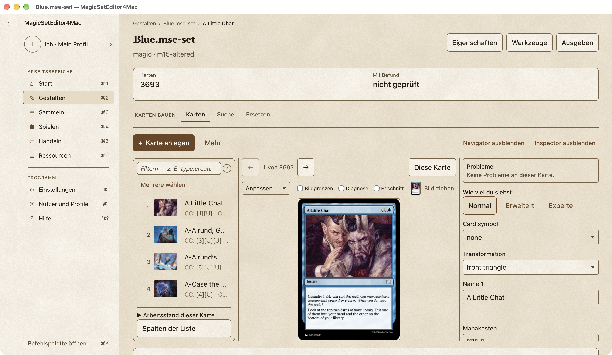

_Das native Fenster mit einem Set aus dem bezogenen Pack: links die Karten, in
der Mitte ihre Felder, rechts die Karte, wie sie gedruckt würde. Wer im Feld
tippt, sieht es rechts — ohne zu bestätigen._

> **Stand: 1.0.0 steht bereit** —
> [die Freigabe](https://github.com/DavidTHeider/MagicSetEditor4Mac/releases/tag/v1.0.0),
> gebaut, ad-hoc signiert, mit Stücklisten, Prüfsummen, ihrer **Herkunft**,
> einer **Signatur darüber** und ihrem **Quelltext** daneben.
>
> **1.0.0 ist die erste Freigabe für Anwendende** — der Programmstand der
> Iteration zur **Produktionsreife**, die als 0.9.0 abgeschlossen wurde:
> **Handeln am Markttisch** — ziehen statt tippen, abschließen in drei Klicks
> je Seite, und ein Tausch prüft, ob noch gilt, was du siehst · **Spielen mit
> direkter Hand** — eine Partie in drei Klicks, ⌘Z für den letzten Zug, ein
> Vorhang zwischen zwei Menschen an einem Gerät, mitspielen mit dem eigenen
> Deck · **gespeichert wird, was gerechnet ist — wie in MSE2**, auch bei
> Massenänderung und neuer Karte · Kennzahlleisten über Set, Sammlung, Deck
> und Paketen, eine Startseite, die sagt, wie es um die Sets steht, Rechtsklick
> an jedem Objekt · ein Betrieb, der meldet, was zu kippen droht, und sichert,
> bevor es nötig ist · und **gemessen** statt behauptet: jeder Kernweg mit
> Budget, ein Reifeprofil je Dimension —
> [`docs/REIFEPROFIL.md`](docs/REIFEPROFIL.md). **Gegenüber 0.9.0 neu** sind
> nur zwei Sicherheitsaktualisierungen (Go 1.27.4, `klauspost/compress`
> v1.20.2) und ein eigener Freigabeschlüssel.
>
> **Die Zusage ist begrenzt, und was sie nicht belegt, steht dabei** — voran
> **zwei echte Rechner**, die **Konten fremder Dienste**, die **Speicherregel
> im Dauerbetrieb** und was nur ein Mensch prüfen kann: [Was diese Fassung
> nicht belegt](#was-diese-fassung-nicht-belegt).
>
> **Wie es dazu kam**: in neun Entwicklungsfassungen. 0.8.0 machte
> Einrichtung, Fehlerfälle und Belege belastbarer; 0.7.0 verfeinerte —
> Entwürfe, die überstehen, ein Schließen in fünf Sekunden, strengere Dienste
> und 70 MB weniger; 0.6.0 brachte die Arbeitsbereiche auf Wails 3, den
> gezeichneten Tisch, Handel zwischen zwei Anwendungen, Einstellungen in
> Ebenen und das Fenster in acht Sprachen; 0.5.0 Spielen, Handeln, KI, die
> semantische Recherche, Nutzer und Profile und das Netz; 0.3.0 die
> Paketwerkstatt, die Sammlung und Suchen und Ersetzen über ein Set; 0.2.0
> den Symboleditor, die Schlüsselwörter, den Dienst auf der Rückschleife und
> Scryfall. **Diese Fassungen sind nicht mehr veröffentlicht**; ihre Issues,
> PRs und Freigaben liegen in einem privaten Entwicklungsarchiv, und ein
> Verweis `#N` in Code und Doku nennt ein Issue oder einen PR von dort
> ([0205](docs/entscheidungen/0205-1-0-0-ist-ein-neuanfang.md)).
>
> **Was noch offen ist**, steht in [`docs/ROADMAP.md`](docs/ROADMAP.md); was
> fertig ist, in [`docs/CHRONIK.md`](docs/CHRONIK.md).

|                |                                                                             |
| -------------- | --------------------------------------------------------------------------- |
| **Unterbau**   | Go · SQLite · TypeScript und React · Wails 3                                |
| **Ziel**       | macOS (Apple Silicon), ab macOS 15.2                                        |
| **Lizenz**     | GPL-2.0-or-later — mit ausdrücklicher Ausnahme fremder Inhalte, siehe unten |
| **Leitlinien** | [`AGENTS.md`](AGENTS.md) — verbindlich für jede Änderung                    |

## Inhalt

**Benutzen** — [Wie sie aufgebaut ist](#wie-sie-aufgebaut-ist) · [Was sie kann — nach Arbeitsbereichen](#was-sie-kann--nach-arbeitsbereichen) · [Einstellungen — was sich einstellen lässt](#einstellungen--was-sich-einstellen-lässt) · [Schnittstellen](#schnittstellen) · [Der MCP-Server](#der-mcp-server) · [Der Dienst auf der Rückschleife](#der-dienst-auf-der-rückschleife) · [Integrationen](#integrationen) · [Was das für vorhandene Daten heißt](#was-das-für-vorhandene-daten-heißt) · [Mitgelieferte Vorlagen](#mitgelieferte-vorlagen)

**Installieren und betreiben** — [Das Heruntergeladene prüfen](#das-heruntergeladene-prüfen) · [Erster Start nach dem Download](#erster-start-nach-dem-download) · [Administration](#administration) · [Betrieb](#betrieb) · [Wie dieses Programm ins Netz geht](#wie-dieses-programm-ins-netz-geht) · [Die Menüleiste spricht die Sprache des Fensters](#die-menüleiste-spricht-die-sprache-des-fensters)

**Gemessen** — [Güte und Leistung — gemessen](#güte-und-leistung--gemessen) · [Der Umfang, gezählt](#der-umfang-gezählt) · [Wie weit die Spielregeln umgesetzt sind](#wie-weit-die-spielregeln-umgesetzt-sind) · [Der Belegstand](#der-belegstand) · [Der Abstand zu Magic Set Editor 2](#der-abstand-zu-magic-set-editor-2) · [Kleine lokale Modelle, gemessen](#kleine-lokale-modelle-gemessen) · [Was diese Fassung nicht belegt](#was-diese-fassung-nicht-belegt)

**Entwickeln** — [Architektur in einem Bild](#architektur-in-einem-bild) · [Neubau — mit Blick in MSE2](#neubau--mit-blick-in-mse2) · [Einrichtung](#einrichtung) · [Kommandos](#kommandos) · [Andere Plattformen](#andere-plattformen) · [Woher die Bildschirmabzüge stammen](#woher-die-bildschirmabzüge-stammen) · [Lizenz](#lizenz)

---

## Wie sie aufgebaut ist

**Sechs Arbeitsbereiche und das Programm.** Die Seitenleiste führt nicht
mehr Seite für Seite, sondern nach dem, was jemand gerade tut — und jeder
Bereich hat sein Kürzel:

| Bereich        | Kürzel | Seiten                                                           | Wofür                                                     |
| -------------- | :----: | ---------------------------------------------------------------- | --------------------------------------------------------- |
| **Start**      |  `⌘1`  | Start                                                            | Weiterarbeiten, was Aufmerksamkeit braucht, der Bestand   |
| **Gestalten**  |  `⌘2`  | Sets, Karten — und am offenen Set dreizehn Seiten                | Karten entwerfen, gestalten, prüfen und herausgeben       |
| **Sammeln**    |  `⌘3`  | Sammlung                                                         | was du besitzt, mit Zustand, Ort und Preis                |
| **Spielen**    |  `⌘4`  | Decks, Turniere, Spielen                                         | Decks bauen, Turniere führen, an einem Tisch spielen      |
| **Handeln**    |  `⌘5`  | Handeln                                                          | tauschen, verleihen und teilen mit bestätigten Gegenübern |
| **Ressourcen** |  `⌘6`  | Pakete, Vorlagen                                                 | Vorlagenpakete beziehen, verwalten und selbst bearbeiten  |
| **Programm**   |        | Einstellungen `⌘,` · Nutzer und Profile `⌘'` · Hilfe `⌘?`        | was für die ganze Anwendung gilt                          |

**Ein offenes Set teilt seine Fläche in Seiten**, und die sprechen
ausschließlich über dieses Set: Karten, Setangaben, Schlüsselwörter,
Konsole, Zufallspack, Symbol, Stil, Suche, Ersetzen, Statistik, Bilder,
Druckbogen und Ausgeben. Zehn davon liegen auf `⌥⌘1` bis `⌥⌘0` — Bilder,
Suche, Ersetzen, Stil, Symbol, Setangaben, Schlüsselwörter, Statistik,
Ausgeben und Druckbogen.

**Die meisten Seiten sind ein Arbeitsplatz aus drei Spalten** — links der
Navigator (_was_), in der Mitte das Zentrum (_daran arbeiten_), rechts der
Inspector (_was es ist_). Die Spalten lassen sich ein- und ausblenden und in
der Breite ziehen; das Fenster merkt sich beides.

**Alles ist über die Tastatur erreichbar**, mit sichtbarem Fokusring. `⌘K`
öffnet die Befehlspalette — sie springt zu jeder Seite, jedem Set und jedem
Befehl, auch zu denen ohne eigenes Kürzel:

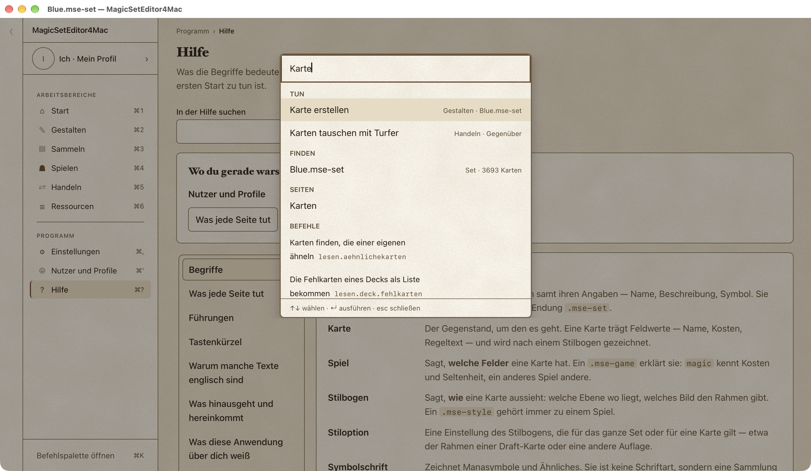

**Was nicht gebraucht wird, lässt sich abschalten** — zehn Schalter unter
_Einstellungen → Bereiche und Funktionen_: vier Arbeitsbereiche (Sammeln,
Spielen, Handeln, Ressourcen) und sechs Funktionen (KI, Netz und Gegenüber,
Marktplätze und Preise, Turniere, Dienst für Skripte, Werkzeugserver über
HTTP). Gestalten und das Programm sind Kern und haben keinen. Ein
abgeschalteter Bereich verschwindet aus Seitenleiste und Befehlspalette, was
an ihm läuft, endet, und **die Flächen ohne Fenster weisen ihn ebenso ab** —
Kommandozeile, Dienst und MCP fragen denselben Schalter, je Fähigkeit
zugeordnet in [`docs/SCHALTER.md`](docs/SCHALTER.md). **Ein Schalter verbirgt,
er sichert nicht**
([0158](docs/entscheidungen/0158-ein-schalter-verbirgt-er-sichert-nicht.md)).

**Hell und dunkel nach der Systemeinstellung** — und wer es anders will,
stellt es um, für diese Anwendung allein:

| Hell                                                                | Dunkel                                                                           |
| ------------------------------------------------------------------- | -------------------------------------------------------------------------------- |
| 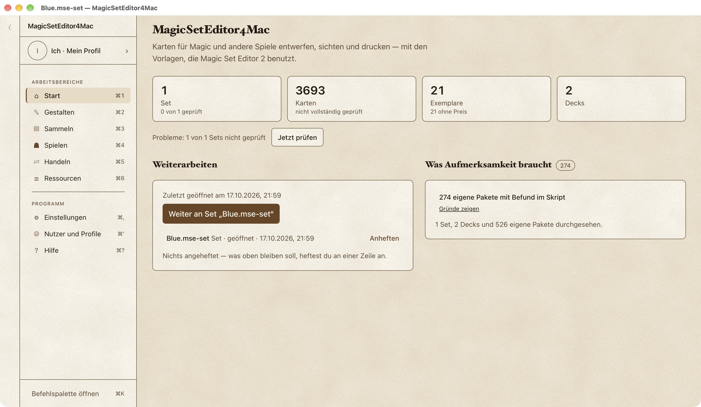 | 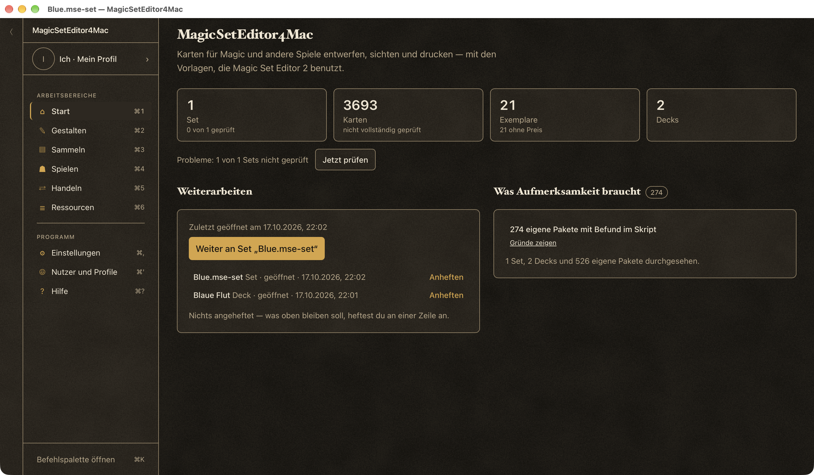 |

Die Kontraste sind **gemessen**, nicht geschätzt: jede benutzte
Vordergrundfarbe steht mit ihrem Wert in
[`docs/KONTRASTE.md`](docs/KONTRASTE.md), und ein Wächter hält die Datei
gegen den Quelltext. Für Trennlinien gilt WCAG 1.4.11 (3:1) in **beiden**
Erscheinungsbildern — sie sind bei jedem ersten Anlauf zu blass gewesen.

**Vier Sätze, die überall gelten**, weil eine Oberfläche mit mehreren
Schreibern sonst still falsche Stände zeigt:

1. Wer das Set oder die Karte wechselt, schließt Formular, Rückfrage und
   geladene Nebenlisten mit.
2. Eine Antwort gehört zu dem Stand, aus dem sie stammt — eine überholte wird
   verworfen, nicht eingetragen.
3. Geschrieben ist geschrieben: ein Fehler beim Nachladen meldet sich, macht
   die Änderung aber nicht rückgängig.
4. Ein Vorgang je Datensatz.

Wo genau sie gelten, steht je Schreibweg in
[`docs/SCHREIBWEGE.md`](docs/SCHREIBWEGE.md). **Und was ein anderer
schreibt, erscheint ohne Zutun**: Fenster, Kommandozeile, Dienst, MCP-Server
und ein Gegenüber über die Leitung arbeiten auf demselben Bestand, und das
Fenster fragt alle zwei Sekunden nach seinem Stand.

**Und was nicht geht:** kein Dialog über einem Dialog. Bearbeitet wird im
Seitenbereich. Leere Zustände sagen den nächsten Schritt, statt „Keine Daten"
zu zeigen.

## Was sie kann — nach Arbeitsbereichen

**In einem Absatz:** Sets aus MSE2 öffnen, Karten anlegen und gestalten, das
Ergebnis sehen, drucken und wieder herausgeben — mit den Vorlagen, die MSE2
benutzt, und ohne dass die Dateien dabei etwas verlieren. Daneben eine
eigene Sammlung, Decks und Turniere, ein Spieltisch und ein Handel mit
bestätigten Gegenübern.

**Und was sie bewusst nicht tut:** sie legt von sich aus nichts außerhalb
ihres Bündels ab — auf Knopfdruck richtet _Einstellungen › Diagnose ›
Werkzeuge ohne Fenster_ dir, wenn du willst, den Verweis auf `mse` in
`~/.local/bin` samt `PATH`-Eintrag in `~/.zprofile`, die Einträge für Codex,
Claude Desktop und Claude Code und den Dienst als LaunchAgent ein und nimmt
alles wieder zurück —, sie lädt von sich aus nichts herunter, und sie
schickt nichts fort, was du nicht angestoßen hast.

### Start — `⌘1`

**Weiterarbeiten, wo du aufgehört hast.** Die Startseite zeigt die zuletzt
benutzten Sets und Decks, was angeheftet ist, und was Aufmerksamkeit braucht
— Sets mit Vorbehalten, Decks mit Fehlkarten, Pakete mit Skriptbefunden —,
dazu den Bestand in Zahlen. **Beim ersten Start steht eine Einführung da**:
drei Schritte bis zur ersten Karte, und ob sie wiederkehrt, lässt sich im
Fenster und in den Einstellungen schalten.

### Gestalten — `⌘2`

#### Ein Set öffnen oder anlegen

_Sets_ öffnet eine `.mse-set` aus MSE2 oder einen Satz aus MTG JSON, legt ein
leeres Set an und zeigt vorab, was das Einfahren täte. Die Datei wird beim
Öffnen in den Bestand eingelesen und bleibt liegen, wie sie ist. **Zum
Ausprobieren ist ein Beispielset dabei** — es braucht keinen Paketbezug.

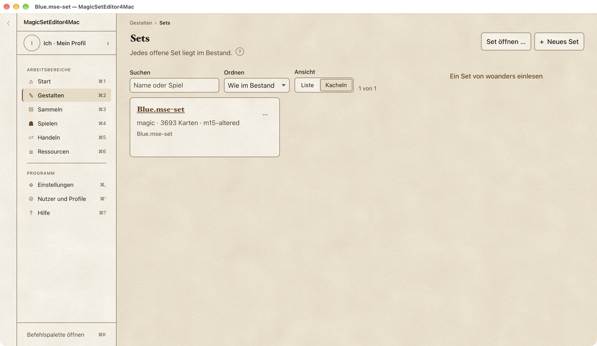

**Fremde Daten sind der Normalfall.** Ein Set mit 300 lesbaren und zwei
unlesbaren Karten wird mit 300 Karten und zwei benannten Befunden geöffnet,
nicht abgewiesen.

#### Karten

_Karten_ ist der Arbeitsplatz einer Karte: links die Liste mit
Vorschaubildern, in der Mitte das Formular, rechts die gezeichnete Karte.
**Die Karte ist das Hauptobjekt** — eine Änderung an einem Feld ist rechts
zu sehen, ohne dass jemand etwas bestätigt.


Die Felder kommen aus dem Spiel des Sets, nicht aus einer Liste bei uns: was
ein Feld heißt und welche Werte es zulässt, steht im bezogenen Paket. **Ein
Feld, das die Vorlage rechnet, sagt das** — es zeigt die Herleitung des
Pakets, gekennzeichnet; beim ersten Tippen wird daraus ein eigener Wert.

|                               |                                                                                                                                                                        |
| ----------------------------- | ---------------------------------------------------------------------------------------------------------------------------------------------------------------------- |
| **Kopieren, ordnen, löschen** | Eine gelöschte Karte kommt mit derselben Kennung zurück — der Verlauf führt sie mit, `⌘Z` über Sitzungen hinweg.                                                        |
| **Zwischenablage**            | `⌘C`, `⌘X`, `⌘V` über ganze Karten, auch zwischen zwei Sets. Bilder gehen mit.                                                                                         |
| **Mehrfachauswahl**           | Anhaken und dann an allen zugleich ein Feld setzen.                                                                                                                    |
| **Spalten und Filter**        | Welche Spalten die Liste zeigt und wie sie ordnet, wählst du; der Schnellfilter folgt den Regeln von MSE2.                                                              |
| **Marken und Notiz**          | Eigene Wörter an einer Karte — „fertig", „noch kein Bild" —, filterbar und über `⌘F` zu finden; sie gehen **nicht** in die Setdatei.                                    |
| **Aus Scryfall anlegen**      | Eine Karte über ihren echten Druck anlegen oder auf ihn beziehen — Felder, Bild und Regeltext kommen mit, und du siehst vorher, was sich ändert.                         |
| **KI zu dieser Karte**        | Vorschläge für Name und Flavortext, eine Einschätzung, ein Bild — lokal oder bei einem Anbieter, den du einschaltest. Nichts wird still übernommen.                      |

#### Was am offenen Set hängt

| Seite               | Was sie tut                                                                                                                                       |
| ------------------- | ------------------------------------------------------------------------------------------------------------------------------------------------- |
| **Setangaben**      | Name, Beschreibung, Setsymbol, Urheber, Fassung — sie stehen **jeder Karte** zur Verfügung, ohne doppelt gepflegt zu werden                        |
| **Stil**            | der Stilbogen und seine Optionen; welches Bedienelement eine Option bekommt, bestimmt das Paket ([`docs/STILOPTIONEN.md`](docs/STILOPTIONEN.md))   |
| **Symbol**          | das Setsymbol zeichnen: Grundformen, Punkte, Griffe, Symmetrien und Gruppen — jeder Anfasser auch als Zahlenfeld                                   |
| **Schlüsselwörter** | die Wörter des Spiels mit Erklärung, Parametern und Skript; ein Set darf eigene mitbringen                                                         |
| **Suche** (`⌘F`)    | Volltext über alle Felder; der Treffer führt zur Karte                                                                                             |
| **Ersetzen**        | dieselbe Zeichenfolge in vielen Karten — zeigt vorher, was sich ändert, und ist **ein** Schritt im Verlauf                                         |
| **Statistik**       | Anzahl, Belegung je Feld, Verteilung eines Werts                                                                                                    |
| **Konsole**         | ein MSE-Script-Ausdruck im Kontext der aufgeschlagenen Karte                                                                                      |
| **Zufallspack**     | ein Booster nach den Regeln des Spielpakets — derselbe Same, dieselbe Ziehung                                                                      |
| **Ausgeben**        | fünf Wege hinaus: Setdatei, Kartenbilder, PDF, Exportvorlage des Pakets, MTG JSON                                                                  |
| **Bilder**          | alle Karten auf einmal als PNG, JPEG oder SVG, mit Namensmuster und einer Regel für gleiche Namen                                                  |
| **Druckbogen**      | maßhaltig auf Papier, 63 × 88 mm, Schnittmarken am Rand und nicht auf der Karte                                                                    |

| Stil                                                       | Symbol                                                        |
| ---------------------------------------------------------- | ------------------------------------------------------------- |
| 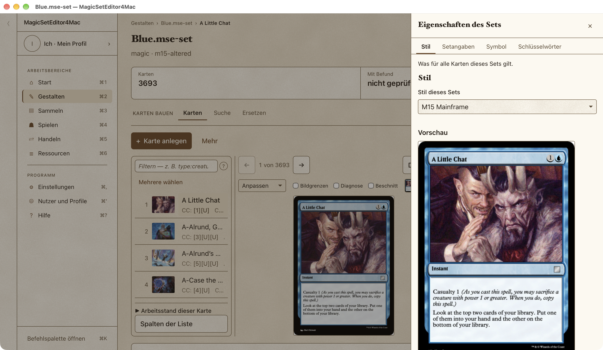 | 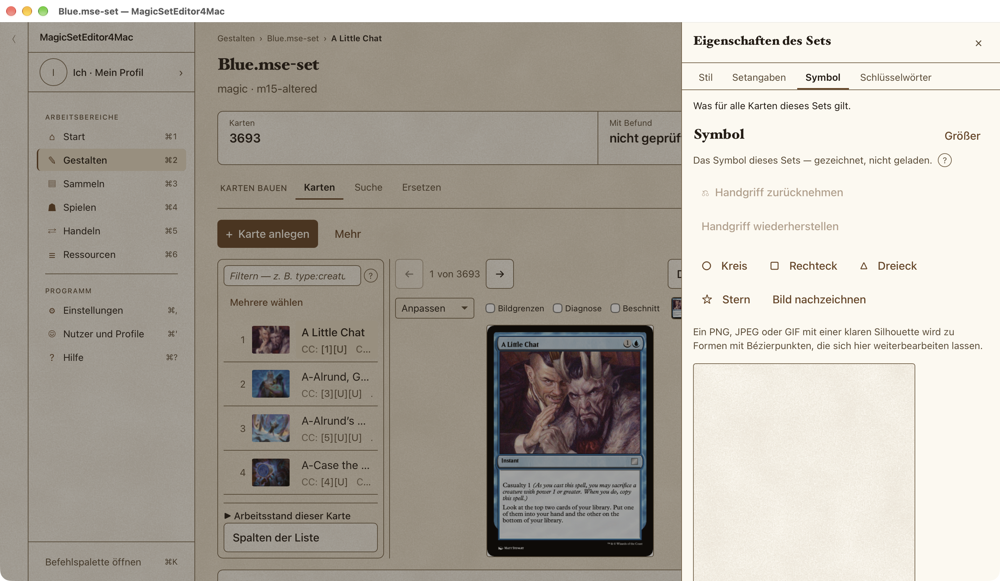 |
| **Setangaben**                                             | **Schlüsselwörter**                                           |
| 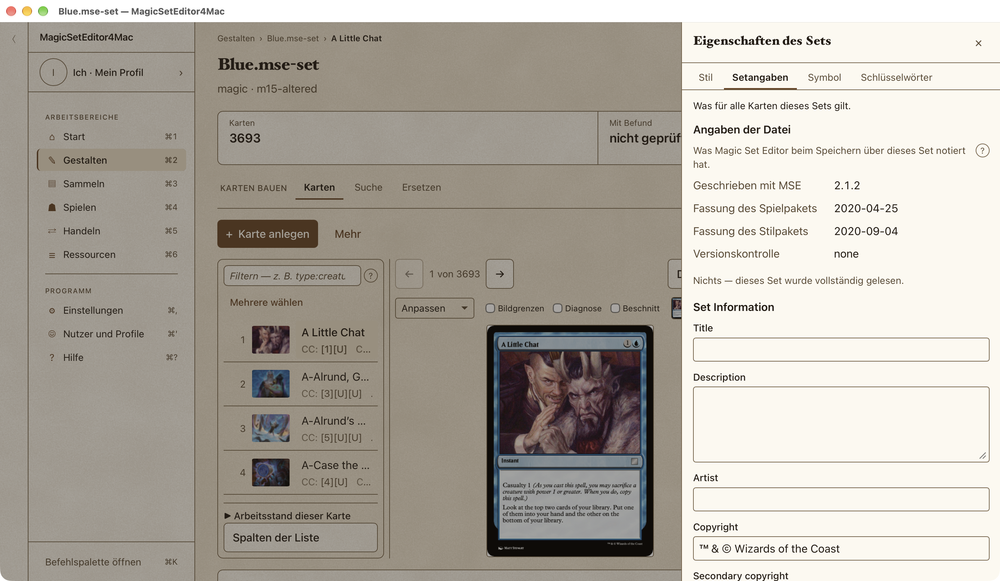 | 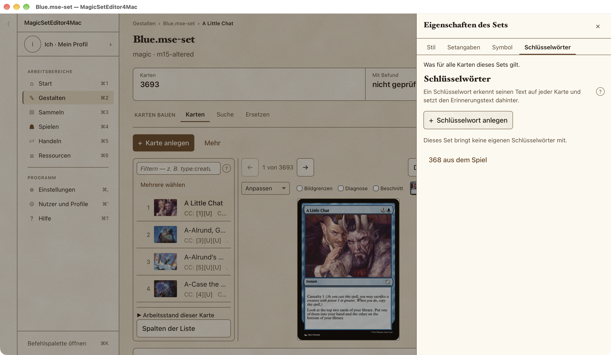 |
| **Suche**                                                  | **Ersetzen**                                                  |
| 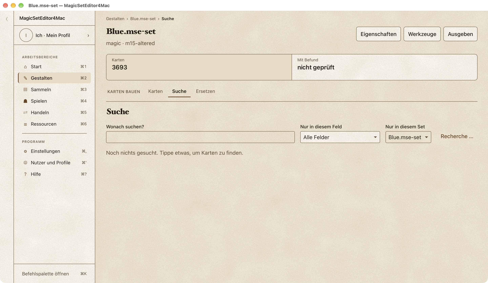 | 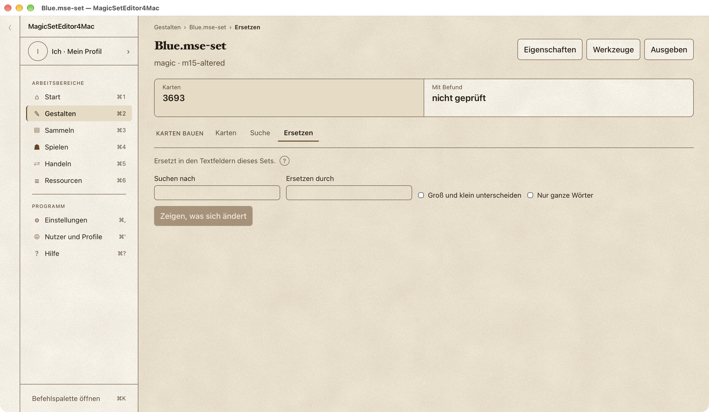 |
| **Statistik**                                              | **Konsole**                                                   |
| 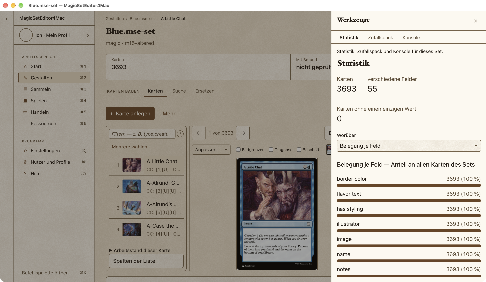 | 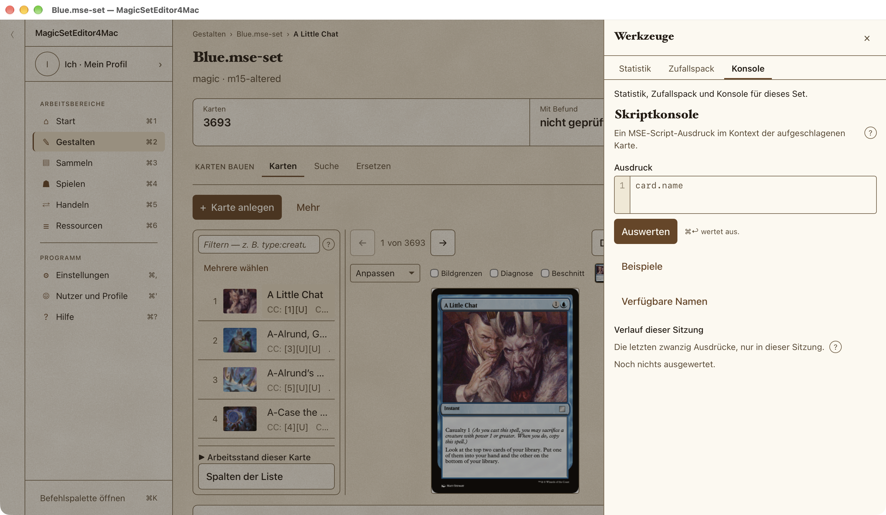 |
| **Zufallspack**                                            | **Ausgeben**                                                  |
| 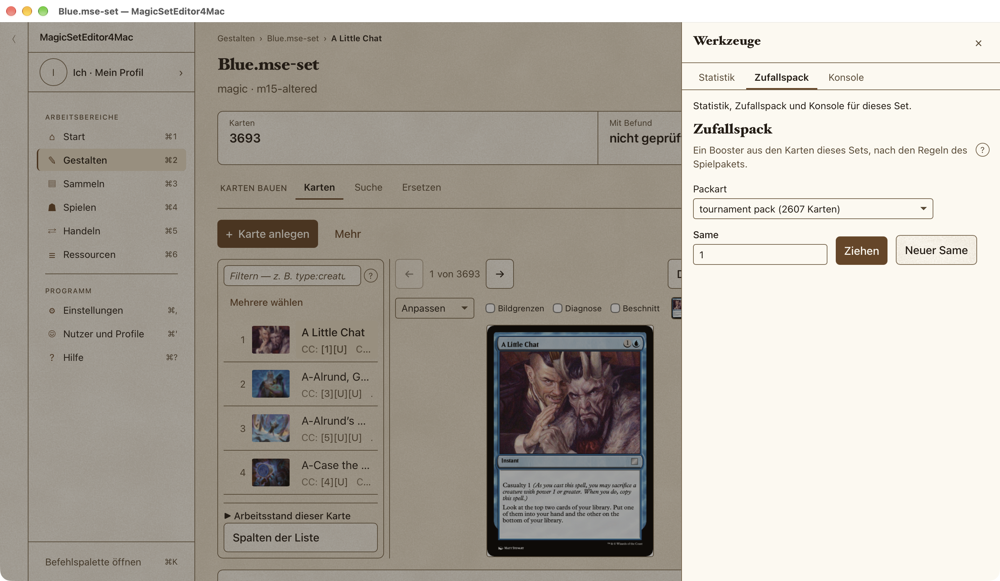 | 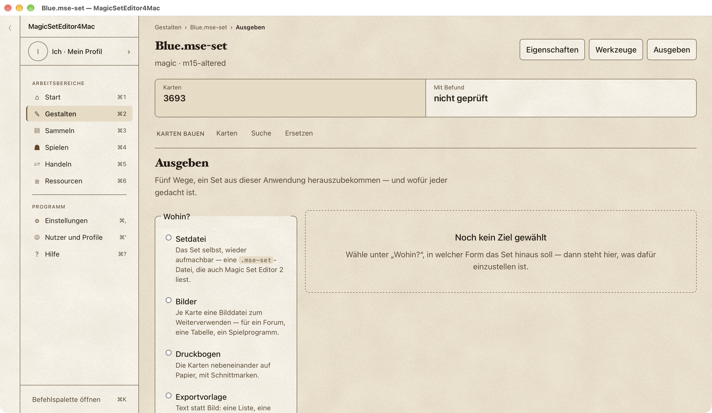 |
| **Bilder**                                                 | **Druckbogen**                                                |
| 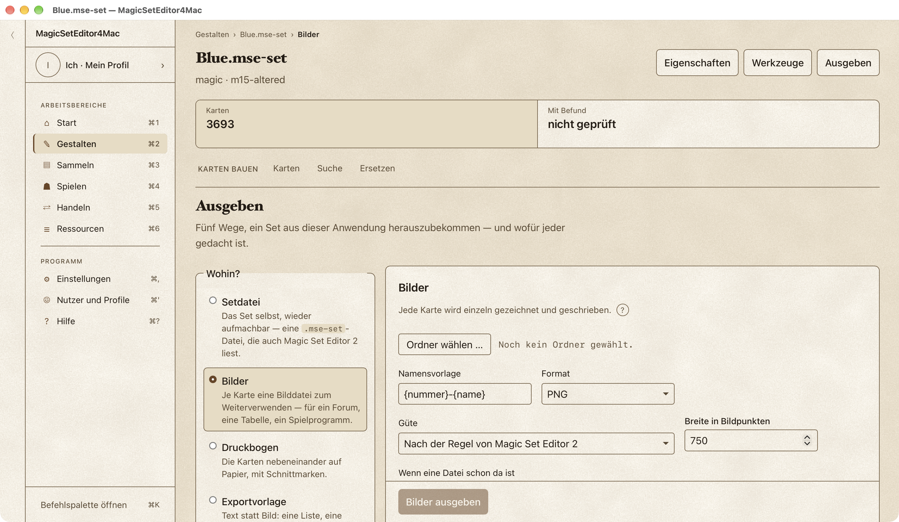 | 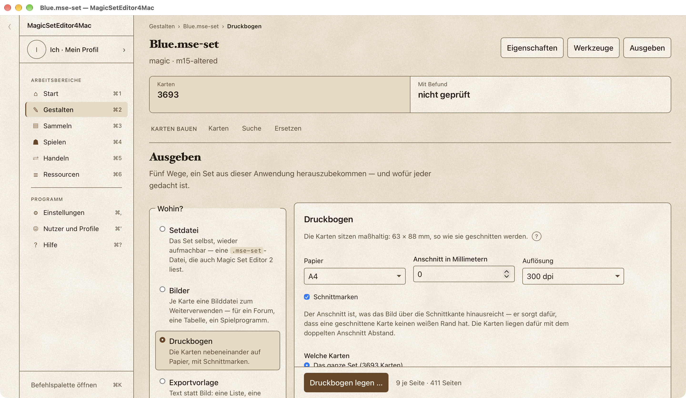 |

### Sammeln — `⌘3`

**Was du besitzt, ist kein Entwurf** — deshalb hängt die Sammlung an keinem
Set ([0052](docs/entscheidungen/0052-die-sammlung-ist-nicht-das-set.md)). Ein
Exemplar ist ein **Druck**: mit Zustand, Sprache, Ausführung, Menge, Ort und
dem, was du dafür bezahlt hast. Als Tabelle, Galerie oder in Gruppen.

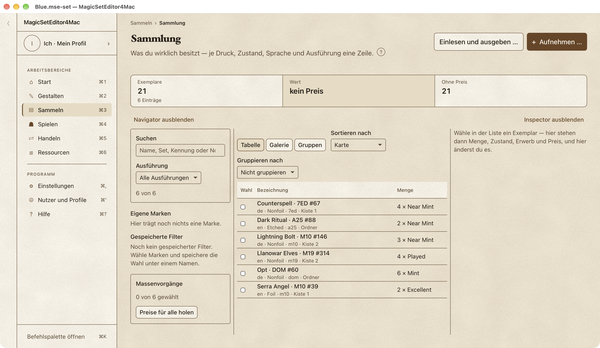

**Preise sind Momentaufnahmen** — ein Stand mit Datum und Quelle, keine
Bewertung. **Ohne Netz arbeitet sie weiter**: der letzte gute Stand bleibt
stehen und sagt, wie alt er ist.

### Spielen — `⌘4`

#### Decks und Formate

**Ein Deck ist keine Kopie.** Es **verweist** auf Karten — eigene Entwürfe und
echte Drucke —, statt sie zu kopieren; eine berichtigte Karte im Ursprungsset
erreicht es sofort ([0061](docs/entscheidungen/0061-was-ein-deck-hier-ist.md)).

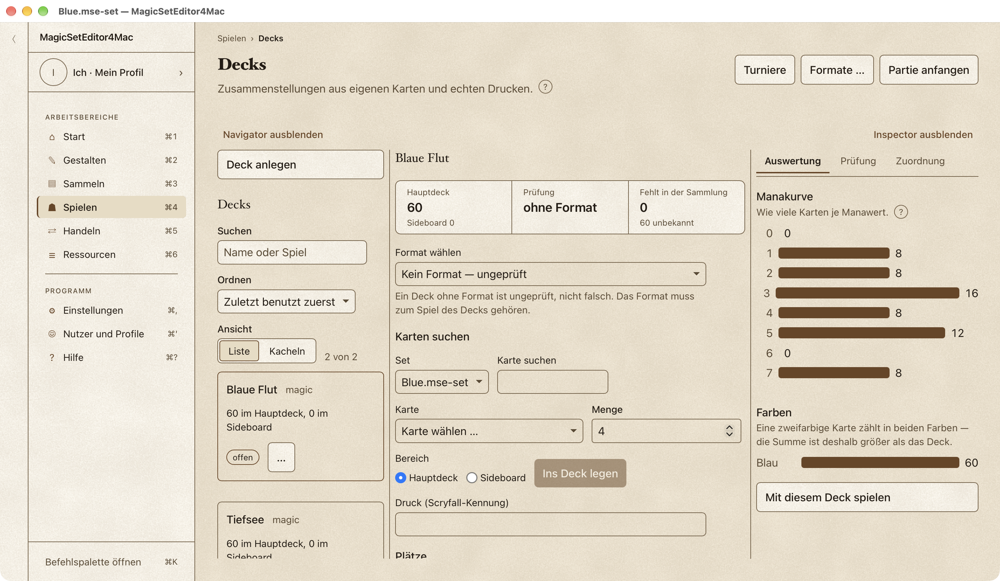

**Ein Format ist hier ein Datensatz und keine eingebaute Liste.** Wer ein
eigenes spielt, legt es an, ohne dass jemand das Programm ändert.
**Mitgeliefert wird keines** — die **Namen** der Formate ließen sich messen (23
Schlüssel in Scryfalls `legalities`, am 2026-09-01 abgerufen), die **Zahlen**
nicht. Drei **Bauarten** bringen welche mit, und jede nennt ihre Regel aus den
_Comprehensive Rules_:

| Bauart      | mindestens | höchstens | Sideboard       | gleiche Karten | Regel                     |
| ----------- | ---------- | --------- | --------------- | -------------- | ------------------------- |
| konstruiert | 60         | —         | 15              | 4              | CR 100.2a, CR 100.4a      |
| commander   | 100        | 100       | keines          | 1              | CR 903.5a, 903.5b, 903.5e |
| limitiert   | 40         | —         | **ohne Grenze** | —              | CR 100.2b, CR 100.4b      |

**Drei Antworten, und sie sind verschieden.** Für einen echten Druck kommt
Scryfalls eigenes Wort — `legal`, `not_legal`, `restricted`, `banned`. Eine
**eigene** Karte ist **`ungeprüft`**, und das heißt **nicht** unzulässig.
**Und „habe ich das?"** rechnet **je Druck**, nicht je Platz: vier im
Hauptdeck und eine im Sideboard verlangen fünf Stück Papier.

#### Turniere

**Ein Turnier ist ein Verlauf über die Zeit** — Runden, Paarungen, Ergebnisse
([0062](docs/entscheidungen/0062-was-ein-turnier-hier-ist.md)). **Die
Rangliste wird gerechnet und nirgends abgelegt**: wer ein Ergebnis
berichtigt, sieht sofort den neuen Stand.

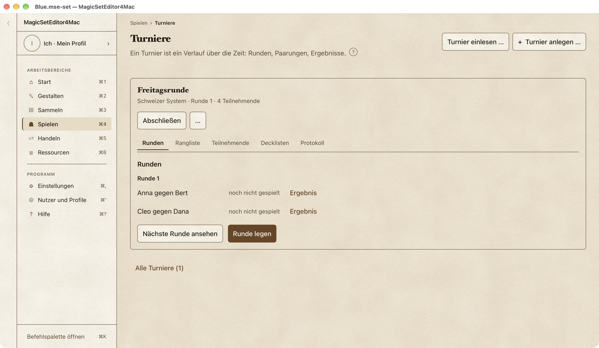

**Die Zahlen stehen in den _Magic Tournament Rules_**, Fassung vom 27. Februar
2026. Vier Tiebreaker in dieser Reihenfolge (§3.1):

| #   | Tiebreaker       | Regel                                                         |
| --- | ---------------- | ------------------------------------------------------------- |
| 1   | Matchpunkte      | 3 je Sieg, 1 je Unentschieden (Appendix C)                    |
| 2   | Gegnermatchquote | Mittel der Quoten aller Gegner, jede mit **Untergrenze 0,33** |
| 3   | Spielquote       | Spielpunkte ÷ (3 × gespielte Spiele), dieselbe Untergrenze    |
| 4   | Gegnerspielquote | dasselbe über die Gegner                                      |

**Gepaart wird nach dem Schweizer System** (§10.4), ohne Auslosung — ein
Turnier, das sich nach einem Absturz anders fortsetzte, wäre keines. **Wer
aussteigt, bleibt in der Rangliste** (Appendix C), und **eine angemeldete
Deckliste ist ein Abzug, kein Verweis**.

#### Partien und der Tisch

**Eine Partie ist ein Tisch mit eingefrorenen Decks.** Was geschieht, steht
als **Strom von Ereignissen** fest: jedes hängt am vorigen, und keines wird
überschrieben. Wer eine Karte umlegt, sieht sofort, was die anderen davon
sehen — und was sie **nicht** sehen dürfen, bleibt verdeckt.

| Die Partien                                                          | Der Tisch                                                             |
| -------------------------------------------------------------------- | --------------------------------------------------------------------- |
| 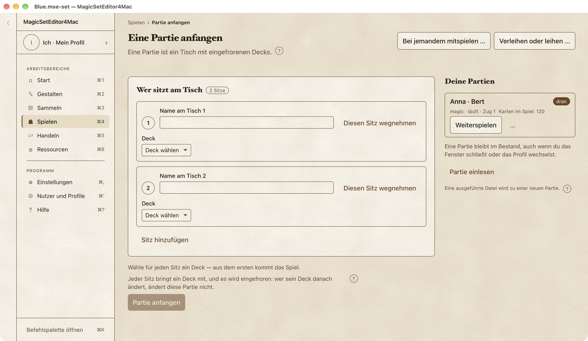 | 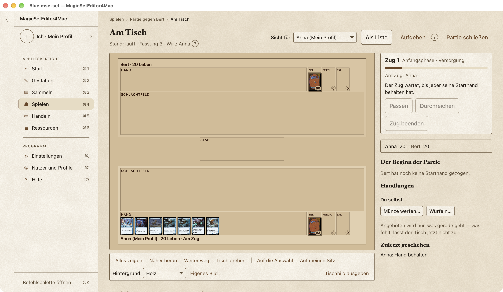 |

**Der Tisch ist gezeichnet** — PixiJS über WebGL, zwei bis sechs Sitze,
ziehen, legen, tappen, Zonen wechseln, Zähler setzen, anhängen und umdrehen. **Der Sandkasten ist
die Vorgabe**; was das Programm automatisch durchsetzt, steht in der
**Regelmatrix** — dreizehn Bereiche, je einer mit Grad, Regelquelle und
**Grenzen** (siehe [Wie weit die Spielregeln umgesetzt
sind](#wie-weit-die-spielregeln-umgesetzt-sind)). Das Profil wird beim
Anfangen **eingefroren**: dieselbe Partie trifft nach einem Neustart dieselben
Entscheidungen.

**Mitspielen geht über die Peerleitung** — TCP mit TLS 1.3, festgenagelt auf
die Kennung des Gegenübers, im eigenen Netz über mDNS gefunden oder über
fremde Netze mit tailcat — **belegt auf einem Rechner** mit zwei Anwendungen;
zwei getrennte Netze hat kein Lauf gesehen. Ein Gast sitzt an **einem** Sitz, sieht, was dieser
Sitz sehen darf, und erfährt von **jedem** Zug am Tisch. Eine Partie lässt
sich anhalten, fortsetzen, kopieren, ausführen und wieder einlesen.

### Handeln — `⌘5`

**Tauschen, verleihen und teilen mit einem Gegenüber, das bestätigt ist.**
Gerechnet wird auf diesem Rechner; was hinausgeht, entscheidet ein Mensch.

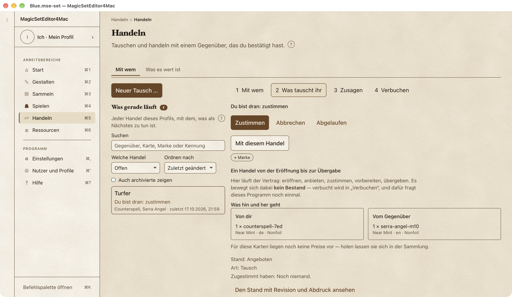

**Ein Handel hat vier Arten** — Teilen, Deckleihe, Tausch, Markt — und
dreizehn Zustände mit achtzehn Übergängen. **Der Initiator sequenziert**:
zwei Vorschläge gegen denselben Stand ergeben einen **Konflikt** und nicht
zwei Revisionen mit derselben Nummer. **Was weggeht, wird festgehalten**: ein
Angebot nennt einen **Druck**, und wer drei davon an drei Orten hat, sagt,
welcher hinausgeht.

**„Beide haben unterschrieben" ist ein Beleg und keine Behauptung**: der
Abschluss der Gegenseite reist als **Urkunde** und wird zweimal geprüft — die
Unterschrift gegen die Peerkennung, der Inhalt gegen den eigenen Beleg. **Was
der Handel im eigenen Bestand bewegt hat**, zeigt danach sein Beleg — an allen
vier Flächen. **Zwei SQLite-Bestände sind keine gemeinsame Transaktion**, und
deshalb heißt der vorletzte Zustand `lokalVerbucht` und nicht `verbucht`.

**Schranken setzt du selbst** — ob überhaupt gehandelt wird, ob mit
Marktplätzen, bis zu welcher Menge und welchem Wert, mit welcher Frist
(_Einstellungen → Dienste_).

### Ressourcen — `⌘6`

#### Pakete

**Eine Karte braucht ein Vorlagenpaket** — es bringt das Spiel mit seinen
Feldern, den Stilbogen mit seinem Aussehen, Symbolschriften und
Exportvorlagen. **Acht kommen mit**, dazu ein Beispielset: wer die Anwendung
öffnet, sieht **sofort eine gezeichnete Karte**
([0037](docs/entscheidungen/0037-die-vorlagen-gehen-ins-buendel.md)).

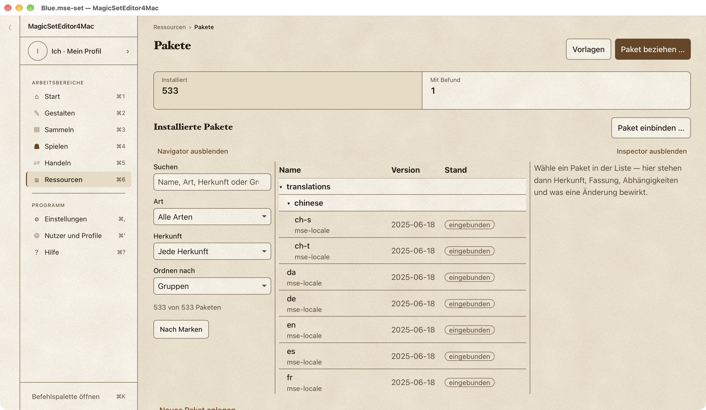

_Pakete_ bezieht alles Weitere, übernimmt es aus einer vorhandenen
MSE2-Installation — auch aus einer CrossOver-Flasche — und verwaltet, was
liegt. Bezogen wird an einem **Stand**, nicht an einem Zweig, mit Prüfsumme
und sicherem Auspacken — kein Pfadausbruch, kein Symlink, keine ausführbare
Datei.

#### Vorlagen

_Vorlagen_ ist die Paketwerkstatt: sie öffnet die Dateien eines Pakets — das
Spiel, den Stilbogen, die eingebundenen Teile — und lässt sie bearbeiten,
**mit einer Vorschau daneben**, die zeigt, was die geänderte Vorlage aus
einer Karte macht, noch bevor etwas geschrieben ist.

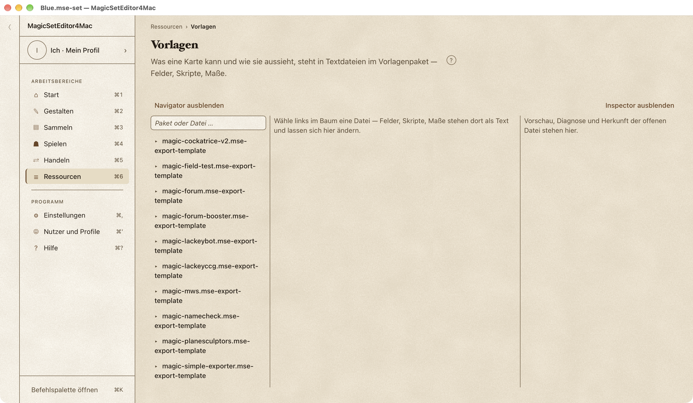

**Und mit einer Schreibsperre**: solange hier eine Datei offen ist, räumt ein
Paketbezug das Paket nicht unter ihr weg; wer über einen fremden Stand
speichert, bekommt den Konflikt gemeldet und behält seinen Entwurf.

### Programm

#### Nutzer und Profile — `⌘'`

**Ein Nutzer ist die Person, ein Profil eine Arbeitsumgebung dieser Person** —
eigene Sets, eigene Sammlung, eigene Decks, eigene Einstellungen. **Wer allein
arbeitet, muss hier nichts tun**: beim ersten Start entsteht ein Nutzer mit
einem Profil.

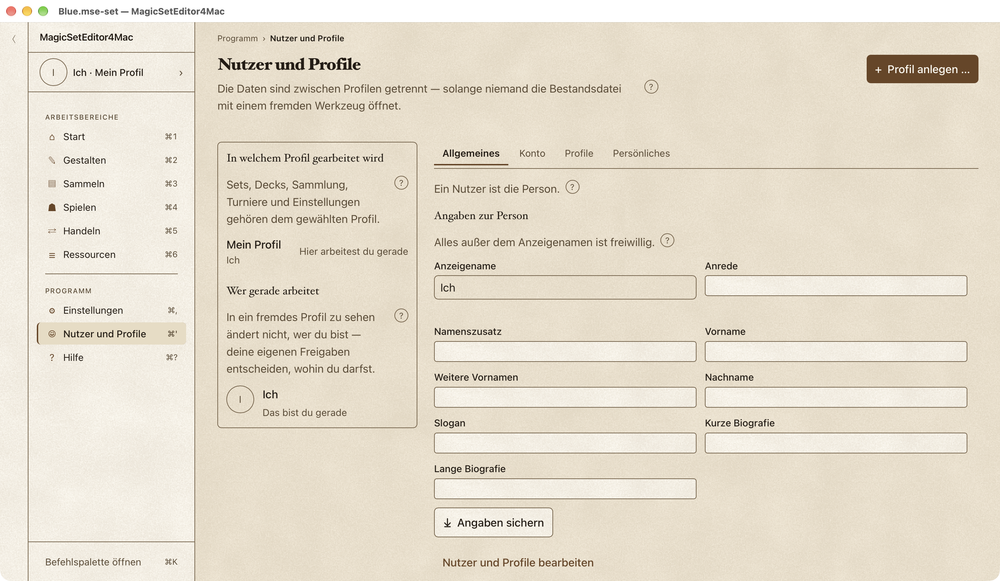

**Ein Profil lässt sich freigeben**, in drei Stufen — Leser, Mitarbeiter,
Verwalter. **Vier Wege hinein**: über einen fremden Anbieter (GitHub,
Google, Microsoft, X — mit PKCE, `state` und `nonce`), mit einem eigenen
Kennwort (Argon2id), anonym, oder als anderer Nutzer; dazu ein zweiter
Faktor nach RFC 6238 oder **Touch ID**. **Die Trennung sagt, was sie nicht
leistet**: ein Profil ist eine Arbeitsteilung, keine Zugriffssperre gegen
jemanden, der die Bestandsdatei in der Hand hält — dagegen hilft die
Verschlüsselung des Bestands. Der ganze Weg steht im
[Handbuch](docs/HANDBUCH.md#nutzer-und-profile).

#### Hilfe — `⌘?`

**Die Hilfe erklärt, was aus Magic Set Editor stammt** und was niemand
mitbringt — Set, Stilbogen, Spielpaket, Symbolschrift, je in einem Satz —,
dazu die Kürzel, **warum manche Aufschriften englisch bleiben** (ein Feld
heißt in jeder Vorlage `casting cost`) und **was diese Anwendung nach draußen
gibt**.

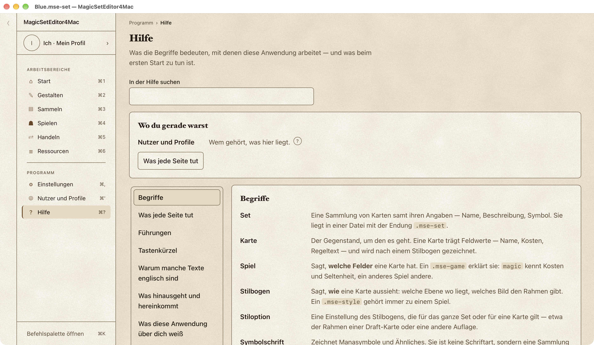

#### Neuere Fassungen

**Nur, wenn man es einschaltet.** _Einstellungen → Allgemein → Nach neuen
Fassungen sehen_ kennt drei Stufen, und die Vorgabe ist **aus**: dann geht
keine einzige Anfrage hinaus. Bei **melden** erscheint beim Start ein Band
mit der Fassung; bei **holen** steht daneben ein Knopf, die Datei geht ins
Downloadverzeichnis, und **Signatur und Prüfsumme werden verglichen, bevor
sie dort auftaucht** ([0051](docs/entscheidungen/0051-die-signatur-wird-geprueft.md)).
Installiert wird nichts von selbst. Ohne Fenster: `mse aktualisierung`,
`GET /aktualisierung`.

## Einstellungen — was sich einstellen lässt

**Unter `⌘,` in zehn Gruppen**, mit einer Suche über alle — nach Name,
Schlüssel oder Wert. Jede Zeile sagt, **was gerade wirkt und wer es gesetzt
hat**, und lässt sich auf die Vorgabe zurücksetzen. Was Fachleute brauchen —
Fristen, Zertifikate, Protokollformat —, steht in jeder Gruppe unter einem
eigenen Aufklapper; Aufklappen ändert nichts.

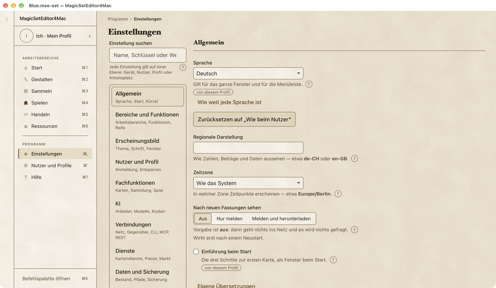

| Gruppe                       | Was sich dort einstellen lässt                                                                                                                                                         |
| ---------------------------- | -------------------------------------------------------------------------------------------------------------------------------------------------------------------------------------- |
| **Allgemein**                | Sprache des Fensters (acht, dazu eigene Übersetzungen), regionale Darstellung, Zeitzone, die Belegung von `⌘0` bis `⌘9`, die Einführung beim Start, ob nach neuen Fassungen gesehen wird |
| **Bereiche und Funktionen**  | die zehn Schalter — vier Arbeitsbereiche und sechs Funktionen, jeder mit seiner Reife (_stabil_, _Vorschau_, _auslaufend_)                                                             |
| **Erscheinungsbild**         | Thema (System, hell, dunkel), Schriftgröße, Anzeigeschrift, Farbwelt, ein eigener Hintergrund, Seitenleiste und ihre Lage, das Fenster beim Start und seine Maße, die Spalten jedes Arbeitsplatzes und die Ansicht von Sets, Decks und Sammlung |
| **Nutzer und Profil**        | die Kennungen bei GitHub, Google, Microsoft und X für die Anmeldung                                                                                                                    |
| **Fachfunktionen**           | Vorgaben für neue Exemplare (Zustand, Währung), Einzelspiel-Turniere, wie tief das Kartenformular geht (normal, erweitert, Experte), gespeicherte Filter, Ordnung und Beschriftung am Tisch |
| **KI**                       | die lokale Laufzeit (Ollama) und ihre Adresse, Apples Gerätemodell, ein Vorrangmodell, die Anbieter Anthropic, OpenAI und xAI mit ihren Adressen, eine Kostenobergrenze                |
| **Verbindungen**             | Proxy für HTTP und HTTPS samt Ausnahmen, drei Fristen, die Netzschnittstelle, das TLS-Zeugnis des Dienstes, Kontingente gegen Überlast                                                  |
| **Dienste**                  | die Kartendienste Scryfall, magicthegathering.io, MTGJSON, Scrydex und CardTrader, welcher bei einer Suche gefragt wird, „nur lokal arbeiten", die Zugangsdaten der Dienste im Schlüsselbund und die **Schranken für den Handel** |
| **Daten und Sicherung**      | die Ordner für Hochladen, Ausfuhr, Sicherung und Diagnose, die Regel für gleiche Bildnamen — dazu das Sichern, Zurückspielen, Verschlüsseln und Aufräumen des Bestands und der Austausch der Einstellungen |
| **Diagnose**                 | Protokoll (Stufe, Datei, Systemprotokoll, Format, Größe, Aufbewahrung, Komponenten, Ort), Messung und Spuren, der Zwischenspeicher, die Werkzeuge ohne Fenster                         |

| Bereiche und Funktionen                                                           | Erscheinungsbild                                                                     |
| --------------------------------------------------------------------------------- | ------------------------------------------------------------------------------------ |
|          | 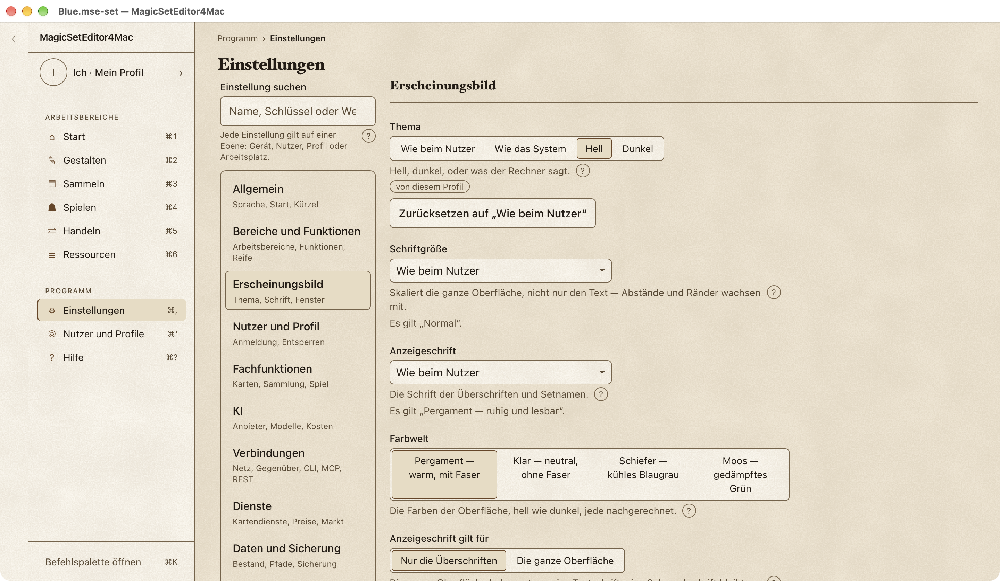 |
| **KI**                                                                            | **Dienste**                                                                          |
| 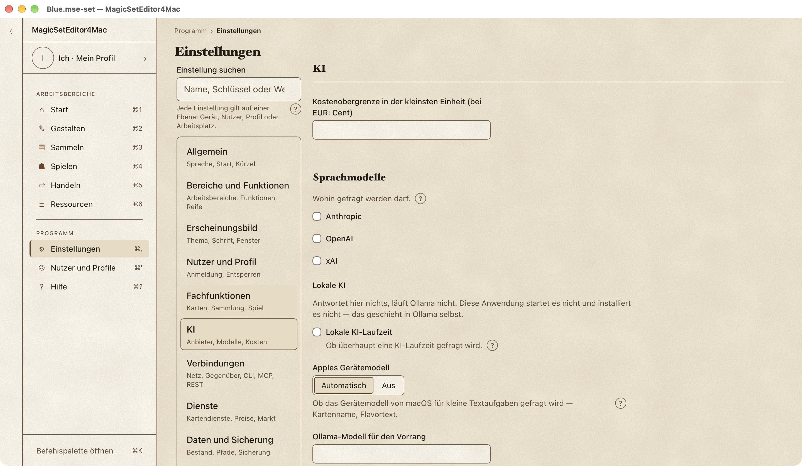 |  |

**Werkzeuge ohne Fenster** — die Kommandozeile, den MCP-Server und den
Dienst — zeigt _Diagnose_ mit ihrem Ort im Bündel. Dort richtet _Alles
einrichten_ sie auf Knopfdruck ein (der Verweis auf `mse`, die Einträge für
Codex, Claude Desktop und Claude Code, der Dienst als LaunchAgent), und dort
steht, wo Dienst und Werkzeugserver lauschen: vorgegeben nur dieser Mac,
wählbar ausgewählte Adressen oder alle (G08,
#2272).
**Gestartet und beendet** werden Dienst und Werkzeugserver über HTTP unter
_Verbindungen_, im Kasten _Was Fachleute hier sonst noch einstellen_:

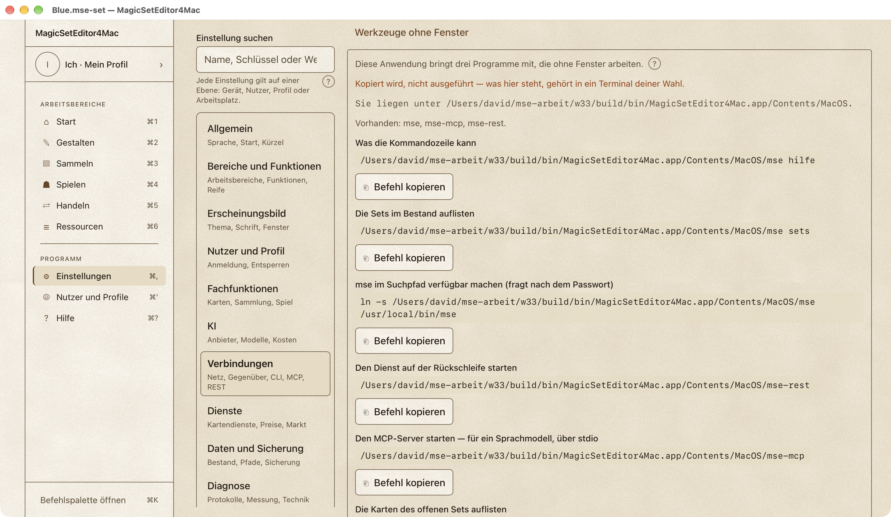

**Jede Einstellung gilt auf einer Ebene**, und das entscheidet, wie weit sie
reist:

| Ebene            | Wem sie gehört                                     | Reist in einem Austausch |
| ---------------- | -------------------------------------------------- | ------------------------ |
| **Gerät**        | diesem Rechner — ein Pfad, ein Fenstermaß, ein Proxy | nie                      |
| **Nutzer**       | dir, in jedem deiner Profile                       | ja                       |
| **Profil**       | dieser Arbeitsumgebung                             | ja                       |
| **Arbeitsplatz** | dem Fenster — welche Spalte steht und wie breit    | nur auf Wunsch           |

**Wirksam ist, was im Profil steht, sonst was du als Nutzer gesetzt hast,
sonst die Vorgabe** — bei einer Richtlinie der strengere Wert. Die meisten
wirken **sofort**; die wenigen, die einen Neustart brauchen (Fenster beim
Start, Protokoll, TLS, Kontingente), sagen es.

**Ein Austausch geht über eine Datei** (_Daten und Sicherung_): eine Ausfuhr
schreibt sie, und eine Einfuhr zeigt vorher, was sich ändern würde. **Dieselben Einstellungen gibt
es ohne Fenster** — `mse einstellungen`, `GET /einstellungen`,
`lesen.einstellungen` —, samt Ausfuhr und Vorschau einer Einfuhr.

**Jede Einstellung mit Schlüssel, Werten, Vorgabe, Ebene und Wirkung** steht
in [`docs/EINSTELLUNGEN.md`](docs/EINSTELLUNGEN.md) — erzeugt und gegen den
Quelltext gehalten, nicht abgeschrieben.

## Schnittstellen

**Vier Flächen auf demselben Bestand** — das Fenster, die Kommandozeile
`mse`, der Dienst `mse-rest` (in der Vorgabe auf der Rückschleife) und der
MCP-Server `mse-mcp` für ein Sprachmodell. Was das Fenster kann, sollen auch Werkzeuge
können; wie weit es ist, steht gezählt in
[`docs/FAEHIGKEITEN.md`](docs/FAEHIGKEITEN.md).

| Schnittstelle            | Stand                                                                                               |
| ------------------------ | --------------------------------------------------------------------------------------------------- |
| **Fenster**              | **375 von 379** Fähigkeiten                                                                         |
| **MCP** über stdio, wahlweise HTTP       | **261 von 379** — 330 Werkzeuge, lesend und schreibend getrennt                                     |
| **CLI** `mse`            | **316 von 379** — 273 Befehle, zwei Ausgaben, auswertbare Rückgabewerte                             |
| **REST**, vorgegeben auf `127.0.0.1` | **307 von 379** — 381 Endpunkte, Marke, Herkunftsprüfung, Drossel                                   |
| GraphQL                  | **nicht geplant** — der Nutzen ist nicht belegt, siehe `docs/AUDIT-0.2.0.md` (Entwicklungsarchiv) |

**Was an einer Fläche fehlt, nennt seinen Grund.** Sechsundzwanzig Fähigkeiten
hängen an einem nativen Dateidialog (gezählt am 2026-10-11), die übrigen
brauchen eine Zeichenfläche oder eine Tastatur — ein Symboleditor ohne Bildschirm ist keine fehlende Fläche, sondern
eine Fähigkeit, die eine braucht. Die Gründe stehen einzeln in
[`docs/FAEHIGKEITEN.md`](docs/FAEHIGKEITEN.md), und ein Wächter macht die
Pipeline rot, wenn einer fehlt.

**Dieselbe Fähigkeit gibt an jeder Fläche dieselbe Antwort**, und je Fähigkeit
fährt ein Lauf denselben Arbeitsablauf über die drei Flächen ohne Fenster —
gegen die **gebauten** Programme (`internal/flaechen`). Dass es ihn für jede
gibt, hält seit 0.3.0 ein Wächter nach; vorher hatten 27 von 59 keinen.

### So werden sie aufgerufen

```bash
# Kommandozeile — jede Ausgabe als Text oder mit --json, Rückgabewert 0 bei Erfolg,
# 1 bei einem fachlichen Nein (mit --json zusätzlich {"fehler":{"code":…}}), 2 bei falschem Aufruf
mse sets
mse karten 1 --json
mse hilfe                      # alle Befehle mit ihrer Beschreibung

# Dienst — bindet vorgegeben an 127.0.0.1 (wählbar), verlangt eine Marke, startet nicht von selbst
mse-rest -port 7777
curl -s -H "Authorization: Bearer $marke" http://127.0.0.1:7777/sets

# MCP — ein Unterprozess über stdio; das Sprachmodell startet ihn
mse-mcp
```

**Alle drei liegen im Bündel** unter
`MagicSetEditor4Mac.app/Contents/MacOS/` und **nicht im `PATH`** — von selbst
legt die Anwendung nichts außerhalb ihres Bündels ab. Unter _Einstellungen →
Diagnose → Werkzeuge ohne Fenster_ steht ihr Ort, und dort richtest du sie auf
Knopfdruck ein (der Verweis auf `mse` samt `PATH`-Eintrag, die Einträge für
Codex, Claude Desktop und Claude Code, der Dienst als LaunchAgent) und wählst,
wo Dienst und Werkzeugserver lauschen; gestartet und beendet werden beide
über HTTP unter _Einstellungen → Verbindungen_. Ausführlich: [Der
MCP-Server](#der-mcp-server) und [Der Dienst auf der
Rückschleife](#der-dienst-auf-der-rückschleife).

### Jede Fähigkeit mit ihren Wegen

**Vollständig, je Abschnitt aufklappbar** — erzeugt aus
[`docs/FAEHIGKEITEN.md`](docs/FAEHIGKEITEN.md) und unter einem Wächter, der
sie dagegen hält (`internal/werkzeuge/readmeschnittstellen_test.go`). Dort
stehen zusätzlich die Bindungen des Fensters und der Grund, wo eine Fläche
fehlt. Ein ✋ in den Gründen heißt: ein nativer Dateidialog.

<!-- schnittstellen:anfang — erzeugt aus docs/FAEHIGKEITEN.md; SCHNITTSTELLEN_SCHREIBEN=1 go test ./internal/werkzeuge -run Schnittstelle -->

<details>
<summary><b>Sets</b> · 17 Fähigkeiten</summary>

| Fähigkeit | Fenster | Kommandozeile | Dienst (REST) | MCP |
| --- | :---: | --- | --- | --- |
| Sets auflisten | ✓ | `mse sets` | `GET /sets` | `lesen.sets` |
| Ein Set öffnen | ✓ | `mse oeffnen` | `POST /sets` | `schreiben.set.einfahren` |
| Ein Set vorab ansehen | ✓ | `mse set-vorschau` | `POST /sets/vorschau` | `lesen.set.vorschau` |
| Ein leeres Set anlegen | ✓ | `mse set-neu` | `POST /sets/neu` | `schreiben.set.neu` |
| Ein Set löschen | ✓ | `mse set-loeschen` | `DELETE /sets/{setID}` | `schreiben.set.loeschen` |
| Zuletzt benutzt merken | ✓ | — | — | — |
| Die Menüleiste nach dem Stand des Fensters führen — Titel und Aktivierung von Seitenleiste, Navigator und Inspector | ✓ | — | — | — |
| Die Handlungen des gewählten Objekts in die Menüleiste bringen — dieselbe Liste wie im Rechtsklick und im Überlauf | ✓ | — | — | — |
| Weiterarbeiten — die Übersicht mit Angeheftetem | ✓ | — | — | — |
| Was Aufmerksamkeit braucht — Sets mit Vorbehalten, Decks mit Fehlkarten, Pakete mit Skriptbefunden, und was der Betrieb meldet | ✓ | — | — | — |
| Hintergrundaufgaben — was gerade geholt wird, mit Stand, Fortschritt und Dauer | ✓ | — | `GET /auftraege`, `GET /auftraege/{auftragID}`, `GET /auftraege/{auftragID}/ergebnis`, `DELETE /auftraege/{auftragID}`, `POST /auftraege/{auftragID}/wiederholung` | — |
| Eine Ausgabe des Dienstes abholen | — | — | `GET /ausgang/{name}`, `DELETE /ausgang/{name}` | — |
| Mitgelieferte Sets nennen | ✓ | `mse beispielsets` | `GET /beispielsets` | `lesen.beispielsets` |
| Ein Set sichern | ✓ | `mse sichern` | `POST /sets/{id}/sicherung` | `schreiben.set.sichern` |
| Setangaben lesen und setzen | ✓ | `mse setangaben` | `GET /sets/{id}/angaben`, `PUT /sets/{id}/angaben/{feld}` | `lesen.setangaben`, `schreiben.setangabe` |
| Vorbehalte eines Sets lesen | ✓ | `mse vorbehalte` | `GET /sets/{id}/vorbehalte` | `lesen.vorbehalte` |
| Die Karten eines Sets auf Probleme prüfen | ✓ | `mse probleme` | `GET /sets/{id}/probleme`, `POST /sets/{id}/probleme` | `lesen.set.probleme`, `lesen.set.probleme.pruefen` |

</details>

<details>
<summary><b>Karten</b> · 97 Fähigkeiten</summary>

| Fähigkeit | Fenster | Kommandozeile | Dienst (REST) | MCP |
| --- | :---: | --- | --- | --- |
| Karten auflisten | ✓ | `mse karten` | `GET /sets/{id}/karten` | `lesen.karten` |
| Die **Gestalt** der Kartenliste — Spalten und Ordnung | ✓ | `mse kartenliste` | `GET /sets/{setID}/kartenliste` · `PUT /sets/{setID}/kartenliste/spalten` · `PUT /sets/{setID}/kartenliste/sortierung` | `lesen.kartenliste` · `schreiben.kartenliste.spalten` · `schreiben.kartenliste.sortierung` |
| Der **Schnellfilter** der Kartenliste | ✓ | `mse kartenfilter` | `GET /sets/{setID}/kartenfilter` | `lesen.kartenfilter` |
| Eine Diagnose für einen Fehlerbericht holen | ✓ | — | — | — |
| Ein Diagnosepaket zusammenstellen, sichern und wieder löschen | ✓ | — | — | — |
| Einen Fehler, den das Fenster beim Zeichnen gefangen hat, mit seiner Kennung ins Protokoll schreiben | ✓ | — | — | — |
| Sehen, dass die letzte Sitzung nicht sauber endete, und ob eine Absturzspur vorliegt | ✓ | — | — | — |
| Die Karten mit ihrem Bild sehen | ✓ | — | — | — |
| Marken an einer Karte führen | ✓ | `mse marke` · `mse marken` | `GET /sets/{setID}/marken` · `GET /sets/{setID}/karten/{karteID}/marken` · `PUT /sets/{setID}/karten/{karteID}/marken/{marke}` · `DELETE /sets/{setID}/karten/{karteID}/marken/{marke}` | `lesen.marken` · `lesen.kartenmarken` · `schreiben.marke` · `schreiben.markeentfernen` |
| Marken an jedem Fachobjekt führen | ✓ | `mse objektmarke` · `mse objektmarken` · `mse marke-vergeben` | `GET /objektmarken/{art}` · `GET /objektmarken/{art}/{kennung}` · `PUT /objektmarken/{art}/{kennung}/{marke}` · `DELETE /objektmarken/{art}/{kennung}/{marke}` · `POST /objektmarken/{art}/vergabe` | `lesen.objektmarken` · `lesen.objektmarke` · `schreiben.objektmarke` · `schreiben.objektmarkeentfernen` · `schreiben.markevergeben` |
| Nach Marken filtern | ✓ | `mse marken-filtern` · `mse markenkatalog` | `GET /objektmarken/{art}/filter` · `GET /objektmarken` | `lesen.markenfilter` · `lesen.markenkatalog` |
| Marken pflegen — umbenennen, zusammenführen, überall entfernen | ✓ | `mse marke-umbenennen` · `mse marke-tilgen` | `POST /marken/umbenennung` · `DELETE /marken/{marke}` | — |
| Eine Karte auf einen **echten Druck** beziehen | ✓ | `mse verweis` · `mse verweise` | `GET /karten/{karteID}/verweis` · `PUT /karten/{karteID}/verweis` · `DELETE /karten/{karteID}/verweis` · `GET /sets/{setID}/verweise` | `lesen.verweis` · `schreiben.verweis` · `schreiben.verweisloesen` |
| Karten bei Scryfall **suchen** | ✓ | `mse scryfall-suche` | `GET /scryfall/suche` | `lesen.scryfall.suche` |
| Regelhinweise von Scryfall lesen | ✓ | `mse scryfall-regeln` | `GET /scryfall/regeln` | `lesen.scryfall.regeln` |
| Einen Manakosten gegen Scryfall prüfen | ✓ | `mse scryfall-mana` | `GET /scryfall/manakosten` | `lesen.scryfall.manakosten` |
| Sammeldaten von Scryfall vorhalten | ✓ | `mse scryfall-sammeldaten` | `GET /scryfall/sammeldaten`, `POST /scryfall/sammeldaten` | `lesen.scryfall.sammeldaten`, `schreiben.scryfall.sammeldaten` |
| Kartendaten von Scryfall übernehmen | ✓ | `mse scryfall` | `GET /sets/{id}/karten/{id}/scryfall`, `POST /sets/{id}/karten/{id}/scryfall` | `lesen.scryfall.vorschlag`, `schreiben.scryfall.uebernehmen` |
| Kartenfelder beschreiben | ✓ | `mse felder` | `GET /sets/{id}/felder` | `lesen.felder` |
| Eine Karte anlegen | ✓ | `mse karte … anlegen` | `POST /sets/{id}/karten` | `schreiben.karte.anlegen` |
| **Die Kartenskripte eines Spielpakets zeigen** | ✓ | `mse kartenskripte` | `GET /sets/{setID}/kartenskripte` | `lesen.kartenskripte` |
| **Ein Kartenskript ausführen** | ✓ | `mse kartenskript` | `POST /sets/{setID}/kartenskripte` | `schreiben.kartenskript` |
| **Wonach ein Spielpaket auszählen lässt** | ✓ | `mse auszaehlung` | `GET /sets/{setID}/auszaehlung` | `lesen.auszaehldimensionen` |
| **Ein Set nach einer Dimension auszählen** | ✓ | `mse auszaehlung <set> <dimension>` | `GET /sets/{setID}/auszaehlung/{name}` | `lesen.auszaehlung` |
| **Die Parameterhilfen eines Schlüsselworts** | ✓ | `mse schluesselwort <set> parameter <id>` | `GET /sets/{setID}/schluesselwoerter/{wortID}/parameter` | `lesen.parameterhilfen` |
| **Die Decks sehen** | ✓ | `mse decks` | `GET /decks` | `lesen.decks` |
| **Ein Deck samt seinen Plätzen sehen** | ✓ | `mse deck <id>` | `GET /decks/{deckID}` | `lesen.deck` |
| **Ein Deck anlegen** | ✓ | `mse deck neu` | `POST /decks` | `schreiben.deck.anlegen` |
| **Ein Deck umbenennen** | ✓ | `mse deck umbenennen` | `PUT /decks/{deckID}` | `schreiben.deck.umbenennen` |
| **Ein Deck kopieren** | ✓ | `mse deck kopieren` | `POST /decks/{deckID}/kopie` | `schreiben.deck.kopieren` |
| **Aus einem Set ein Deck anlegen** | ✓ | `mse deck aus-set` | `POST /decks/aus-set` | `schreiben.deck.ausset` |
| **Ein Deck löschen** | ✓ | `mse deck loeschen` | `DELETE /decks/{deckID}` | `schreiben.deck.loeschen` |
| **Eine Karte ins Deck legen** | ✓ | `mse deck legen` | `PUT /decks/{deckID}/plaetze` | `schreiben.deckplatz.legen` |
| **Einen Platz aus dem Deck nehmen** | ✓ | `mse deck nehmen` | `DELETE /decks/{deckID}/plaetze/{platzID}` | `schreiben.deckplatz.nehmen` |
| **Einen Platz in den anderen Bereich legen** | ✓ | `mse deck verschieben` | `PUT /decks/{deckID}/plaetze/{platzID}/bereich` | `schreiben.deckplatz.verschieben` |
| **Ein Deck auf ein Format stellen** | ✓ | `mse deck format` | `PUT /decks/{deckID}/format` | `schreiben.deck.format` |
| **Ein Deck gegen sein Format prüfen** | ✓ | `mse deck pruefen` | `GET /decks/{deckID}/pruefung` | `lesen.deck.pruefung` |
| **Nachsehen, was von einem Deck da ist** | ✓ | `mse deck bestand` | `GET /decks/{deckID}/bestand` | `lesen.deck.bestand` |
| **Sehen, welche Exemplare für ein Deck vorgesehen sind** | ✓ | `mse deck zuordnungen` | `GET /decks/{deckID}/zuordnungen` | `lesen.deck.zuordnungen` |
| **Exemplare einem Deckplatz zuordnen** | ✓ | `mse deck zuordnen` | `PUT /decks/{deckID}/zuordnungen` | `schreiben.deck.zuordnen` |
| **Eine Zuordnung wieder lösen** | ✓ | `mse deck zuordnung-loesen` | `DELETE /decks/{deckID}/zuordnungen/{zuordnungID}` | `schreiben.deck.zuordnung.loesen` |
| **Die Fehlkarten eines Decks als Liste bekommen** | ✓ | `mse deck fehlkarten` | `GET /decks/{deckID}/fehlkarten` | `lesen.deck.fehlkarten` |
| **Ein Deck als Liste ausgeben** | ✓ | `mse deck liste` | `GET /decks/{deckID}/liste` | `lesen.deck.liste` |
| **Etwas über die Ziele des Systems teilen** — eine Einladung, ein Kartenbild, ein Set, ein Deck, die Sammlung | ✓ | — | — | — |
| **Die Fehlkarten eines Decks auf die Wunschliste setzen** | ✓ | `mse deck wuenschen` | `POST /decks/{deckID}/fehlkarten/wunschliste` | `schreiben.deck.fehlkarten.wuenschen` |
| **Sehen, welche Decks ein Exemplar benutzen** | ✓ | `mse exemplar decks` | `GET /sammlung/exemplare/{exemplarID}/decks` | `lesen.exemplar.decks` |
| **Die Formate sehen** | ✓ | `mse formate` | `GET /formate` | `lesen.formate` |
| **Die nachgelesenen Deckbauarten sehen** | ✓ | `mse format bauarten` | `GET /formatbauarten` | `lesen.formatbauarten` |
| **Ein Format aus einer Bauart anlegen** | ✓ | `mse format neu` | `POST /formate` | `schreiben.format.ausbauart` |
| **Ein Format anlegen oder fortschreiben** | ✓ | `mse format setzen` | `PUT /formate/{formatID}` | `schreiben.format.setzen` |
| **Ein Format löschen** | ✓ | `mse format loeschen` | `DELETE /formate/{formatID}` | `schreiben.format.loeschen` |
| **Die Turniere sehen** | ✓ | `mse turniere` | `GET /turniere` | `lesen.turniere` |
| **Ein Turnier samt Verlauf sehen** | ✓ | `mse turnier <id>` | `GET /turniere/{turnierID}` | `lesen.turnier` |
| **Ein Turnier anlegen** | ✓ | `mse turnier neu` | `POST /turniere` | `schreiben.turnier.anlegen` |
| **Ein Turnier nach einer Vorlage anlegen** | ✓ | `mse turnier kopieren` | `POST /turniere/{turnierID}/kopie` | `schreiben.turnier.kopieren` |
| **Ein Turnier löschen** | ✓ | `mse turnier loeschen` | `DELETE /turniere/{turnierID}` | `schreiben.turnier.loeschen` |
| **Einen Teilnehmer anmelden** | ✓ | `mse turnier anmelden` | `POST /turniere/{turnierID}/teilnehmer` | `schreiben.turnier.anmelden` |
| **Einen Teilnehmer abmelden** | ✓ | `mse turnier aussteigen` | `PUT /turniere/{turnierID}/teilnehmer/{teilnehmerID}` | `schreiben.turnier.aussteigen` |
| **Sehen, wie die nächste Runde ausfiele** | ✓ | `mse turnier vorschlag` | `GET /turniere/{turnierID}/vorschlag` | `schreiben.turnier.vorschlag` |
| **Die nächste Runde legen** | ✓ | `mse turnier runde` | `POST /turniere/{turnierID}/runden` | `schreiben.turnier.runde` |
| **Ein Ergebnis eintragen** | ✓ | `mse turnier ergebnis` | `PUT /turniere/{turnierID}/paarungen/{paarungID}` | `schreiben.turnier.ergebnis` |
| **Die Rangliste sehen** | ✓ | `mse turnier rangliste` | `GET /turniere/{turnierID}/rangliste` | `lesen.turnier.rangliste` |
| **Sehen, was eine Berichtigung verschöbe** | ✓ | `mse turnier folgen` | `POST /turniere/{turnierID}/paarungen/{paarungID}/folgen` | `lesen.turnier.folgen` |
| **Ein Turnier abschließen** | ✓ | `mse turnier abschliessen` | `POST /turniere/{turnierID}/abschluss` | `schreiben.turnier.abschliessen` |
| **Ein Turnier wiedereröffnen** | ✓ | `mse turnier wiedereroeffnen` | `DELETE /turniere/{turnierID}/abschluss` | `schreiben.turnier.wiedereroeffnen` |
| **Das Protokoll eines Turniers sehen** | ✓ | `mse turnier protokoll` | `GET /turniere/{turnierID}/protokoll` | `lesen.turnier.protokoll` |
| **Ein Turnier als Datei ausgeben** | ✓ | `mse turnier ausgeben` | `GET /turniere/{turnierID}/ausgabe` | `lesen.turnier.ausgabe` |
| **Ein Turnier aus einer Datei einlesen** | ✓ | `mse turnier einlesen` | `POST /turniere/einlesen` | `schreiben.turnier.einlesen` |
| **Den Bericht eines Turniers sichern** | ✓ | `mse turnier bericht` | `GET /turniere/{turnierID}/bericht` | `lesen.turnier.bericht` |
| **Die Autoersetzungen eines Spiels sehen** | ✓ | `mse autoersetzung <set>` | `GET /sets/{setID}/autoersetzungen` | `lesen.autoersetzungen` |
| **Eine Autoersetzungsregel setzen** | ✓ | `mse autoersetzung <set> setzen` | `PUT /sets/{setID}/autoersetzungen/{muster}` | `schreiben.autoersetzung` |
| **Eine eigene Autoersetzungsregel löschen** | ✓ | `mse autoersetzung <set> loeschen` | `DELETE /sets/{setID}/autoersetzungen/{muster}` | `schreiben.autoersetzung.loeschen` |
| **Die eigenen Autoersetzungen vergessen** | ✓ | `mse autoersetzung <set> zuruecksetzen` | `DELETE /sets/{setID}/autoersetzungen` | `schreiben.autoersetzungen.zuruecksetzen` |
| **Die Autoersetzung ganz schalten** | ✓ | `mse autoersetzung <set> an` | `PUT /sets/{setID}/autoersetzungen` | `schreiben.autoersetzung.schalter` |
| Eine Karte kopieren | ✓ | `mse karte … kopieren` | `POST /sets/{id}/karten/{id}/kopie` | `schreiben.karte.kopieren` |
| Karten über die **Zwischenablage** bewegen | ✓ | `mse ablage-kopieren` · `mse ablage-ausschneiden` · `mse ablage-einfuegen` | `POST /sets/{setID}/ablage/kopieren` · `POST /sets/{setID}/ablage/ausschneiden` · `POST /sets/{setID}/ablage/einfuegen` | `lesen.ablage.kopieren` · `schreiben.ablage.ausschneiden` · `schreiben.ablage.einfuegen` |
| Eine Karte löschen | ✓ | `mse karte … loeschen` | `DELETE /sets/{id}/karten/{id}` | `schreiben.karte.loeschen` |
| Karten umordnen | ✓ | `mse karte … tauschen` | `POST /sets/{id}/karten/tausch` | `schreiben.karten.tauschen` |
| Ein Feld setzen | ✓ | `mse feld` | `PUT /sets/{id}/karten/{id}/felder/{feld}` | `schreiben.feld` |
| Ein Feld auf vielen Karten setzen | ✓ | `mse felder-setzen` | `POST /sets/{setID}/felder` | `schreiben.felder` |
| Eine Massenänderung vorher sehen | ✓ | `mse felder-vorschau` | `POST /sets/{setID}/felder/vorschau` | `lesen.felder.vorschau` |
| Ein Symbol zeichnen | ✓ | `mse symbol-rechnen` | `POST /symbol/grundform` | `lesen.symbol.grundform` |
| **Ein Bild als Symbol nachzeichnen** | ✓ | `mse symbol-nachzeichnen` | `POST /sets/{setID}/symbol-nachzeichnen` | `schreiben.symbolnachzeichnen` |
| Ein gezeichnetes Symbol ins Set legen | ✓ | `mse symbol-setzen` | `PUT /sets/{setID}/symbol` | `schreiben.symbol` |
| Einen Bézierhandgriff ziehen | ✓ | `mse symbol-rechnen` | `POST /symbol/griff` | `lesen.symbol.griff` |
| Einem Punkt seine Art geben | — | `mse symbol-rechnen` | `POST /symbol/sperre` | `lesen.symbol.sperre` |
| Einen Punkt einer Form einfügen oder löschen | ✓ | `mse symbol-rechnen` | `POST /symbol/punkt` | `lesen.symbol.punkt` |
| Das Symbol eines Sets lesen | ✓ | `mse symbol` | `GET /sets/{setID}/symbol` | `lesen.symbol` |
| Die Packarten eines Spiels zeigen | ✓ | `mse packarten` | `GET /sets/{id}/packarten` | `lesen.packarten` |
| Einen Booster ziehen | ✓ | `mse pack` | `POST /sets/{id}/packarten/{art}/ziehung` | `lesen.pack.ziehen` |
| Die Schlüsselwörter eines Sets zeigen | ✓ | `mse schluesselwoerter` | `GET /sets/{id}/schluesselwoerter` | `lesen.schluesselwoerter` |
| Ein Schlüsselwort anlegen | ✓ | `mse schluesselwort … anlegen` | `POST /sets/{id}/schluesselwoerter` | `schreiben.schluesselwort.anlegen` |
| Ein Schlüsselwort ändern | ✓ | `mse schluesselwort … setzen` | `PUT /sets/{id}/schluesselwoerter/{id}/felder/{feld}` | `schreiben.schluesselwort.setzen` |
| Ein Schlüsselwort löschen | ✓ | `mse schluesselwort … loeschen` | `DELETE /sets/{id}/schluesselwoerter/{id}` | `schreiben.schluesselwort.loeschen` |
| Die Auswahl eines Feldes zeigen | ✓ | `mse wortlisten` | `GET /karten/{id}/felder/{feld}/wortlisten` | `lesen.wortlisten` |
| Aus der Auswahl wählen | ✓ | `mse wortwahl` | `POST /sets/{id}/karten/{id}/felder/{feld}/wortwahl` | `schreiben.wortwahl` |
| Beim Tippen ersetzen | ✓ | — | — | — |

</details>

<details>
<summary><b>Suchen und zählen</b> · 62 Fähigkeiten</summary>

| Fähigkeit | Fenster | Kommandozeile | Dienst (REST) | MCP |
| --- | :---: | --- | --- | --- |
| Im Volltext suchen | ✓ | `mse suche` | `GET /suche` | `lesen.suche` |
| Im Text **ersetzen** | ✓ | `mse ersetzen` | `POST /sets/{setID}/ersetzung/vorschau` · `POST /sets/{setID}/ersetzung` | `lesen.ersetzen` · `schreiben.ersetzen` |
| Ein Set auszählen | ✓ | `mse statistik` | `GET /sets/{id}/statistik`, `GET /sets/{id}/statistik/{feld}` | `lesen.statistik`, `lesen.verteilung` |
| Einen Ausdruck auswerten | ✓ | `mse skript` | `POST /karten/{id}/skript` | `lesen.skript` |
| Die Namen der Umgebung lesen | ✓ | `mse skriptnamen` | `GET /karten/{id}/skriptnamen` | `lesen.skriptnamen` |
| Einen Ausdruck einfärben | ✓ | — | — | — |
| Eine Paketdatei einfärben | ✓ | — | — | — |
| Die Dateien einer Vorlage aufzählen | ✓ | `mse paketdateien` | `GET /pakete/{paket}/dateien` | `lesen.paketdateien` |
| Die Skripte einer Vorlage prüfen | ✓ | `mse paketdatei-pruefen` | `POST /paketdateien/pruefung` | `lesen.skriptbefund` |
| Eine Vorlage lesen | ✓ | `mse paketdatei` | `GET /pakete/{paket}/dateien/{datei}` | `lesen.paketdatei` |
| Eine Vorlage schreiben | ✓ | `mse paketdatei-setzen` | `PUT /pakete/{paket}/dateien/{datei}` | `schreiben.paketdatei` |
| Eine Vorlage im Paket anlegen | ✓ | `mse paketdatei-anlegen` | `POST /pakete/{paket}/dateien` | `schreiben.paketdatei.anlegen` |
| Ein Bild oder eine Schrift ins Paket legen | ✓ | `mse paketdatei-einfuegen` | — | — |
| Eine Datei im Paket umbenennen | ✓ | `mse paketdatei-umbenennen` | `PATCH /pakete/{paket}/dateien/{datei}` | `schreiben.paketdatei.umbenennen` |
| Eine Datei aus dem Paket entfernen | ✓ | `mse paketdatei-entfernen` | `DELETE /pakete/{paket}/dateien/{datei}` | `schreiben.paketdatei.entfernen` |
| Eine ungespeicherte Vorlage sehen | ✓ | — | — | — |
| Die Testkarten zu einer Vorlage nennen | ✓ | — | — | — |
| Die Symbole einer Vorlage nennen | ✓ | — | — | — |
| Die Verwendungen eines Namens nennen | ✓ | — | — | — |
| Die eigene Sammlung aufzählen | ✓ | `mse sammlung` | `GET /sammlung` | `lesen.sammlung` |
| Nachsehen, was von einem Druck da ist | — | `mse sammlung <druck>` | `GET /sammlung/drucke/{printing}` | `lesen.sammlungfuer` |
| Ein Exemplar aufnehmen | ✓ | `mse exemplar` | `POST /sammlung` | `schreiben.exemplar` |
| Ein Exemplar ändern | ✓ | `mse exemplar-aendern` | `PUT /sammlung/{id}` | `schreiben.exemplaraendern` |
| Ein Exemplar herausnehmen | ✓ | `mse exemplar-loeschen` | `DELETE /sammlung/{id}?fassung=…` | `schreiben.exemplarloeschen` |
| Die abgelegten Preise eines Drucks sehen | ✓ | `mse preise` | `GET /drucke/{printing}/preise` | `lesen.preise` |
| Den Preisverlauf sehen | ✓ | `mse preisverlauf` | `GET /drucke/{printing}/preisverlauf` | `lesen.preisverlauf` |
| Preise holen | ✓ | `mse preise-holen` | `POST /drucke/{printing}/preise` | `schreiben.preiseholen` |
| Preise einer ganzen Quelle holen | ✓ | `mse preise-bulk` | `POST /preise/bulk/{quelle}/{umfang}` | `schreiben.preise.bulk` |
| **Die Angebote eines Marktplatzes sehen** | ✓ | `mse markt` | `GET /drucke/{printing}/angebote` | `lesen.marktangebote` |
| **Den Preisverlauf einer anderen Quelle holen** | ✓ | `mse fremdverlauf` | `POST /drucke/{printing}/fremdverlauf` | `schreiben.fremdverlauf` |
| **Das Kontingent an einem Anbieterkonto sehen** | ✓ | `mse anbieterstand` | `GET /anbieter/{dienst}/stand` | `lesen.anbieterstand` |
| **Sehen, woher ein Kartenwert stammt** | ✓ | — | — | — |
| **Sehen, was über KI-Modelle feststeht** | ✓ | `mse ki-modelle` | `GET /ki/modelle` | `lesen.ki.modelle` |
| **Ein Modell Felder einer Karte vorschlagen lassen** | ✓ | `mse ki-vorschlag` | `POST /karten/{karteID}/ki-vorschlag` | `schreiben.ki.vorschlag` |
| **Apples Gerätemodell für eine Sitzung abschalten** | ✓ | `mse ki-vorschlag --ohne-geraetemodell` | `POST /ki/geraetemodell/sitzung` | `schreiben.ki.geraetemodell.sitzung` |
| **Mehrere Karten auf einmal vorschlagen lassen** | ✓ | `mse ki-batch` | `POST /ki/batch` | `schreiben.ki.batch` |
| **Mehrere Vorschläge als eine Gruppe übernehmen** | ✓ | `mse ki-gruppe` | `POST /ki/gruppe` | `schreiben.ki.gruppe` |
| **Ein Modell ein Kartenbild erzeugen oder bearbeiten lassen** | ✓ | — | — | — |
| **Eine Karte beurteilen lassen — mit Belegen** | ✓ | `mse ki-einschaetzung` | `POST /karten/{karteID}/ki-einschaetzung` | `schreiben.ki.einschaetzung` |
| **Eine Karte auf einem Foto erkennen** | ✓ | `mse ki-erkennung` | `POST /ki/erkennung` | `schreiben.ki.erkennung` |
| **Messen, was ein Modell kann** | ✓ | `mse ki-modell-pruefen`, `mse ki-modell-vergessen` | `POST /ki/modelle/pruefen`, `POST /ki/modelle/vergessen` | `schreiben.ki.modell.pruefen`, `schreiben.ki.modell.vergessen` |
| Eine Kartenliste **deuten** | ✓ | `mse liste-deuten` | `POST /sammlung/liste/deuten` | `lesen.liste.deuten` |
| Eine Kartenliste **einlesen** | ✓ | `mse liste-einlesen` | `POST /sammlung/liste/einlesen` | `schreiben.liste.einlesen` |
| Eine Kartenliste **vorab ansehen** | ✓ | `mse liste-vorschau` | `POST /sammlung/liste/vorschau` | `lesen.liste.vorschau` |
| Einen verbindlichen Handelsschritt freigeben | ✓ | — | — | — |
| Eine **Deckliste** deuten | ✓ | `mse deck-liste` | `POST /decks/{deckID}/liste/vorschau` | `lesen.deckliste` |
| Eine **Deckliste** ins Deck legen | ✓ | `mse deck-liste-uebernehmen` | `POST /decks/{deckID}/liste` | `schreiben.deckliste` |
| **Viele Exemplare auf einmal ändern** | ✓ | `mse masse-aendern` | `POST /sammlung/masse` | `schreiben.sammlung.masse` |
| **Viele Exemplare auf einmal löschen** | ✓ | `mse masse-loeschen` | `POST /sammlung/masse/loeschen` | `schreiben.sammlung.masseloeschen` |
| **Preise für die ganze Sammlung** | ✓ | `mse preise-alle` | `POST /sammlung/masse/preise` | `schreiben.sammlung.preisschub` |
| **Besitze ich diese Karte?** | ✓ | `mse besitz` | `GET /sammlung/besitz/{printing}` | `lesen.sammlung.besitz` |
| Die **Lagerorte** zeigen | ✓ | `mse lagerorte` | `GET /sammlung/lagerorte` | `lesen.sammlung.lagerorte` |
| **Dubletten** finden | ✓ | `mse dubletten` | `GET /sammlung/dubletten` | `lesen.sammlung.dubletten` |
| Die **Wunschliste** zeigen | ✓ | `mse wuensche` | `GET /sammlung/wuensche` | `lesen.sammlung.wuensche` |
| Die Sammlung **ausgeben** | ✓ | `mse sammlung-ausgeben` | `GET /sammlung/ausgeben` | `lesen.sammlung.ausgeben` |
| Eine CSV-Sammlung **zurücklesen** | ✓ | `mse sammlung-einlesen` | `POST /sammlung/einlesen` | `schreiben.sammlung.einlesen` |
| Eine CSV-Sammlung **vorab ansehen** | ✓ | `mse sammlung-vorschau` | `POST /sammlung/vorschau` | `lesen.sammlung.vorschau` |
| Die Sammlung zusammenrechnen | ✓ | `mse portfolio` | `GET /portfolio` | `lesen.portfolio` |
| Die Werkzeuge ohne Fenster finden | ✓ | — | — | — |
| Die Kommandozeile einrichten — `mse` und `mse-mcp` in `~/.local/bin` | ✓ | — | — | — |
| Nachsehen, was **Kommandozeile, Codex, Claude und Dienst** von dieser Anwendung wissen | ✓ | `mse schnittstellen` | `GET /schnittstellen` | `lesen.schnittstellen` |
| Kommandozeile, Codex, Claude und Dienst **einrichten und widerrufen** — je Ziel oder **alle mit einem Ruf**, und **wählen, wo der Dienst lauscht** | ✓ | `mse schnittstellen widerrufen` [ziel] | — | — |

</details>

<details>
<summary><b>Aussehen</b> · 5 Fähigkeiten</summary>

| Fähigkeit | Fenster | Kommandozeile | Dienst (REST) | MCP |
| --- | :---: | --- | --- | --- |
| Stile nennen und wechseln | ✓ | `mse stile` | `GET /sets/{id}/stile`, `GET /sets/{id}/stile/{paket}/folgen`, `PUT /sets/{id}/stil` | `lesen.stile`, `lesen.stilfolgen`, `schreiben.stil` |
| Stiloptionen lesen und setzen | ✓ | `mse stiloption` | `GET /sets/{id}/stiloptionen`, `PUT /sets/{id}/stiloptionen/{feld}`, `DELETE /sets/{id}/stiloptionen/{feld}` | `lesen.stiloptionen`, `schreiben.stiloption`, `schreiben.stiloption.zuruecksetzen` |
| Die Felder des Stils an einer Karte lesen und setzen | ✓ | `mse zusatzfeld` | `GET /sets/{setID}/karten/{karteID}/zusatzfelder`, `PUT /sets/{setID}/karten/{karteID}/zusatzfelder/{feld}` | `lesen.zusatzfelder`, `schreiben.zusatzwert` |
| Die Wahlen einer Stiloption zeigen | ✓ | — | — | — |
| Eine Karte zeichnen | ✓ | — | — | — |

</details>

<details>
<summary><b>Bilder</b> · 28 Fähigkeiten</summary>

| Fähigkeit | Fenster | Kommandozeile | Dienst (REST) | MCP |
| --- | :---: | --- | --- | --- |
| Ein Kartenbild einsetzen | ✓ | `mse bild-setzen` | `PUT /sets/{setID}/karten/{karteID}/felder/{feld}/bild` | `schreiben.karte.bild` |
| Ein Bild zuschneiden | ✓ | `mse symbol-rechnen` | `POST /symbol/zuschnitt` | `lesen.symbol.zuschnitt` |
| Ein Kartenbild von Scryfall holen | ✓ | `mse scryfall-bild` | `POST /sets/{id}/karten/{id}/scryfall/bild` | `schreiben.scryfall.bild` |
| Eine Karte aus einem Scryfall-Namen anlegen | ✓ | `mse scryfall-karte` | `POST /sets/{id}/karten/scryfall` | `schreiben.scryfall.karte` |
| Ein ganzes Set von Scryfall einlesen | ✓ | `mse scryfall-set` | `POST /sets/scryfall` | `schreiben.scryfall.set` |
| Teile gruppieren, auflösen und umordnen | ✓ | `mse symbol-rechnen` | `POST /symbol/gruppe`, `POST /symbol/reihenfolge` | `lesen.symbol.gruppe`, `lesen.symbol.reihenfolge` |
| Eine Symmetrie bedienen | ✓ | `mse symbol-rechnen` | `POST /symbol/symmetrie`, `POST /symbol/symmetriekopien` | `lesen.symbol.symmetrie`, `lesen.symbol.symmetriekopien` |
| Symbole zur Auswahl stellen | ✓ | `mse symbolpalette` | `GET /karten/{karteID}/symbolpalette/{feld}` | `lesen.symbolpalette` |
| Die Symbolbibliothek sehen und durchsuchen | ✓ | `mse symbolbibliothek` | `GET /symbole` | `lesen.symbolbibliothek` |
| Ein Setsymbol in die Bibliothek aufnehmen | ✓ | `mse symbolbibliothek aufnehmen` | `POST /symbole` | `schreiben.symbolbibliothek.aufnehmen` |
| Ein Symbol der Bibliothek duplizieren und umbenennen | ✓ | `mse symbolbibliothek duplizieren`, `mse symbolbibliothek umbenennen` | `POST /symbole/{symbolID}/kopie`, `PUT /symbole/{symbolID}/name` | `schreiben.symbolbibliothek.duplizieren`, `schreiben.symbolbibliothek.umbenennen` |
| Ein Symbol der Bibliothek löschen | ✓ | `mse symbolbibliothek loeschen` | `DELETE /symbole/{symbolID}` | `schreiben.symbolbibliothek.loeschen` |
| Ein Symbol der Bibliothek in ein Set einsetzen | ✓ | `mse symbolbibliothek einsetzen` | `PUT /sets/{setID}/bibliothekssymbol` | `schreiben.symbolbibliothek.einsetzen` |
| Ein Symbol ein- und ausgeben | ✓ | `mse symbolbibliothek einlesen`, `mse symbolbibliothek ausgeben` | `POST /symbole/einlesen`, `GET /symbole/{symbolID}` | `schreiben.symbolbibliothek.einlesen`, `lesen.symbolbibliothek.symbol` |
| Ein Symbol der Bibliothek bearbeiten und zurücknehmen | ✓ | `mse symbolbibliothek teile`, `mse symbolbibliothek sichern`, `mse symbolbibliothek zuruecknehmen` | `GET /symbole/{symbolID}/teile`, `PUT /symbole/{symbolID}/teile`, `POST /symbole/{symbolID}/zuruecknahme` | `lesen.symbolbibliothek.teile`, `schreiben.symbolbibliothek.sichern`, `schreiben.symbolbibliothek.zuruecknehmen` |
| Die Sets mit der vorigen Fassung nachziehen | ✓ | `mse symbolbibliothek nachziehen` | `POST /symbole/{symbolID}/nachzug` | `schreiben.symbolbibliothek.nachziehen` |
| Ein Symbol in den Fassungen eines Sets sehen | ✓ | — | — | — |
| Die eigenen Übersetzungen sehen | ✓ | `mse sprachpaket`, `mse sprachpaket zeige` | `GET /sprachpakete`, `GET /sprachpakete/{kennung}` | `lesen.sprachpakete`, `lesen.sprachpaket` |
| Eine eigene Übersetzung anlegen | ✓ | `mse sprachpaket anlegen` | `POST /sprachpakete` | `schreiben.sprachpaket.anlegen` |
| Eine eigene Übersetzung bearbeiten | ✓ | `mse sprachpaket setze` | `PATCH /sprachpakete/{kennung}` | `schreiben.sprachpaket.aendern` |
| Eine eigene Übersetzung löschen | ✓ | `mse sprachpaket loeschen` | `DELETE /sprachpakete/{kennung}` | `schreiben.sprachpaket.loeschen` |
| Eine eigene Übersetzung ein- und ausgeben | ✓ | `mse sprachpaket einlesen`, `mse sprachpaket ausgeben` | `POST /sprachpakete/einlesen`, `GET /sprachpakete/{kennung}/datei` | `schreiben.sprachpaket.einlesen`, `lesen.sprachpaket.datei` |
| Kartenbilder schreiben | ✓ | `mse zeichnen` | `POST /karten/{id}/bild` | `schreiben.karte.zeichnen` |
| Ein Profilbild setzen und wegnehmen | ✓ | `mse nutzer-bild` | `PUT /nutzer/{nutzerID}/bild`, `DELETE /nutzer/{nutzerID}/bild` | `schreiben.nutzer.bild`, `schreiben.nutzer.bild.loeschen` |
| Die Einstellungen eines **Menschen** lesen und setzen | ✓ | `mse nutzereinstellung` | `GET /nutzer/{nutzerID}/einstellungen`, `PUT /nutzer/{nutzerID}/einstellungen/{schluessel}` | `lesen.nutzereinstellungen`, `schreiben.nutzereinstellung` |
| Die eigenen Daten ausgeben | ✓ | `mse personendaten` | `GET /nutzer/{nutzerID}/personendaten` | `lesen.personendaten` |
| Ein Profil-Abzeichen setzen und wegnehmen | ✓ | `mse profil-badge` | `PUT /profile/{profilID}/badge`, `DELETE /profile/{profilID}/badge` | `schreiben.profil.badge`, `schreiben.profil.badge.loeschen` |
| Die Nutzer mit ihrem Bild sehen | ✓ | — | — | — |

</details>

<details>
<summary><b>Ausgeben</b> · 4 Fähigkeiten</summary>

| Fähigkeit | Fenster | Kommandozeile | Dienst (REST) | MCP |
| --- | :---: | --- | --- | --- |
| Einen Druckbogen legen | ✓ | `mse bogen` | `POST /sets/{setID}/bogen`, `POST /sets/{setID}/bogen/probelauf` | `schreiben.set.bogen`, `lesen.set.bogenprobelauf` |
| Über eine Exportvorlage ausgeben | ✓ | `mse vorlagen` | `GET /sets/{setID}/vorlagen`, `POST /sets/{setID}/vorlagen`, `POST /sets/{setID}/vorlagen/probelauf`, `PUT /vorlagen/{vorlage}/optionen/{feld}` | `lesen.vorlagen`, `schreiben.vorlage.ausfuehren`, `lesen.vorlage.probelauf`, `schreiben.vorlagenoption` |
| MTG JSON lesen | ✓ | `mse mtgjson-lesen`, `mse mtgjson-spiele` | `POST /mtgjson`, `GET /mtgjson/spiele` | `schreiben.mtgjson.lesen`, `lesen.mtgjson.spiele` |
| MTG JSON schreiben | ✓ | `mse mtgjson-schreiben` | `POST /sets/{setID}/mtgjson` | `schreiben.mtgjson.schreiben` |

</details>

<details>
<summary><b>Vorlagenpakete</b> · 27 Fähigkeiten</summary>

| Fähigkeit | Fenster | Kommandozeile | Dienst (REST) | MCP |
| --- | :---: | --- | --- | --- |
| Pakete auflisten | ✓ | `mse pakete` | `GET /pakete` | `lesen.pakete` |
| Ein Paket beziehen | ✓ | `mse paket-beziehen` | `POST /pakete` | `schreiben.paket.beziehen` |
| Nutzer und Profile führen | ✓ | `mse nutzer`, `mse nutzer-neu`, `mse profil-neu` | `GET /nutzer`, `POST /nutzer`, `POST /nutzer/{nutzerID}/profile` | `lesen.nutzer`, `schreiben.nutzer.neu`, `schreiben.profil.neu` |
| Das Profil wechseln | ✓ | `mse profil [kennung]`, `--profil=<kennung>` | `GET /profil`, `PUT /profil` | `lesen.profil`, `schreiben.profil.wechseln` |
| Über einen Anbieter anmelden | ✓ | `mse anbieter`, `mse anmelden <anbieter>` | — | — |
| Anbieterkonten führen | ✓ | `mse konten <nutzer> [anbieter]` | `GET /nutzer/{nutzerID}/konten`, `DELETE /nutzer/{nutzerID}/konten/{anbieter}` | `lesen.anbieterkonten`, `schreiben.konto.loesen` |
| Nutzer und Profile bearbeiten | ✓ | `mse nutzer-aendern`, `mse profil-aendern`, `mse nutzer-loeschen`, `mse profil-loeschen` | `PUT /nutzer/{nutzerID}`, `PUT /profile/{profilID}`, `DELETE /nutzer/{nutzerID}`, `DELETE /profile/{profilID}` | `schreiben.nutzer.aendern`, `schreiben.profil.aendern`, `schreiben.nutzer.loeschen`, `schreiben.profil.loeschen` |
| Ein eigenes Konto anlegen und sich damit anmelden | ✓ | `mse konto-neu`, `mse konto-anmelden`, `mse konto-anonym` | `POST /konten`, `POST /konten/anmeldung`, `POST /konten/anonym` | `schreiben.konto.anonym` |
| Einen zweiten Faktor einrichten und verlangen | ✓ | `mse faktoren`, `mse faktor-neu`, `mse faktor-bestaetigen`, `mse faktor-loeschen` | `GET /nutzer/{nutzerID}/faktoren`, `POST /nutzer/{nutzerID}/faktoren`, `PUT /nutzer/{nutzerID}/faktoren/totp`, `DELETE /nutzer/{nutzerID}/faktoren/{art}` | `lesen.faktoren`, `schreiben.faktor.loeschen` |
| Das Fenster sperren, entsperren, abmelden und lokal anmelden | ✓ | `mse sitzung` | — | — |
| Das eigene Kennwort wechseln oder über den Zettel wiederherstellen | ✓ | `mse kennwort-wechseln`, `mse kennwort-wiederherstellen` | — | — |
| Zugriffstoken für ein technisches Profil führen | ✓ | `mse token`, `mse token-anlegen`, `mse token-aendern`, `mse token-loeschen`, `mse token-rotieren`, `mse token-alle-widerrufen`, `mse token-ablaufwahlen` | `GET /profile/{profilID}/token`, `POST /profile/{profilID}/token`, `PUT /token/{tokenID}`, `DELETE /token/{tokenID}`, `POST /token/{tokenID}/rotation`, `DELETE /profile/{profilID}/token`, `GET /token/ablaufwahlen` | `lesen.token`, `schreiben.token.anlegen`, `schreiben.token.aendern`, `schreiben.token.loeschen`, `schreiben.token.widerrufen.alle`, `lesen.token.ablaufwahlen` |
| Vorgaben eines Profils, die auf **Zeilen** zeigen | ✓ | `mse vorgaben`, `mse vorgabe-setzen` | `GET /profile/{profilID}/vorgaben`, `PUT /profile/{profilID}/vorgaben/{art}` | `lesen.profilvorgaben`, `schreiben.profilvorgabe` |
| Wer außer dem Eigner an einem Profil etwas darf | ✓ | `mse freigaben`, `mse freigabe-setzen`, `mse freigabe-loeschen` | `GET /profile/{profilID}/freigaben`, `PUT /profile/{profilID}/freigaben/{nutzerID}`, `DELETE /profile/{profilID}/freigaben/{nutzerID}` | `lesen.freigaben`, `schreiben.freigabe`, `schreiben.freigabe.loeschen` |
| Ein Deck aus einem fremden Profil holen | ✓ | `mse deck-uebernehmen` | `POST /decks/uebernehmen` | `schreiben.deck.uebernehmen` |
| Die Decks eines fremden Profils sehen | ✓ | `mse decks-uebernehmbar` | `GET /profile/{profilID}/decks` | `lesen.decks.uebernehmbar` |
| Ein Paket aus einem Gerüst anlegen | ✓ | `mse paket-anlegen` | `POST /pakete/neu` | `schreiben.paket.anlegen` |
| Ein Paket als eigene Kopie anpassen | ✓ | `mse paket-kopieren` | `POST /pakete/{art}/{name}/kopie` | `schreiben.paket.kopieren` |
| Ein Paket als `.mse-installer` weitergeben und einlesen | ✓ | `mse paket-weitergeben`, `mse installer-einlesen` | `POST /pakete/weitergabe`, `POST /pakete/eingelesen` | `schreiben.paket.weitergeben`, `schreiben.paket.einlesen` |
| Ein Paket einbinden oder entfernen | ✓ | `mse paket-installieren`, `mse paket-entfernen` | `PUT /pakete/eingebunden`, `DELETE /pakete/{art}/{name}` | `schreiben.paket.installieren`, `schreiben.paket.entfernen` |
| Vor einer Paketänderung sehen, was sie bewirkt | ✓ | `mse paket-plan` | `GET /pakete/plan` | `lesen.paket.plan` |
| Eine neue Fassung über ein Paket legen | ✓ | `mse paket-ersetzen` | `PUT /pakete/ersetzt` | `schreiben.paket.ersetzen` |
| Die vorige Fassung eines Pakets zurückholen | ✓ | `mse paket-zurueck` | `POST /pakete/{art}/{name}/zurueck` | `schreiben.paket.zurueck` |
| Die Stände der bezogenen Pakete sehen und eine Aktualisierung prüfen | ✓ | `mse paketbezuege`, `mse paketbezug-vorschau` | `GET /paketbezuege`, `GET /paketbezuege/{name}/vorschau` | `lesen.paket.bezuege`, `lesen.paket.bezug.vorschau` |
| Ein bezogenes Paket aktualisieren und zurückholen | ✓ | `mse paketbezug-aktualisieren`, `mse paketbezug-zurueck` | `POST /paketbezuege/{name}/aktualisierung`, `POST /paketbezuege/{name}/zurueck` | `schreiben.paket.bezug.aktualisieren`, `schreiben.paket.bezug.zurueck` |
| Sehen, welche Pakete einem Set fehlen | ✓ | `mse paketbedarf` | `GET /sets/{setID}/paketbedarf` | `lesen.set.paketbedarf` |
| Aus einer MSE2-Installation übernehmen | ✓ | `mse mse2-uebernehmen`, `mse mse2-orte` | `POST /pakete/uebernommen`, `GET /mse2/orte` | `schreiben.paket.uebernehmen`, `lesen.mse2orte` |

</details>

<details>
<summary><b>Der Bestand</b> · 13 Fähigkeiten</summary>

| Fähigkeit | Fenster | Kommandozeile | Dienst (REST) | MCP |
| --- | :---: | --- | --- | --- |
| Den Bestand sichern | ✓ | `mse bestand-sichern`, `mse bestand-schauen` | `POST /bestand/sicherung`, `GET /bestand/sicherung` | `schreiben.bestand.sichern`, `lesen.sicherung` |
| Sehen, wann der Bestand zuletzt gesichert wurde — und den freiwilligen Plan | ✓ | `mse bestand-sicherungsstand` | `GET /bestand/sicherungsstand` | `lesen.bestand.sicherungsstand` |
| Den freiwilligen Plan einrichten und beenden — wöchentlich in einen Ordner, sieben eigene | ✓ | — | — | — |
| Eine Datei ansehen | ✓ | `mse datei-ansehen` | `GET /dateien/ansicht` | `lesen.datei.ansicht` |
| Eine Sicherung zurückspielen | ✓ | `mse bestand-zurueckspielen` | — | — |
| Einen gescheiterten Start erneut versuchen | ✓ | — | — | — |
| Wer wo als was arbeitet — der **Arbeitskontext** | ✓ | `mse kontext` | `GET /kontext` | `lesen.kontext` |
| Wer arbeitet, ansehen | ✓ | `mse nutzer-wechseln` | `GET /werarbeitet` | `lesen.werarbeitet` |
| Ein anderer Nutzer werden | ✓ | `mse nutzer-wechseln <id> [nachweis]` | `PUT /nutzer` | `schreiben.nutzer.wechseln` |
| Den Bestand verschlüsseln | ✓ | `mse bestand-verschluesselung`, `mse bestand-verschluesselung an`, `mse bestand-verschluesselung aus` | `GET /bestand/verschluesselung` | `lesen.bestand.verschluesselung` |
| Eine Änderung zurücknehmen | ✓ | `mse zuruecknehmen`, `mse wiederherstellen` | `POST /sets/{id}/zuruecknehmen`, `POST /sets/{id}/wiederherstellen` | `schreiben.zuruecknehmen`, `schreiben.wiederherstellen` |
| Den Verlauf eines Sets sehen | ✓ | `mse verlauf <set>` | `GET /sets/{setID}/verlauf` | `lesen.verlauf` |
| Den Stand des Bestands lesen | ✓ | — | — | — |

</details>

<details>
<summary><b>Das Programm</b> · 44 Fähigkeiten</summary>

| Fähigkeit | Fenster | Kommandozeile | Dienst (REST) | MCP |
| --- | :---: | --- | --- | --- |
| Sehen, was die fremden Dienste hier können — der Dienstkatalog | ✓ | `mse dienstkatalog` | `GET /dienstkatalog` | `lesen.dienstkatalog` |
| Sehen, was dieser Prozess an Rufen und Parallelität zulässt — die Grenzen | ✓ | `mse grenzen` | `GET /grenzen` | `lesen.grenzen` |
| Sehen, ob dieser Prozess lebt und arbeiten kann — der Betriebszustand | ✓ | `mse gesundheit` | `GET /gesundheit` · `GET /bereit` | `lesen.gesundheit` |
| Sehen, was dieser Prozess gewirkt hat — Zahlen mit endlich vielen Reihen | ✓ | — | `GET /metriken` | `lesen.metriken` |
| Ein Leistungsprofil dieses Fensters aufzeichnen | ✓ | — | — | — |
| Die Zwischenspeicher sehen und leeren | ✓ | — | — | — |
| Betrieb und Vertrauen sehen — Fassung, Datenstand, Signatur, Aktualisierung, Orte und was geprüft ist | ✓ | — | — | — |
| Sehen, welches Programm antwortet — Fassung, Plattform, Fläche | — | `mse meta` | `GET /meta` | `lesen.meta` |
| Die Kommandozentrale — einen Fachbefehl strukturiert wählen, mit Vorschau ausführen, abbrechen | ✓ | — | — | — |
| Die Skriptkonsole — einen laufenden Ausdruck abbrechen | ✓ | — | — | — |
| Zugangsdaten fremder Dienste verwalten | ✓ | — | — | — |
| Das Geheimnis eines Anmeldeanbieters hinterlegen | ✓ | — | — | — |
| Kontakte aus einem Adressbuch übernehmen | ✓ | — | — | — |
| Sehen, was Platz belegt — und alte Sicherungen wegräumen | ✓ | `mse platz`, `mse platz freigeben <posten>` | `GET /platz`, `DELETE /platz/{posten}` | `lesen.platz`, `schreiben.platz.freigeben` |
| Sehen, welche Bereiche und Funktionen an sind — die Schalter | ✓ | `mse schalter` | `GET /schalter` | `lesen.schalter` |
| Einstellungen lesen und setzen | ✓ | `mse einstellungen` | `GET /einstellungen`, `PUT /einstellungen/{schluessel}` | `lesen.einstellungen`, `schreiben.einstellung` |
| **Einstellungen ausführen** | ✓ | `mse einstellungen ausfuhr` | `GET /einstellungen/ausfuhr` | `lesen.einstellungen.ausfuhr` |
| **Eine Einfuhr von Einstellungen vorschauen** | ✓ | `mse einstellungen vorschau` | `POST /einstellungen/vorschau` | `lesen.einstellungen.vorschau` |
| **Eine Einfuhr von Einstellungen übernehmen** | ✓ | `mse einstellungen einfuhr` | `POST /einstellungen/einfuhr` | `schreiben.einstellungen.einfuhr` |
| Nach einer neueren Fassung sehen und sie holen | ✓ | `mse aktualisierung`, `mse aktualisierung --laden` | `GET /aktualisierung`, `POST /aktualisierung/laden` | — |
| Sehen, ob die neueste Freigabe **diesen** Bestand öffnen kann | ✓ | `mse vertraeglichkeit` | `GET /vertraeglichkeit` | `lesen.vertraeglichkeit` |
| Nachsehen, was im Bestand herumliegt | ✓ | `mse pflege-vorschau` | `GET /pflege/vorschau` | `lesen.pflegevorschau` |
| Aufräumen, was im Bestand herumliegt | ✓ | `mse pflege` | `POST /pflege` | — |
| Sehen, was zurückgehen kann und was davon diese Anwendung selbst tut | ✓ | `mse ruecksprung-arten` | `GET /ruecksprung/arten` | `lesen.ruecksprungarten` |
| Sehen, was ein Zurückspielen dieser Sicherung kostet | ✓ | `mse ruecksprung-lage` | `GET /ruecksprung/lage` | `lesen.ruecksprunglage` |
| Sehen, worüber nach einer Rückkehr nichts feststeht | ✓ | `mse rueckkehren` | `GET /rueckkehren` | `lesen.rueckkehren` |
| Eine Rückkehr für nachgesehen erklären | ✓ | `mse rueckkehr-quittieren` | `POST /rueckkehren/{id}/quittung` | — |
| Sehen, wie viel Geld an einem Konto freigegeben ist | ✓ | `mse kosten` | `GET /kosten/{konto}` | `lesen.kostenstand` |
| Die letzten Aufträge eines Kontos ansehen | ✓ | `mse kostenposten` | `GET /kosten/{konto}/posten` | — |
| Die Kostengrenze eines Kontos setzen | ✓ | `mse kostenbudget` | `PUT /kosten/{konto}/budget` | — |
| Einen bezahlten KI-Auftrag freigeben | ✓ | — | — | — |
| Die Arten, zurückzusetzen, ansehen | ✓ | `mse ruecksetzungsarten` | `GET /ruecksetzung/arten` | — |
| Sehen, was eine Rücksetzung anfassen würde | ✓ | `mse ruecksetzung-vorschau` | `GET /ruecksetzung/{art}/vorschau` | `lesen.ruecksetzungsvorschau` |
| Zurücksetzen | ✓ | `mse zuruecksetzen` | `POST /ruecksetzung/{art}` | — |
| Den Neuanfang freigeben | ✓ | — | — | — |
| Einen Fassungswechsel vorbereiten — Platz, laufende Arbeit, eine zurückgelesene Sicherung | ✓ | — | — | — |
| Einen laufenden Bildauftrag abbrechen | ✓ | — | — | — |
| Sehen, wogegen der lokale Suchindex sucht | ✓ | `mse indexstand` | `GET /index` | `lesen.indexstand` |
| Lokal suchen — Volltext und Vektoren zusammengeführt | ✓ | `mse indexsuche` | `GET /index/suche` | `lesen.indexsuche` |
| Den Suchindex neu aufbauen | ✓ | `mse indexaufbau` | `POST /index/aufbau` | — |
| Den Wissensbestand fragen — Karten, Regeln, Rulings | ✓ | `mse recherche` | `GET /recherche` | `lesen.recherche` |
| Karten finden, die einer eigenen ähneln | ✓ | `mse aehnlich` | `GET /recherche/aehnlich/{karte}` | `lesen.aehnlichekarten` |
| Sehen, was an ein Modell ginge | ✓ | `mse kontextpaket` | `POST /kontextpaket` | — |
| Einen laufenden Indexaufbau abbrechen | ✓ | — | `DELETE /index/aufbau` | — |

</details>

<details>
<summary><b>Peer und Austausch</b> · 82 Fähigkeiten</summary>

| Fähigkeit | Fenster | Kommandozeile | Dienst (REST) | MCP |
| --- | :---: | --- | --- | --- |
| Sehen, womit sich dieses Profil gegenüber anderen ausweist | ✓ | `mse peer` | `GET /peer` | `lesen.peeridentitaet` |
| Die erste Identität anlegen | ✓ | `mse peer-anlegen` | `POST /peer` | — |
| Die Identität ablösen | ✓ | `mse peer-rotieren` | `POST /peer/rotation` | — |
| Sehen, wen dieses Profil kennt | ✓ | `mse kontakte` | `GET /peer/kontakte` | `lesen.peerkontakte` |
| Ein Gegenüber von Hand eintragen | ✓ | `mse kontakt-aufnehmen` | `POST /peer/kontakte` | — |
| Ein Gegenüber bestätigen | ✓ | `mse kontakt-bestaetigen` | `POST /peer/kontakte/{kennung}/bestaetigung` | — |
| Eine Einladung ausstellen | ✓ | `mse einladung-erstellen` | `POST /peer/einladungen` | — |
| Eine Einladung prüfen | ✓ | `mse einladung-pruefen` | `POST /peer/einladungen/pruefung` | — |
| Eine Einladung annehmen | ✓ | `mse einladung-annehmen` | `POST /peer/einladungen/annahme` | — |
| Ein Gegenüber sperren | ✓ | `mse kontakt-sperren` | `PUT /peer/kontakte/{kennung}/sperre` | `schreiben.peerkontakt.sperren` |
| Eine Sperre zurücknehmen | ✓ | `mse kontakt-entsperren` | `DELETE /peer/kontakte/{kennung}/sperre` | — |
| Einen Zweck freigeben | ✓ | `mse zweck-erlauben` | `PUT /peer/kontakte/{kennung}/zwecke/{zweck}` | — |
| Einen Zweck zurücknehmen | ✓ | `mse zweck-entziehen` | `DELETE /peer/kontakte/{kennung}/zwecke/{zweck}` | — |
| Eintragen, wo ein Gegenüber erreichbar ist | ✓ | `mse kontakt-adresse` | `PUT /peer/kontakte/{kennung}/adresse` | — |
| Sich zu einem Gegenüber etwas notieren | ✓ | `mse kontakt-notiz` | `PUT /peer/kontakte/{kennung}/notiz` | — |
| Sehen, was ein Gegenüber sehen darf | ✓ | `mse kontakt-freigaben` | `GET /peer/kontakte/{kennung}/freigaben` | — |
| Einem Gegenüber etwas freigeben | ✓ | `mse kontakt-freigeben` | `POST /peer/kontakte/{kennung}/freigaben` | — |
| Eine Freigabe zurücknehmen | ✓ | `mse kontakt-widerrufen` | `DELETE /peer/kontakte/{kennung}/freigaben/{zweck}/{umfang}` | — |
| Sehen, was ein Gegenüber wirklich sähe | ✓ | `mse kontakt-sicht` | `GET /peer/kontakte/{kennung}/sicht` | — |
| Fragen, was ein Gegenüber zum Handeln freigibt — über die Leitung | ✓ | `mse sicht-anfragen` | — | — |
| Sehen, was zwei Sammlungen einander zu bieten haben | ✓ | `mse tausch-abgleich` | `POST /peer/kontakte/{kennung}/abgleich` | — |
| Sehen, was zu einem Gegenüber noch aussteht | ✓ | `mse handelspost` | `GET /peer/kontakte/{kennung}/post` | — |
| Einen Handel eröffnen | ✓ | `mse handel eroeffnen` | `POST /handel` | — |
| Eine neue Revision vorschlagen | ✓ | `mse handel vorschlagen` | `POST /handel/{vorgang}/vorschlag` | — |
| Einen Handel bis zur Übergabe führen | ✓ | `mse handel anbieten` … `mse handel klaeren` | `POST /handel/{vorgang}/schritt` | — |
| Sehen, wo ein Handel steht | ✓ | `mse handel stand` | `GET /handel/{vorgang}` | `lesen.handel` |
| Die Handel mit einem Gegenüber sehen | ✓ | `mse handel vorgaenge` | `GET /peer/kontakte/{kennung}/handel` | `lesen.handelsvorgaenge` |
| Alle eigenen Handel sehen | ✓ | `mse handel liste` | `GET /handel` | `lesen.handelsuebersicht` |
| Sehen, wie ein Handel dorthin kam | ✓ | `mse handel protokoll` | `GET /handel/{vorgang}/protokoll` | `lesen.handelsprotokoll` |
| Sehen, wer einen Handel unterschrieben hat | ✓ | `mse handelsbeleg` | `GET /handel/{vorgang}/beleg` | `lesen.handelsbeleg` |
| Sehen, was die Seiten eines Tauschs ungefähr wert sind | ✓ | `mse handel anhalt` | `GET /handel/{vorgang}/anhalt` | `lesen.handelsanhalt` |
| Einen Entwurf neu schreiben | ✓ | `mse handel entwurf` | `PUT /handel/{vorgang}/entwurf` | — |
| Einen Handel als neuen Entwurf kopieren | ✓ | `mse handel kopieren` | `POST /handel/{vorgang}/kopie` | — |
| Einen Entwurf löschen | ✓ | `mse handel verwerfen` | `DELETE /handel/{vorgang}/entwurf` | — |
| Einen beendeten Handel archivieren | ✓ | `mse handel archivieren` · `mse handel hervorholen` | `PUT /handel/{vorgang}/archiv` · `DELETE /handel/{vorgang}/archiv` | — |
| Den Stand eines Handels an ein Gegenüber schicken | ✓ | `mse handelspost-schicken` | `POST /handel/{vorgang}/versand` | — |
| Welche Besitzzeilen für einen Handel weggehen | ✓ | `mse handel-festhalten`, `mse handelszusagen` | `POST /handel/{vorgang}/zusagen`, `GET /handel/{vorgang}/zusagen` | `lesen.handelszusagen` |
| Den Ausgang über eine Leitung zu einem Gegenüber tragen | ✓ | `mse handelszustellung` | — | — |
| Eine angekommene Nachricht wegräumen | ✓ | `mse handelspost-bestaetigen` | `POST /handelspost/{nachrichtId}/bestaetigung` | — |
| Sagen, was nach einem Abriss noch einmal hinausmuss | ✓ | `mse handelspost-wiederaufnahme` | `POST /handel/{vorgang}/wiederaufnahme` | — |
| Einen übergebenen Handel im eigenen Bestand verbuchen | ✓ | `mse handel verbuchen` | `POST /handel/{vorgang}/schritt` | — |
| Der Gegenseite melden, dass hier fertig ist | ✓ | `mse handel abgleichen` | `POST /handel/{vorgang}/schritt` | — |
| Die zweite Unterschrift entgegennehmen | ✓ | `mse handel bestaetigen` | `POST /handel/{vorgang}/schritt` | — |
| Sehen, was sich im eigenen Bestand bewegt hat | ✓ | `mse handelsjournal` | `GET /handel/{vorgang}/journal` | — |
| Ein Deck aus einem Umschlag annehmen | ✓ | — | — | — |
| Eine Karte aus einem Umschlag annehmen | ✓ | — | — | — |
| Eine Vorlage aus einem Umschlag annehmen | ✓ | — | — | — |
| Eine empfangene Sammlungssicht ansehen | ✓ | — | — | — |
| Sehen, wer an einem Tisch saß | ✓ | — | — | — |
| Das **eigene** Konto bei einem Marktplatz ansehen | ✓ | `mse markt-konto` | `GET /markt/{quelle}/konto` | `lesen.marktkonto` |
| Sehen, wo es eine Karte außerhalb gibt | ✓ | `mse markt-links` | `GET /drucke/{printing}/links` | `lesen.marktlinks` |
| Einen dieser Wege im Browser öffnen | ✓ | `mse markt-oeffnen` | — | — |
| Für andere erreichbar sein | ✓ | `mse horchen` | — | — |
| Eine Partie für Gäste öffnen | ✓ | — | — | — |
| An einem fremden Tisch mitspielen | ✓ | — | — | — |
| Am Tisch reden und zeigen | ✓ | — | — | — |
| Was von einer Partie bleibt | ✓ | — | — | — |
| Wie die Leitung steht | ✓ | — | — | — |
| Ein Deck verleihen und leihen | ✓ | — | — | — |
| Eine Paarung an eine Partie binden | ✓ | — | — | — |
| Über fremde Netze erreichbar sein | ✓ | `mse fernhorchen` | — | — |
| In der Nähe gefunden werden | ✓ | — | — | — |
| Sehen, wer in der Nähe ist | ✓ | `mse nachbarn` | `GET /peer/nachbarn` | — |
| Einen Gegenstand als Umschlag ablegen | ✓ | `mse umschlag-schnueren` | `POST /umschlag` | `schreiben.umschlag.schnueren` |
| Sehen, was in einem Umschlag steht | ✓ | `mse umschlag-schauen` | `GET /umschlag` | `lesen.umschlag` |
| Einen Umschlag übernehmen | ✓ | `mse umschlag-uebernehmen` | `POST /umschlag/uebernahme` | `schreiben.umschlag.uebernehmen` |
| Eine Partie anfangen | ✓ | `mse partie-anlegen` | `POST /partien` | `schreiben.partie.anlegen` |
| Sehen, wie eine Partie für einen Sitz aussieht | ✓ | `mse partie-zeigen` | `GET /partien/{id}` | `lesen.partie` |
| Sehen, welche Partien es gibt | ✓ | `mse partien` | `GET /partien` | `lesen.partien` |
| Sehen, was in einer Partie geschehen ist | ✓ | `mse partie-verlauf` | `GET /partien/{id}/verlauf` | `lesen.partieverlauf` |
| Einen Spielbefehl stellen | ✓ | `mse partie-befehl` | `POST /partien/{id}/befehle` | `schreiben.partie.befehl` |
| Eine Partie anhalten, fortsetzen oder beenden | ✓ | `mse partie-stand` | `POST /partien/{id}/stand` | `schreiben.partie.stand` |
| Eine Partie löschen oder kopieren | ✓ | `mse partie-loeschen`, `mse partie-kopieren` | `DELETE /partien/{id}`, `POST /partien/{id}/kopie` | `schreiben.partie.loeschen`, `schreiben.partie.kopieren` |
| Eine Partie ausführen und einlesen | ✓ | `mse partie-ausfuhr`, `mse partie-einfuhr` | `GET /partien/{id}/ausfuhr`, `POST /partien/einfuhr` | `lesen.partie.ausfuhr`, `schreiben.partie.einfuhr` |
| Sehen, was von den Spielregeln durchgesetzt wird | ✓ | `mse regelfreigabe` | `GET /regelfreigabe` | `lesen.regelfreigabe` |
| Einen eigenen Tischhintergrund mitbringen | ✓ | — | — | — |
| Ein eigenes Fensterbild mitbringen | ✓ | — | — | — |
| Einen Abzug des Tisches sichern | ✓ | — | — | — |
| Eine Karte am Spieltisch zeichnen | ✓ | — | — | — |
| Sehen, wie dieses Programm hinausgeht | ✓ | `mse netzweg` | `GET /netz` | `lesen.netzweg` |
| Den Dienst für Skripte schalten | ✓ | `mse-rest --adresse` | — | — |
| Den Werkzeugserver über HTTP schalten | ✓ | `mse-mcp --adresse` | — | — |

</details>

<!-- schnittstellen:ende -->

## Der MCP-Server

`mse-mcp` ist ein **eigenes Programm**, das in der Vorgabe über Standardein-
und -ausgabe spricht — dann hat es keinen Port, keine Adresse und ist kein
Dienst, der wartet
([`docs/entscheidungen/0010`](docs/entscheidungen/0010-mcp-als-eigener-prozess.md)).
Ein Sprachmodell oder ein Werkzeug startet es als Unterprozess. **Über HTTP**
lauscht es nur, wenn du es unter _Einstellungen › Verbindungen_ startest oder
`mse-mcp --adresse` rufst (N6,
#1572); die
Adresse wählst du dort, wo auch der Dienst sie wählt, und jenseits der
Schleife gelten TLS und ein Zugang.

**Es liegt der Anwendung bei**, zusammen mit `mse` und `mse-rest`:

```
MagicSetEditor4Mac.app/Contents/MacOS/mse        die Kommandozeile
MagicSetEditor4Mac.app/Contents/MacOS/mse-mcp    der MCP-Server
MagicSetEditor4Mac.app/Contents/MacOS/mse-rest   der Dienst
```

**Im `PATH` liegen sie nicht, und das ist eine Entscheidung**: diese Anwendung
legt von selbst nichts außerhalb ihres eigenen Bündels ab. Ein `mse` in
`/usr/local/bin` verlangte Rechte, die ein Doppelklick nicht hat, und bliebe
liegen, wenn jemand die Anwendung in den Papierkorb zieht. **Auf Knopfdruck**
legt _Einstellungen › Verbindungen › Werkzeuge ohne Fenster_ den Verweis nach
`~/.local/bin` (samt `PATH`-Eintrag in `~/.zprofile`) und nimmt ihn wieder
zurück. Wer sie von Hand von überall aufrufen will, legt den Verweis selbst:

```bash
ln -s /Applications/MagicSetEditor4Mac.app/Contents/MacOS/mse /usr/local/bin/mse
```

Aus dem Quelltext gebaut geht es weiterhin:

```bash
go build -o mse-mcp ./cmd/mse-mcp
```

Es liest denselben Bestand wie das Fenster. Die Werkzeuge stehen in zwei
getrennten Reihen — **die lesenden**: `lesen.sets`, `lesen.karten`,
`lesen.felder`, `lesen.felder.vorschau`, `lesen.verlauf`, `lesen.suche`, `lesen.scryfall.vorschlag`,
`lesen.scryfall.regeln`, `lesen.scryfall.manakosten`,
`lesen.scryfall.sammeldaten`, `lesen.skript`, `lesen.skriptnamen`,
`lesen.paketdateien`, `lesen.paketdatei`, `lesen.skriptbefund`,
`lesen.symbol`, `lesen.symbolpalette`, `lesen.symbol.grundform`,
`lesen.symbol.griff`, `lesen.symbol.sperre`, `lesen.symbol.punkt`, `lesen.symbol.gruppe`,
`lesen.symbol.reihenfolge`, `lesen.symbol.symmetrie`,
`lesen.symbol.symmetriekopien`, `lesen.symbol.zuschnitt`, `schreiben.symbol`,
`lesen.wortlisten`,
`lesen.schluesselwoerter`, `lesen.packarten`, `lesen.pack.ziehen`,
`lesen.setangaben`, `lesen.vorbehalte`, `lesen.set.probleme`, `lesen.set.probleme.pruefen`, `lesen.beispielsets`,
`lesen.stile`, `lesen.stilfolgen`, `lesen.stiloptionen`, `lesen.zusatzfelder`, `lesen.pakete`,
`lesen.statistik`, `lesen.verteilung`, `lesen.einstellungen`,
`lesen.einstellungen.ausfuhr`, `lesen.einstellungen.vorschau`,
`lesen.sammlung`, `lesen.sammlungfuer`, `lesen.preise`,
`lesen.preisverlauf`, `lesen.marktangebote`, `lesen.anbieterstand`, `schreiben.fremdverlauf`,
`lesen.ki.modelle`, `schreiben.ki.vorschlag`, `schreiben.ki.batch`,
`schreiben.ki.gruppe`,
`schreiben.ki.einschaetzung`, `schreiben.ki.erkennung`,
`schreiben.ki.modell.pruefen`, `schreiben.ki.modell.vergessen`,
`schreiben.ki.geraetemodell.sitzung`,
`lesen.portfolio`, `lesen.mtgjson.spiele`,
`lesen.sicherung`, `lesen.umschlag`, `lesen.netzweg`, `lesen.regelfreigabe`, `lesen.bestand.verschluesselung`, `lesen.bestand.sicherungsstand`, `lesen.werarbeitet`, `lesen.kontext`,
`lesen.platz`, `schreiben.platz.freigeben`, `lesen.datei.ansicht`, `lesen.set.vorschau`,
`lesen.objektmarken`, `lesen.objektmarke`, `lesen.markenfilter`, `lesen.markenkatalog`,
`schreiben.objektmarke`, `schreiben.objektmarkeentfernen`, `schreiben.markevergeben`,
`lesen.ersetzen`,
`lesen.ablage.kopieren`,
`lesen.kartenliste`, `lesen.kartenfilter`, `lesen.verweis`, `lesen.marken`, `lesen.kartenmarken`,
`lesen.mse2orte`, `lesen.scryfall.suche`, `lesen.dienstkatalog`, `lesen.grenzen`,
`lesen.schnittstellen`, `lesen.schalter`,
`lesen.peeridentitaet`, `lesen.peerkontakte`,
`schreiben.peerkontakt.sperren`, `lesen.vorlagen`, `lesen.vorlage.probelauf`,
`lesen.set.bogenprobelauf`,
`lesen.liste.deuten`, `lesen.liste.vorschau`, `lesen.sammlung.ausgeben`,
`lesen.sammlung.vorschau`,
`lesen.sammlung.besitz`, `lesen.sammlung.lagerorte`,
`lesen.sammlung.dubletten`, `lesen.sammlung.wuensche`,
`lesen.kartenskripte`, `lesen.auszaehldimensionen`,
`lesen.auszaehlung`, `lesen.parameterhilfen`,
`lesen.autoersetzungen`, `lesen.decks`, `lesen.decks.uebernehmbar`, `lesen.deck`,
`lesen.deck.pruefung`, `lesen.deck.bestand`, `lesen.deck.zuordnungen`,
`lesen.deck.fehlkarten`, `lesen.deck.liste`, `lesen.exemplar.decks`, `lesen.formatbauarten`,
`lesen.formate`, `lesen.turniere`, `lesen.turnier`,
`lesen.turnier.rangliste`, `lesen.turnier.folgen`, `lesen.turnier.protokoll`,
`lesen.turnier.ausgabe`, `lesen.turnier.bericht`, `lesen.symbolbibliothek`,
`lesen.symbolbibliothek.symbol`, `lesen.symbolbibliothek.teile`,
`lesen.sprachpakete`, `lesen.sprachpaket`, `lesen.sprachpaket.datei`,
`schreiben.turnier.vorschlag`. Und
**die schreibenden**: `schreiben.autoersetzung`,
`schreiben.autoersetzung.loeschen`, `schreiben.autoersetzungen.zuruecksetzen`,
`schreiben.autoersetzung.schalter`, `schreiben.paketdatei`, `schreiben.paketdatei.anlegen`,
`schreiben.paketdatei.umbenennen`, `schreiben.paketdatei.entfernen`, `schreiben.feld`, `schreiben.felder`,
`schreiben.wortwahl`, `schreiben.schluesselwort.anlegen`,
`schreiben.schluesselwort.setzen`, `schreiben.schluesselwort.loeschen`,
`schreiben.karte.anlegen`,
`schreiben.karte.kopieren`, `schreiben.karte.loeschen`,
`schreiben.karten.tauschen`, `schreiben.set.neu`,
`schreiben.set.loeschen`,
`schreiben.set.einfahren`,
`schreiben.set.sichern`, `schreiben.karte.zeichnen`, `schreiben.set.bogen`,
`schreiben.mtgjson.lesen`, `schreiben.mtgjson.schreiben`,
`schreiben.scryfall.uebernehmen`, `schreiben.scryfall.bild`,
`schreiben.scryfall.karte`, `schreiben.scryfall.set`,
`schreiben.scryfall.sammeldaten`, `schreiben.setangabe`,
`schreiben.stil`, `schreiben.stiloption`,
`schreiben.stiloption.zuruecksetzen`, `schreiben.zusatzwert`, `schreiben.paket.beziehen`,
`schreiben.zuruecknehmen`, `schreiben.wiederherstellen`,
`schreiben.einstellung`, `schreiben.einstellungen.einfuhr`, `schreiben.exemplar`,
`schreiben.exemplaraendern`, `schreiben.exemplarloeschen`,
`schreiben.preiseholen`, `schreiben.preise.bulk`, `schreiben.nutzer.wechseln`, `schreiben.bestand.sichern`,
`schreiben.umschlag.schnueren`, `schreiben.umschlag.uebernehmen`,
`lesen.partie`, `lesen.partien`, `lesen.partieverlauf`,
`lesen.partie.ausfuhr`, `schreiben.partie.anlegen`,
`schreiben.partie.befehl`, `schreiben.partie.stand`,
`schreiben.partie.loeschen`, `schreiben.partie.kopieren`,
`schreiben.partie.einfuhr`, `schreiben.ersetzen`,
`schreiben.ablage.ausschneiden`, `schreiben.ablage.einfuegen`,
`schreiben.kartenliste.spalten`, `schreiben.kartenliste.sortierung`,
`schreiben.verweis`, `schreiben.verweisloesen`, `schreiben.marke`,
`schreiben.markeentfernen`, `lesen.nutzer`, `schreiben.nutzer.neu`,
`schreiben.profil.neu`, `lesen.profil`, `schreiben.profil.wechseln`,
`lesen.anbieterkonten`, `schreiben.konto.loesen`,
`schreiben.nutzer.aendern`, `schreiben.profil.aendern`,
`schreiben.nutzer.loeschen`, `schreiben.profil.loeschen`,
`schreiben.nutzer.bild`, `schreiben.nutzer.bild.loeschen`,
`lesen.nutzereinstellungen`, `schreiben.nutzereinstellung`, `lesen.personendaten`,
`schreiben.profil.badge`, `schreiben.profil.badge.loeschen`,
`schreiben.konto.anonym`,
`lesen.faktoren`, `schreiben.faktor.loeschen`,
`lesen.token`, `schreiben.token.anlegen`, `schreiben.token.aendern`,
`schreiben.token.loeschen`, `schreiben.token.widerrufen.alle`, `lesen.token.ablaufwahlen`,
`lesen.profilvorgaben`, `schreiben.profilvorgabe`,
`lesen.deckliste`, `lesen.freigaben`, `lesen.marktkonto`,
`lesen.marktlinks`, `lesen.handel`, `lesen.handelsvorgaenge`, `lesen.handelsuebersicht`, `lesen.handelsprotokoll`, `lesen.handelsanhalt`, `lesen.handelsbeleg`, `lesen.handelszusagen`,
`schreiben.freigabe`,
`schreiben.freigabe.loeschen`,
`schreiben.deck.uebernehmen`,
`schreiben.paket.anlegen`, `schreiben.paket.kopieren`,
`schreiben.paket.weitergeben`, `schreiben.paket.einlesen`,
`schreiben.paket.installieren`,
`schreiben.paket.uebernehmen`, `schreiben.paket.entfernen`,
`lesen.paket.plan`, `schreiben.paket.ersetzen`, `schreiben.paket.zurueck`,
`lesen.paket.bezuege`, `lesen.paket.bezug.vorschau`,
`schreiben.paket.bezug.aktualisieren`, `schreiben.paket.bezug.zurueck`,
`lesen.set.paketbedarf`,
`schreiben.deck.anlegen`, `schreiben.deck.umbenennen`, `schreiben.deck.kopieren`, `schreiben.deck.ausset`,
`schreiben.deck.fehlkarten.wuenschen`,
`schreiben.deck.loeschen`, `schreiben.deckplatz.legen`,
`schreiben.deckplatz.nehmen`, `schreiben.deckplatz.verschieben`,
`lesen.gesundheit`, `lesen.metriken`, `lesen.meta`, `lesen.vertraeglichkeit`,
`lesen.ruecksprungarten`, `lesen.ruecksprunglage`, `lesen.rueckkehren`,
`lesen.pflegevorschau`, `lesen.ruecksetzungsvorschau`, `lesen.kostenstand`,
`lesen.indexstand`, `lesen.indexsuche`,
`lesen.recherche`, `lesen.aehnlichekarten`,
`schreiben.deck.format`,
`schreiben.deck.zuordnen`, `schreiben.deck.zuordnung.loesen`,
`schreiben.format.ausbauart`, `schreiben.format.setzen`,
`schreiben.format.loeschen`,
`schreiben.turnier.anlegen`, `schreiben.turnier.kopieren`, `schreiben.turnier.einlesen`, `schreiben.turnier.abschliessen`, `schreiben.turnier.wiedereroeffnen`, `schreiben.turnier.loeschen`,
`schreiben.turnier.anmelden`, `schreiben.turnier.aussteigen`,
`schreiben.turnier.runde`, `schreiben.turnier.ergebnis`,
`schreiben.karte.bild`, `schreiben.vorlage.ausfuehren`,
`schreiben.vorlagenoption`, `schreiben.deckliste`, `schreiben.liste.einlesen`,
`schreiben.sammlung.einlesen`,
`schreiben.sammlung.masse`, `schreiben.sammlung.masseloeschen`,
`schreiben.sammlung.preisschub`, `schreiben.kartenskript`,
`schreiben.symbolnachzeichnen`, `schreiben.symbolbibliothek.aufnehmen`,
`schreiben.symbolbibliothek.duplizieren`, `schreiben.symbolbibliothek.umbenennen`,
`schreiben.symbolbibliothek.einsetzen`, `schreiben.symbolbibliothek.einlesen`,
`schreiben.symbolbibliothek.loeschen`, `schreiben.symbolbibliothek.sichern`,
`schreiben.symbolbibliothek.zuruecknehmen`, `schreiben.symbolbibliothek.nachziehen`,
`schreiben.sprachpaket.anlegen`, `schreiben.sprachpaket.aendern`,
`schreiben.sprachpaket.loeschen`, `schreiben.sprachpaket.einlesen`.

**Die Reihenfolge ist Absicht**: ein Gegenüber, das die Liste kürzt, behält
damit die harmlosen.

**Kein Werkzeug ändert mehr, als es nennt**
([`0040`](docs/entscheidungen/0040-der-lebenszyklus-einer-karte-gehoert-dazu.md)):
keines überschreibt ein Set, und keines fasst mehr an als das, was in seinen
Argumenten steht — bei den Kartenwerkzeugen ist das die Karte, bei
`schreiben.setangabe` eine Angabe **eines** Sets, bei den drei
Sammlungswerkzeugen **eine** Zeile der Sammlung.

**Was eine Karte ändert, sagt auch, wie es zurückzunehmen ist** — eine
gelöschte Karte kommt mit derselben Kennung zurück, ein überschriebenes Feld
gibt seinen vorigen Wert heraus, und `schreiben.zuruecknehmen` bewegt den
Verlauf.

**Für die Sammlung und die Preise gilt das nicht:**

- Die drei Sammlungswerkzeuge stehen **neben** den Kreativdaten
  ([`0052`](docs/entscheidungen/0052-die-sammlung-ist-nicht-das-set.md)) —
  deren Verlauf führt sie nicht mit. Ein gelöschtes Exemplar ist weg; wer es
  zurückwill, legt es wieder an.
- `schreiben.preise.bulk` geht ins **Netz** und lädt eine **große Datei**:
  MTGJSON antwortet nicht je Karte, sondern mit allem. Quelle und Umfang werden
  genannt und nicht erraten; ohne einen Druck mit MTGJSON-Kennung im Bestand
  wird gar nicht erst gefragt (A3,
  #1442).
- `schreiben.preiseholen` geht ins **Netz** und legt Momentaufnahmen ab. Es
  überschreibt nichts — ein Verlauf entsteht —, aber es gibt keinen Ruf, der
  eine Aufnahme wieder herausnimmt.

**Der Wächter dazu hält die Liste, nicht den Satz.**
`internal/werkzeuge/readmewerkzeuge_test.go` vergleicht die aufgezählten Namen
mit `internal/mcp`; dass die Sätze darüber noch stimmen, prüft niemand
maschinell.

**Einfahren, Sichern und Zeichnen fassen mehr an, und das hat einen Maßstab**
([`0044`](docs/entscheidungen/0044-was-ein-werkzeug-schreiben-darf.md)): nicht
die Menge, sondern die **Umkehrbarkeit**. Ein Einfahren legt ein **neues** Set
an; Sichern und Zeichnen schreiben eine Datei — und nur dorthin, wo nichts
liegt. Ein vorhandenes Ziel wird abgewiesen.

**Die Kommandozeile darf dasselbe überschreiben.** Der Unterschied ist die
**Aufsicht**, nicht die Fähigkeit: wer tippt, sieht seinen Aufruf; ein
Sprachmodell ruft, während niemand hinsieht, und wiederholt nach einer
Zeitüberschreitung.

**Diese Liste hält ein Wächter** gegen `internal/mcp`
(`internal/werkzeuge/readmewerkzeuge_test.go`).

**Und das Fenster bekommt es mit.** Es fragt alle zwei Sekunden nach dem Stand
des Bestands und lädt die betroffene Seite nach
([0017](docs/entscheidungen/0017-die-prozesse-bemerken-einander.md)).

## Der Dienst auf der Rückschleife

`mse-rest` ist das dritte eigene Programm. Es bindet in der Vorgabe an
`127.0.0.1` und an nichts sonst — **wählbar** seit G08
(#2272):
über die Einstellung `netz.lauschen` oder `--adresse` (wiederholbar) auch
ausgewählte Adressen oder alle; jenseits der Schleife gelten TLS und ein
Zugang ohne Ausnahme
([`docs/NETZEIGENSCHAFTEN.md`](docs/NETZEIGENSCHAFTEN.md#als-dienst)). Es
startet **nicht von selbst**, und es verlangt eine Marke:

```bash
mse-rest -port 7777
```

Beim Start sagt es Adresse und Marke an. Ein Skript nimmt sie sich von dort:

```bash
mse-rest > /tmp/dienst.txt &
adresse=$(sed -n '1s|Dienst auf http://||p' /tmp/dienst.txt)
marke=$(sed -n '2s|Marke ||p' /tmp/dienst.txt)
curl -s -H "Authorization: Bearer $marke" "http://$adresse/sets"
```

| Endpunkt                                   | Was er tut                                          |
| ------------------------------------------ | --------------------------------------------------- |
| `GET /sets`                                | die offenen Sets                                    |
| `GET /sets/{id}/karten`                    | die Karten eines Sets                               |
| `PUT /sets/{id}/karten/{id}/felder/{feld}` | ein Feld setzen; die Antwort trägt den vorigen Wert |
| `POST /sets`                               | ein Setpaket einfahren                              |
| `POST /sets/{id}/sicherung`                | ein Set an einen **freien** Ort schreiben           |
| `POST /karten/{id}/bild`                   | eine Karte an einen **freien** Ort rastern          |

**Drei Wachen, in dieser Reihenfolge**: Herkunft, Drossel, Marke. Die Drossel
steht vor der Marke, weil sie genau deren Prüfung schützt — eine dahinter
zählte nur die erfolgreichen Versuche.

**Wogegen die Herkunftsprüfung steht**, ist kein fremder Rechner — dagegen
steht in der Vorgabe die Bindung. Sie steht gegen einen **Browser auf diesem** Rechner: eine
Seite, die `fetch` auf den Port richtet (sie schickt `Origin`), und
DNS-Rebinding (der Browser schickt dann kein `Origin`, wohl aber den Namen des
Angreifers als `Host`).

**Was die Marke gewährt**: die Rechte des Prozesses, der den Dienst gestartet
hat. Die drei schreibenden Endpunkte nehmen einen Pfad und arbeiten damit
überall, wo dieses Benutzerkonto darf — wie `mse sichern` und wie das Fenster.
Wer die Marke weitergibt, gibt das weiter.

**Warum es diesen Dienst gibt**, obwohl
[0039](docs/entscheidungen/0039-kein-dienst-auf-der-rueckschleife.md) ihn am
2026-08-22 abgelehnt hat, und **unter welchen drei Bedingungen die
Entscheidung wieder fiele**, steht in
[0046](docs/entscheidungen/0046-doch-ein-dienst-auf-der-rueckschleife.md).

## Integrationen

**Jeder fremde Dienst ist ab Werk aus**, bis auf Scryfall — und keiner fragt
von selbst. **Ob ein Klient je gegen sein Original gelaufen ist, steht dabei**;
wo ein Konto mit Guthaben oder eine registrierte Anwendung fehlt, ist er nur
gegen eingecheckte Beispiele geprüft
([`docs/HAERTUNG.md`](docs/HAERTUNG.md#4--lauf-gegen-einen-echten-fremden-dienst)).

| Woher                                 | Was                                                                | Vorgabe     | Gegen das Original                              |
| ------------------------------------- | ------------------------------------------------------------------ | ----------- | ----------------------------------------------- |
| **MSE2-Pakete**                       | Spiele, Stilbögen, Symbolschriften, Exportvorlagen, Übersetzungen  | —           | gelesen und geschrieben; acht Paketarten        |
| **MSE2-Installation**                 | vorhandene Pakete übernehmen, auch aus einer CrossOver-Flasche      | —           | gebaut                                          |
| **Paketbezug** (GitHub)               | Vorlagenpakete an einem gepinnten Stand                            | auf Aufruf  | gelaufen am 2026-10-04                          |
| **MTG JSON**                          | Kartendefinitionen lesen und schreiben, Preise                     | aus         | gelaufen am 2026-09-14                          |
| **Scryfall**                          | Sets, Karten, Orakeltext, Rulings, Symbole, Preise                 | **an**      | gelaufen am 2026-10-10                          |
| **magicthegathering.io**              | Karten                                                             | aus         | gelaufen am 2026-10-10                          |
| **MTGJSON (GraphQL)**, **Scrydex**    | Karten — mit Zugang                                                | aus         | **nie** — kein Konto                            |
| **CardTrader**                        | Marktplatz lesend, das eigene Konto                                | aus         | **nie** — kein Konto                            |
| **Ollama**                            | lokale KI: Text und Einbettung                                     | aus         | gelaufen am 2026-09-12 (Ollama 0.33.3)          |
| **Apples Gerätemodell**               | KI auf dem Gerät                                                   | automatisch | gelaufen am 2026-10-04                          |
| **Anthropic**, **OpenAI**, **xAI**    | KI bei einem Anbieter                                              | aus         | **nie** — ein Lauf braucht ein Konto mit Guthaben |
| **GitHub, Google, Microsoft, X**      | Anmeldung über OAuth 2.0 mit PKCE und OIDC                          | —           | **nie** — braucht je Anbieter eine registrierte Anwendung |
| **tailcat**, **mDNS**                 | über fremde Netze erreichbar sein, im eigenen Netz gefunden werden | auf Aufruf  | mDNS gelaufen; tailcat braucht zwei getrennte Netze |

Wie ein fremder Dienst hier angebunden wird — drei Lagen, sechs Regeln,
Vertragstests gegen die Fassung —, steht in [`AGENTS.md`](AGENTS.md) §16.

## Was das für vorhandene Daten heißt

Sets, Spiele, Stile und Symbolschriften aus MSE2 bleiben nutzbar — gelesen wie
geschrieben:

`.mse-set` · `.mse-game` · `.mse-style` · `.mse-symbol-font` ·
`.mse-include` · `.mse-locale` · `.mse-export-template`

Die Dateien bleiben das **Austauschformat**. Gearbeitet wird auf SQLite: das
bringt Volltextsuche, Massenbearbeitung und sitzungsübergreifendes Rückgängig,
die MSE2 nicht hat. Import beim Öffnen, Export beim Speichern.

## Mitgelieferte Vorlagen

**Die freigegebene Anwendung bringt ihre Vorlagen mit** — Spiel, M15-Stilbogen,
Rahmenbilder, Manasymbole, **die Schriften der Vorlagen** und ein Beispielset
mit 107 Karten. Wer sie lädt, zeichnet sofort eine Karte samt Text; ein
Paketbezug ist dafür nicht nötig
([0037](docs/entscheidungen/0037-die-vorlagen-gehen-ins-buendel.md),
[0169](docs/entscheidungen/0169-die-schriften-gehen-mit.md)). **Bis zum ersten
Abbild von 0.6.0 gingen die Schriften nicht mit**, und eine frische Anwendung
zeichnete Rahmen und Bild ohne Text. Wer eine gleichnamige Schrift selbst
installiert hat, behält sie: die Schriften von macOS gehen vor.

**Das Bündel wiegt rund 449 MB auf der Platte, als `.dmg` 303 MB** — gemessen am
ausgelieferten Abbild von 0.7.0 am 2026-10-08; 26 MB davon sind die Schriften.

**Ins Repositorium kommen sie nicht.** 158 MB Binärkunst wären in jedem Klon
für immer drin; `scripts/mitliefern.sh` holt sie im Freigabeweg aus dem
**bezogenen** Pack dieses Rechners. Wer den Quelltext klont, lädt sie nicht mit
— und wer die Anwendung entwickelt, arbeitet mit der Saat und seinen bezogenen
Paketen.

**Alles Weitere wird bezogen.** Der Paketverwalter holt Vorlagen auf dem Rechner
der Nutzenden — **316 der 324** Pakete von `M15-Magic-Pack` kommen von dort,
nachgezählt am 2026-08-28. Das vollständige `Full-Magic-Pack` führt **526**;
von dort sind es entsprechend 518.

**Gezählt, nicht geschätzt** — die Zahlen wandern mit dem Pack, und wer sie
abschreibt, schreibt einen Stand ab, den es nicht mehr gibt. **Acht** ist die
Zahl, die dieses Repositorium selbst bestimmt; sie steht in
`scripts/mitliefern.sh`, und ein Wächter hält sie gegen diesen Satz.

**Und die Saat bleibt.** `scripts/saat.sh` legt die kleine, selbst erstellte
Sammlung unter `saat/` beim Bauen nach `Contents/Resources/saat`, gerufen aus
`scripts/bauen.sh` — damit gilt derselbe Weg für die Freigabe, `make bau` und
`make dev`. Wer die Anwendung ohne Bündel startet (`go run`), hat keine Saat;
die Vorschau sagt dann, dass kein Paketverzeichnis eingerichtet ist.

---

## Das Heruntergeladene prüfen

**Bevor Sie das Abbild öffnen.** Jeder Freigabe liegen bei:

| Datei                                         | Was darin steht                            |
| --------------------------------------------- | ------------------------------------------ |
| `MagicSetEditor4Mac-<Fassung>.dmg`            | die Anwendung                              |
| `stueckliste-go.json`, `stueckliste-npm.json` | jede Abhängigkeit mit ihrer Lizenz         |
| `pruefsummen.txt`                             | SHA-256 über die drei Dateien darüber      |
| `pruefsummen.txt.asc`                         | die **Signatur** über die Prüfsummen       |
| `freigabebeleg-<Fassung>.md`                  | Commit, Artefakthash und die Handprüfungen |

Alles in ein Verzeichnis laden, dann:

```bash
gpg --verify pruefsummen.txt.asc pruefsummen.txt && shasum -c pruefsummen.txt
```

Die erste Zeile sagt, **wer** gebaut hat — der Freigabeschlüssel
`44C59428DE1F766E`, derselbe, den die Anwendung eingebettet trägt und gegen den
sie eine Aktualisierung prüft. Die zweite sagt, dass die Dateien seither
unverändert sind. Nur zusammen sagen sie etwas: Prüfsummen ohne Signatur kann
jeder mitliefern, der beides austauscht.

**Den öffentlichen Schlüssel** gibt es an zwei Stellen mit demselben Inhalt:
im Repositorium unter
[`internal/aktualisierung/freigabeschluessel.asc`](internal/aktualisierung/freigabeschluessel.asc)
— genau die Datei, die ins Programm eingebettet wird — und als Beigabe jeder
Freigabe. Einlesen mit `gpg --import freigabeschluessel.asc`, dann den
**Fingerabdruck** abgleichen:

```text
9772 1629 ABDC 00BA 1711  4882 44C5 9428 DE1F 766E
```

Der Freigabebeleg nennt ihn ebenfalls, denn der Bauweg schreibt den
Fingerabdruck der Signatur hinein. Die Kennung des Schlüssels nennt nur die
Noreply-Adresse von GitHub. **Die Commits** dieses Repositoriums signiert ein
anderer Schlüssel, `1503F87D4C128638` — getrennt, wie Vermerk
[0194](docs/entscheidungen/0194-der-freigabeschluessel-wechselt-ueber-benannte-anker.md)
es verlangt ([0205](docs/entscheidungen/0205-1-0-0-ist-ein-neuanfang.md)).

**Schlägt eine der beiden Prüfungen fehl, öffnen Sie das Abbild nicht.**

## Erster Start nach dem Download

Diese Anwendung ist **nicht notarisiert**. Es gibt keinen
Apple-Developer-Account und es soll keinen geben — die Entscheidung steht in
[`docs/entscheidungen/0003-keine-notarisierung.md`](docs/entscheidungen/0003-keine-notarisierung.md).

**Die GPG-Signatur ändert daran nichts.** Gatekeeper sieht sie nicht an; sie
beantwortet eine andere Frage — _wer hat gebaut_ statt _hat Apple geprüft_.
Der Weg unten bleibt deshalb, wie er ist.

Beim ersten Start weist macOS die Anwendung deshalb ab. Sie wird **einmalig**
freigegeben:

1. `MagicSetEditor4Mac.app` in den Ordner _Programme_ ziehen und starten.
2. Es erscheint dieses Fenster:

   

   Es sagt: „Apple konnte nicht überprüfen, ob „MagicSetEditor4Mac" frei von
   Schadsoftware ist, die deinen Mac beschädigen oder deine Privatsphäre
   verletzen kann."

   **Nicht** auf _In den Papierkorb legen_ drücken — das ist der obere und
   breitere Knopf. Der richtige ist **„Fertig"**.

3. **Systemeinstellungen** → **Datenschutz & Sicherheit** → nach unten zum
   Abschnitt _Sicherheit_. Dort steht „„MagicSetEditor4Mac" wurde blockiert, um
   deinen Mac zu schützen." und daneben der Knopf:

   

4. **„Dennoch öffnen"** anklicken und mit Kennwort oder Touch ID bestätigen.
5. Die App erneut starten und die Rückfrage bestätigen.

Danach startet sie ohne weitere Nachfrage. Ab macOS 15 ist das nach Apples
Dokumentation der einzige Weg — das frühere Öffnen über Rechtsklick →
_Öffnen_ gebe es nicht mehr. **Das ist Apples Aussage und hier nicht
gemessen**: nachgestellt ist nur macOS 26.6.1 (2026-08-16), nicht macOS 15.

Der Wortlaut der Schritte 1 bis 3 ist **abgelesen**, nicht erinnert:
nachgestellt auf macOS 26.6.1 mit gesetztem Quarantäne-Attribut; die Bilder
oben stammen aus diesem Lauf.

**Die Schritte 4 und 5 sind nicht abgelichtet.** Sie brauchen einen Klick und
eine Authentisierung, und der Lauf hatte keine Hand an der Tastatur. Sie stehen
hier aus Apples Dokumentation. Was das genau heißt, steht in
[`docs/RELEASE.md`](docs/RELEASE.md) unter „Nachgestellt, nicht angenommen".

## Administration

**Alles, was die Anwendung selbst führt, liegt an einer Stelle:**

```
~/Library/Application Support/MagicSetEditor4Mac/
├── bestand.db      die Datenbank — Sets, Karten, Felder, Verlauf
├── pakete/         die bezogenen Vorlagenpakete
├── beiwerk/        eingesetzte Bilder
└── mse.log         das Protokoll
```

Nicht in `~/Documents` — dort liegen die Sets der Nutzenden, und das ist etwas
anderes ([0029](docs/entscheidungen/0029-bilder-liegen-neben-dem-set.md)).

| Frage               | Antwort                                                                                                                                                                                                                                                                                          |
| ------------------- | ------------------------------------------------------------------------------------------------------------------------------------------------------------------------------------------------------------------------------------------------------------------------------------------------ |
| **Sicherung**       | _Einstellungen → Daten und Sicherung_ schreibt eine `.msesicherung` — ein Archiv aus Bestand **und** eingesetzten Bildern (#1162). Vor jeder Migration entsteht zusätzlich eine automatisch, als nackte `.db`                                        |
| **Zurückspielen**   | _Einstellungen → Daten und Sicherung_ → „Sicherung zurückspielen …". Sie wird **gelesen, nicht übernommen** — erst wenn sie taugt, wird getauscht (#940). Eine Sicherung von **vor 0.7.0** wird seit 0.8.0 mit Rat abgewiesen: einmal mit 0.7.0 zurückgespielt, öffnet diese Fassung den Bestand ([0189](docs/entscheidungen/0189-nur-die-grundlinie.md)) |
| **Migration**       | **101** Schritte, die ersten 97 seit 0.8.0 als **eine Grundlinie**: ein neuer Bestand entsteht in einem Zug, einer aus 0.7.0 öffnet sich ohne Schritt, einer von davor wird mit Rat abgewiesen. Was danach kommt — `0098_sicherungsvermerke.sql`, `0099_setstand.sql`, `0100_setstand_genauer.sql`, `0101_gegenbelegbefunde.sql` —, läuft in **einer** Transaktion mit Prüfung darin                                                                                                                                                                                             |
| **Protokoll**       | `mse.log` neben dem Bestand **und** das Unified Log. Der Pfad des Benutzerverzeichnisses wird zur Tilde, und nur angemeldete Merkmale kommen hinein                                                                                                                                              |
| **Verschlüsselung** | **abschaltbar, voreingestellt aus** — seit Werkstück 14 von Phase 4.12 eine Wahl und keine Feststellung ([0072](docs/entscheidungen/0072-ein-treiber-der-verschluesseln-kann.md)). Eingeschaltet unter _Einstellungen → Daten und Sicherung_ oder mit `mse bestand-verschluesselung an`; der Schlüssel liegt im Schlüsselbund, nicht im Bestand. **Hier stand bis zum 2026-09-07 „keine, bewusst“** mit dem überholten Vermerk [0042](docs/entscheidungen/0042-keine-verschluesselung-des-bestands.md) — während die Nutzerseite im Fenster schon darauf verwies |
| **Aktualisierung**  | drei Stufen, Vorgabe **aus**. Bei _melden_ ein Band beim Start, bei _herunterladen_ zusätzlich ein Knopf ins Downloadverzeichnis — mit Signatur- und Prüfsummenprüfung, **ohne** selbsttätige Installation ([0050](docs/entscheidungen/0050-die-anwendung-ersetzt-sich-nicht-selbst.md))         |

Das Protokoll ist das, was jemand einem Fehlerbericht beilegen kann. Was darin
**nicht** steht: Kartentexte, Feldwerte, Setinhalte.

**Ausführlich steht das alles in [`docs/ADMINISTRATION.md`](docs/ADMINISTRATION.md)** —
samt der Sätze, die hier nicht hinpassen: dass die Sicherung **unverschlüsselt**
ist, auch wenn der Bestand es nicht ist, was bei einem Fassungswechsel
geschieht, und was hinausgeht.

**Und wie man die Anwendung wieder loswird**, steht dort ebenfalls
([Außerbetriebnahme](docs/ADMINISTRATION.md#außerbetriebnahme)). Der Ordner
allein genügt nicht: **vier Einträge im Schlüsselbund überleben ihn** —
Zugangsdaten fremder Kartendienste, die `client_secret` der Anmeldeanbieter,
die TOTP-Geheimnisse und der Schlüssel des verschlüsselten Bestands. Ein
Wächter hält die Liste gegen den Quelltext; ein fünfter Dienst ohne Zeile dort
macht die Pipeline rot.

## Betrieb

**Wo etwas liegt** — alles unter `~/Library/Application Support/MagicSetEditor4Mac/`:

|                               |                                                                  |
| ----------------------------- | ---------------------------------------------------------------- |
| `bestand.db` (`-wal`, `-shm`) | die SQLite-Datenbank: Sets, Karten, Verlauf, Sammlung, Marken    |
| `bestand.db.sperre`           | die leere Nachbardatei, über die sich zwei Prozesse verständigen |
| `beiwerk/`                    | die Bilder, die du in dieser Anwendung eingesetzt hast           |
| `pakete/`                     | die bezogenen Vorlagenpakete                                     |
| `bestand-vor-*.db`            | die Sicherungen vor Migrationen                                  |
| `mse.log`, `mse.log.1`        | das Programmprotokoll, für die Diagnoseseite                     |

**Diese Tabelle nannte bis zum 2026-09-07 drei Pfade, die es nicht gibt** —
`bilder/<set>/`, `symbole/` und ein Verzeichnis `protokoll/`. Ein
Symbolverzeichnis kommt im Quelltext gar nicht vor, die Bilder liegen flach in
`beiwerk/`, und das Protokoll ist eine Datei. Zwanzig Zeilen weiter oben stand
es richtig; die falsche Fassung stand unter der Überschrift, die jemand im
Betrieb aufschlägt.

**Wie viel wovon daliegt, sagt die Anwendung selbst**: _Einstellungen →
Bestand → Platz auf der Platte_, oder `mse platz`. Sechs Posten, und der letzte
heißt _Sonstiges_ — er zählt, was keiner der anderen beansprucht, damit die
Summe **den ganzen Ordner** deckt und nicht nur das, was eine Liste gerade
führt.

**Was gesichert wird und wie.** `mse sicherung` schreibt ein ZIP aus Bestand
und Beiwerk, samt Manifest aus Fassung, Zeitpunkt, Größen und SHA-256. Das
Zurückspielen prüft beides und tauscht in zwei Schritten; ein abgebrochener
Tausch wird beim nächsten Start nachgeholt. Es braucht **kein Fenster** — ein
Zeitplan kann es fahren.

**Was über das Netz geht, und wann.** Von selbst nichts. Ein Paketbezug, eine
Scryfall-Anfrage und die Suche nach einer neueren Fassung gehen erst auf einen
Knopfdruck oder einen Befehl hinaus; die Fassungssuche ist ab Werk **aus**.
Jede Anfrage hat eine Frist, eine Drossel unter der genannten Grenze und einen
`User-Agent`, der dieses Programm benennt. Fällt das Netz aus, bleibt der letzte
gute Stand stehen und sagt, wie alt er ist.

**Was in einem Protokoll steht.** Start, Fassung, Fehler mit ihrer Stelle —
keine Kartentexte, keine Dateipfade aus deinem Zuhause. Die Diagnoseseite zeigt
vor dem Weitergeben, was im Text steht, und fragt.

**Und wie lange es bleibt**: in der Vorgabe bis 4 MB. Dann wird es zu
`mse.log.1`, und ein neues beginnt — in der Vorgabe gibt es nie mehr als zwei
Dateien; `protokoll.aufbewahrung` erlaubt bis zu neun ältere, `protokoll.grenze`
bis zu 64 MB je Datei. Gemessen am 2026-09-07: 84 kB am Tag, mit der Vorgabe
also rund sieben Wochen je Datei. Gedreht wird beim Start, und nur von einem
Prozess, der belegen kann, dass kein anderer hineinschreibt.

**Zwei Prozesse zugleich.** Fenster, Kommandozeile, MCP-Server und Dienst
greifen auf denselben Bestand zu. Schreibende Wege nehmen eine Dateisperre; das
Fenster fragt alle zwei Sekunden nach dem Stand und lädt nach, was sich
geändert hat.

**Wenn der Bestand nicht aufgeht.** Das Fenster öffnet trotzdem und zeigt, was
schiefging — in einem Satz, der sagt, was zu tun ist, nicht in einem
SQLite-Text. Stammt der Bestand aus einer **neueren Fassung**, nennt es
zusätzlich **den Weg zurück**: die jüngste Sicherung neben dem Bestand, die
sich mit _dieser_ Fassung wirklich öffnen lässt — samt Schemastand und dem, was
darin liegt. Es ist nicht immer die jüngste Datei.

**Was ein Abbruch kostet.** Bei ⌘Q schließt die Anwendung den Bestand; ein
laufender Schreibvorgang wird nicht abgewartet, und was nicht festgeschrieben
war, rollt zurück. Bei einem Absturz oder Stromausfall bleibt, **was quittiert
war** — `journal_mode = wal` und `synchronous = FULL` auf jeder Verbindung,
beides unter einem Wächter. Die Dateien neben dem Bestand — Bilder, Pakete,
`.mse-set`, die Marke des Zurückspielens — werden über eine Nachbardatei
geschrieben und umbenannt; ein Abbruch lässt dann eine sichtbare Datei mit
führendem Punkt liegen statt ein halbes PNG unter dem richtigen Namen.

Ausführlich steht das alles in
[`docs/ADMINISTRATION.md`](docs/ADMINISTRATION.md).

## Wie dieses Programm ins Netz geht

**Vier Rollen, und sie haben nichts miteinander zu tun.** Was für die eine
gilt, gilt für die andere nicht — ein Proxy etwa gilt für **HTTP** und für
nichts sonst. Die Einzelheiten samt Messungen stehen in
[`docs/NETZEIGENSCHAFTEN.md`](docs/NETZEIGENSCHAFTEN.md); hier steht das Bild.

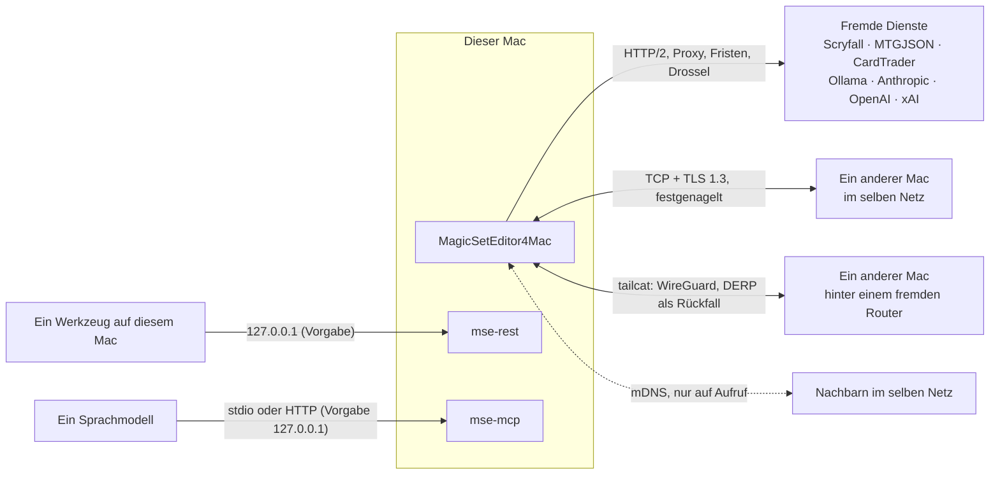

| Rolle | Protokoll | Proxy | Von selbst? |
| --- | --- | --- | --- |
| **Klient** — fremde Dienste | HTTP/2, sonst HTTP/1.1 | **ja** | nein |
| **Dienst** — `mse-rest`, `mse-mcp` | HTTP bzw. stdio | — | nein, beide starten auf Zuruf |
| **Peerleitung** — Mac zu Mac | TCP mit **TLS 1.3** | **nein** — das ist kein HTTP | nein |
| **Fernleitung** — über fremde Netze | tailcat (WireGuard) | **nein** | nein |
| **Entdeckung** — wer im Netz da ist | mDNS über UDP 5353 | **nein** | nein |

### Wie dieses Programm hinausgeht — der Proxy

**Genau drei Stellen bauen einen HTTP-Klienten**, und ein Wächter hält die
Aufzählung (`internal/werkzeuge/httpklienten_test.go`): `internal/netz` für
jeden fremden Dienst, `internal/anmeldung` für den Anmeldefluss und seit AI-05
(#2042) der
Socketklient zu Apples Gerätemodell (`internal/netz/socketklient.go`), der
nicht ins Netz geht und deshalb ohne Proxy arbeitet. Eine vierte erzwingt die
Entscheidung, statt still einen Transport mit anderen Eigenschaften
aufzumachen. Der Ablauf unten gilt für die ersten beiden.

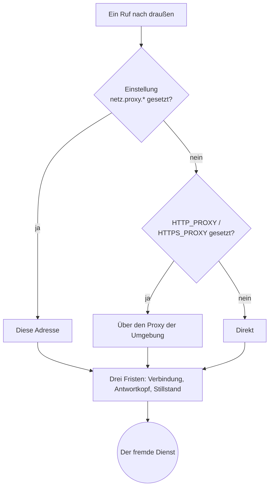

**`NO_PROXY` gilt für beide Wege.** Und die Einstellung schlägt die Umgebung:
wer sie setzt, hat entschieden.

**Die Fristen sind drei und nicht eine** — und die mittlere ist die, auf die
es ankommt:

| | Verbindung | Antwortkopf | Stillstand |
| --- | ---: | ---: | ---: |
| übliche | 15 s | 30 s | 60 s |
| Ollama | 5 s | **5 min** | 60 s |
| Anthropic | 10 s | 2 min | 60 s |
| OpenAI, xAI | 10 s | **3 min** | 2 min |

**Die Kopffrist misst bis zur Statuszeile**, und ein Bildmodell antwortet
erst, wenn es fertig ist. Wer sie zu knapp setzt, bricht den Auftrag ab,
**während der Anbieter ihn noch abrechnet**.

### Wie zwei Rechner einander finden — die Entdeckung

**mDNS, und nur auf Aufruf.** Von selbst kündigt sich nichts an, auch nach
einem Neustart nicht.

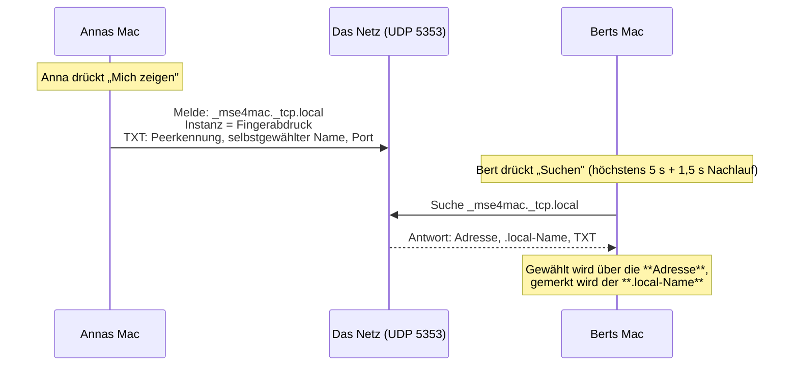

**Was hinausgeht, ist benannt**: Peerkennung, selbstgewählter Name und der
Port des Horchpostens. **Der Rechnername dieses Macs ausdrücklich nicht** —
die Bibliothek nähme ihn ohne Zutun aus `os.Hostname()`.

**Gemerkt wird der Name, gewählt wird die Adresse** (#1633):
eine IP von heute ist nach dem nächsten DHCP-Wechsel falsch.

### Wie zwei Rechner sich erkennen — die Paarung

**Die Kennung trägt den Schlüssel.** Ein Peer ist ein Ed25519-Paar, und seine
Kennung ist die eines libp2p-Peers; der **Fingerabdruck** daneben ist eine
Lesehilfe und kein zweiter Nachweis.

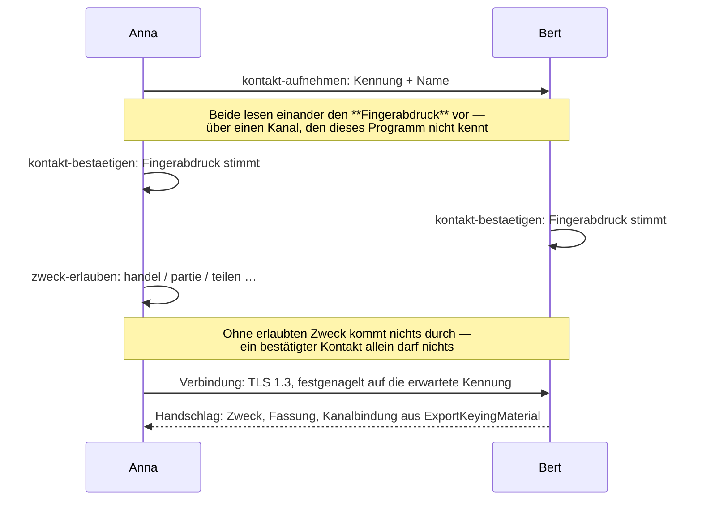

**Geprüft wird in `VerifyConnection` und nicht in `VerifyPeerCertificate`** —
und **festgenagelt auf die erwartete Kennung**, nicht auf eine
Zertifizierungsstelle. Es gibt keinen Rechnernamen im Zeugnis, und es gibt
keine CA, der jemand vertrauen müsste.

**Die Kanalbindung kommt aus `ExportKeyingMaterial`** (Marke
`mse4mac/kanal/1`, 32 Byte) und nicht aus dem Vierertupel aus Adressen und
Ports: hinter einem NAT sagt das Vierertupel über die Gegenstelle nichts.

### Worüber sie sprechen — der Transport

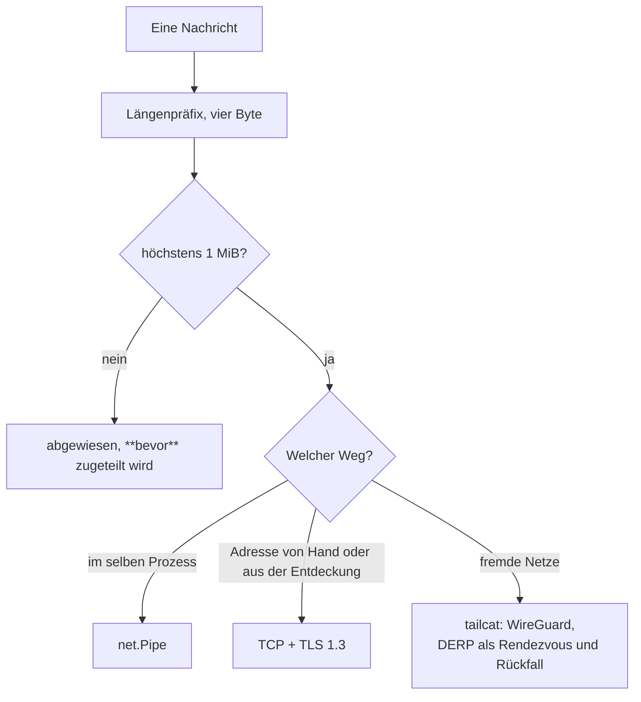

**Die behauptete Länge wird geprüft, bevor sie zugeteilt wird.** Sonst
bestimmte ein Fremder mit vier Byte den Arbeitsspeicher dieses Programms.

**Die Fristen**: 20 s zum Wählen (Verbindung **und** Handschlag), 20 s je
hereinkommender Verbindung.

**Und die Einladung für fremde Netze trägt eine Fassung**
([0114](docs/entscheidungen/0114-tailcat-gepinnt.md)): tailcats Drahtformat
darf sich ändern, und ein Bruch soll **vor** dem Wählen erkannt werden statt
als Zeitüberschreitung.

### Was hier nicht steht

**Ein Lauf über zwei echte Rechner.** Es gibt keinen
([0007](docs/entscheidungen/0007-kein-entfernter-lauf.md)); alles oben ist
über `127.0.0.1` und über `net.Pipe` gemessen — mit einer Ausnahme, die seit
dem 2026-10-07 gilt: mDNS, TLS 1.3 und der Fernweg über tailcat (gewöhnlich
und mit erzwungenem Relais) sind zusätzlich zwischen **zwei VM-Gästen** auf
diesem Mac gelaufen, im selben Netz
([`docs/belege/sec22-vmlauf.md`](docs/belege/sec22-vmlauf.md)). Was ein echtes
Netz zwischen zwei Geräten dazwischenlegt — Namensauflösung, MTU, eine
Fritz!Box, zwei Router — ist **ungeprüft**.
Die Schrittfolge für die Handprüfung steht in
`docs/ABNAHME-T12.md` (Entwicklungsarchiv).

## Die Menüleiste spricht die Sprache des Fensters

**Seit #255 ganz** (#255).
Bis dahin standen drei der Menüs englisch da — das Anwendungsmenü, „Edit" und
„Window" —, weil Wails 2 sie als Rollen mit fest verdrahteten Beschriftungen
baute ([0030](docs/entscheidungen/0030-die-menueleiste-bleibt-zur-haelfte-englisch.md)).
Wails 3 lässt einen Eintrag mit Rolle selbst beschriften, ohne dass er sein
Verhalten verliert; die Anwendung baut diese Menüs deshalb selbst, mit den
Wörtern, die macOS dafür benutzt: _Widerrufen_, _Ausschneiden_,
_Im Dock ablegen_.

**Und zwei Einträge stehen jetzt, wo macOS sie erwartet**: _Über
MagicSetEditor4Mac_ und _Einstellungen …_ (⌘,) im Anwendungsmenü — vorher
lagen sie in der Hilfe und in der Ablage, weil sich ins Anwendungsmenü von
Wails 2 nichts hängen ließ.

**Was fehlt, und warum**: „Einsetzen und Stil anpassen", das macOS sonst im
Bearbeitenmenü führt. Wails 3 gibt dieser Rolle keinen Selektor, und ein
Eintrag, der nichts tut, ist schlechter als keiner.

---

## Güte und Leistung — gemessen

**Jede Zeile trägt ihr Datum und ihren Beleg** — gemessen zwischen dem Stand
von 0.6.0 (2026-10-05) und dem 2026-10-11, nicht an einem einzigen Stand —, auf **einem** Rechner — Apple M5, 10 Kerne, 32 GB, macOS 27.0.1 —, und jede Zahl
hat einen Beleg unter [`docs/belege/`](docs/belege/). **Eine Maschine, keine
Plattform** ([0007](docs/entscheidungen/0007-kein-entfernter-lauf.md)):
ein langsamerer Mac misst langsamer, ohne dass am Code etwas anders wäre.

| Frage | Ergebnis | Beleg |
| --- | --- | --- |
| **Zeichnet sie wie MSE2?** | **nahe, aber nicht punktgleich**: gegen MSE2s eigene Rasterung seiner zehn kanonischen Sets (25.148 Karten) liegt der Abstand im Mittel bei **9,3** auf der Skala 0 bis 255 — 95-%-Band 9,19 bis 9,40 aus einer Zufallsstichprobe von 4.582 Karten; „gleich" hieße hier höchstens 1,0. Zu 0.7.0 lag er bei 13,8, zu 0.8.0 bei 9,4; gesenkt haben ihn Portierungen aus MSE2 (F02, #2302, #2315, #2396). Den Abstand tragen zu 15 % die Schrift auf 4,4 % der Fläche. Im Befundlauf über 680 Karten **kein** Portierungsfehler. Gemessen am 2026-10-20 am Stand `2b2204f` | [Der Belegstand](#der-belegstand), [Der Abstand zu Magic Set Editor 2](#der-abstand-zu-magic-set-editor-2) |
| **Wie schnell gegen MSE2?** | Öffnen **3,7-mal**, Sichern **16-mal** schneller (Archenemy, 70 Karten); bei 3.788 Karten (_Black_) 2,9- und 15-mal. Eine Karte in einer laufenden Sitzung **102 ms** gegen 43 ms bei MSE2; 70 Bilder in **6,1 s** gegen 3,1 s | [`leistungsvergleich.md`](docs/belege/leistungsvergleich.md), Lauf vom 2026-10-05 am Stand `c42b1b4ef` |
| **Und gegen 0.5.0?** | Eine Karte in der Sitzung **13-mal**, 70 Bilder **11-mal**, die Navigation durch ein Set **5- bis 8-mal** schneller; beim Öffnen (131 gegen 109 ms) und Sichern (41 gegen 39 ms) ist 0.5.0 etwas schneller | dito, Lauf vom 2026-10-05 |
| **Hält sie einen langen Lauf?** | 879 Karten am Stück ohne Fehler, Speicher stabil bei **535 MB**; MSE2 im selben Lauf 123 Fehler und **8,6 GB** Höchststand | dito, Lauf vom 2026-10-05 |
| **Was tun Dienst und Werkzeugserver unter Last?** | acht Klienten, ohne Kontingente: REST lesend **11.969 Rufe/s** (p95 1,2 ms), schreibend 1.447/s (p95 8,1 ms), MCP über stdio **31.169/s**, über HTTP 7.144/s — null Fehler, und **jede geprüfte Wirkung ist da** (Bild am Ziel, Feld im Bestand, Set nach der Einfuhr). Mit Kontingenten drosselt der Schutz eine Flut von 40.000 Rufen/s ganz, ein zweiter Klient fragt daneben ungestört, und eine Sekunde nach der Überlast antwortet der Dienst wieder | [`lastlauf.md`](docs/belege/lastlauf.md), Lauf vom 2026-10-06 (go1.27.1) |
| **Und der Tisch?** | die Rechnung der Extremszene (4 Sitze, 330 Objekte) **0,19 ms** im Median, 0,61 ms im schlechtesten von 200 Läufen — 1 % eines Bildes bei 60 Hz; am nativen Fenster **60 Bilder je Sekunde** in Ruhe und beim Verschieben (Bildabstand im Median 17 ms, höchstens 18 ms, je 300 Bilder) — und seit #2066 mit Kartenseiten und Rücken | [`TISCHLEISTUNG.md`](docs/TISCHLEISTUNG.md), [`bildrate.md`](docs/belege/huellenprobe/bildrate.md), beide vom 2026-10-09 |
| **Und der Handel?** | **funktional** über zwei Anwendungen in zwei Fenstern belegt, vom Zustimmen bis zur beidseitigen Verbuchung; eine **Leistung** ist nicht eigens gemessen — ein Handel sind wenige Nachrichten, und keine davon wartet auf eine Rechnung | [`nat04handel.md`](docs/belege/huellenprobe/nat04handel.md), Lauf vom 2026-10-09 |
| **Was taugt die KI?** | Apples Gerätemodell: von 32 Vorschlägen **20 passend**, 9 teilweise, 3 nicht (2026-10-04, zweiter Lauf mit geschärften Sätzen; ein anderer Lauf desselben Tages zählt 18 / 10 / 4, siehe [unten](#kleine-lokale-modelle-gemessen)); die kleinen lokalen Modelle unter [Kleine lokale Modelle, gemessen](#kleine-lokale-modelle-gemessen) | [`fmguete.md`](docs/belege/fmguete.md), [`modellvergleich.md`](docs/belege/modellvergleich.md) |
| **Sehen die Tests einen echten Fehler?** | **12 von 12** absichtlich eingebauten Fehlern an kritischen Wachen gefangen | [`mutationen.md`](docs/belege/mutationen.md), Lauf vom 2026-10-09 am Stand `0189cfba7` |
| **Und fremde Eingaben?** | **60 Fuzzziele, zehn Minuten je Ziel**, zusammen rund 1,6 Milliarden Ausführungen; **drei Funde**, jeder behoben und als Testfall erhalten. Gesättigt sind acht Ziele, 49 wachsen noch, drei endeten mit einem Fund (2026-10-11) | [`fuzzkampagne.md`](docs/belege/fuzzkampagne.md), Lauf vom 2026-10-11 am Stand `a397d98dc` |
| **Am nativen Fenster?** | **98 Drehbücher** am gebauten Bündel, über LaunchServices gestartet, je mit frischem Bestand und eigenem Schlüsselbund — im letzten vollen Lauf am Freigabestand `08e79ac53` (2026-10-08, ohne `ai02`) **alle grün**; einen Lauf zuvor waren es 97 von 98, und das rote (`fmt02f`) war ein Wackler der Probe, gemessen und behoben (M01, #2192). Auf dem Weg dahin fanden sie **zwei Fehler der Anwendung** (#2068, #2069) und sieben veraltete Drehbücher. Nicht dabei: die README-Bilder und das Bildmodell aus AI-02 | [`belege/huellenprobe/`](docs/belege/huellenprobe/), `ABNAHME-0.7.0.md` (Entwicklungsarchiv) |

**Wo sie langsamer ist als MSE2, steht es da**: eine einzelne Karte und das
Zeichnen vieler Bilder dauern rund doppelt so lang, und zwei der vier
Exportvorlagen brauchen länger. **Bytegleich mit MSE2** schreiben alle vier.
**Zwei Befunde des Laufs gelten 0.5.0**: es schrieb `magic-text` und
`magic-mws` anders als MSE2 — der Fehler, den #2006 behob.

**Was diese Zahlen nicht sagen**: wie es sich am Fenster anfühlt. Die Wege
oben laufen über die Kommandozeile und den Dienst; was das Fenster dazutut,
misst die Hüllenprobe nur als „geht" oder „geht nicht".

## Der Umfang, gezählt

**Erhoben am 2026-11-15 am Stand von 1.0.0** — die Zeilen, das
Verhältnis von Test zu Produktiv und die Zahl der Go-Funktionen samt ihrer
mittleren Komplexität. Nachrechnen: `make kennzahlen` — diese Zahlen sind
seine Ausgabe und nicht abgeschrieben. **Der Kommentaranteil und die
Verteilung der Komplexität stammen vom 2026-09-20**; der Wächter hält sie
nicht, und sie stehen deshalb mit ihrem Datum da.

| Sprache                                         | Art         | Zeilen ohne Kommentar |
| ----------------------------------------------- | ----------- | --------------------: |
| Go                                              | Produktiv   |               219.036 |
| Go                                              | Test        |               450.806 |
| TypeScript und TSX                              | Produktiv   |               159.045 |
| TypeScript und TSX                              | Test        |               167.578 |
| Übriges (JSON, SQL, Shell, JS, CSS, YAML, HTML) |             |                98.481 |
| **Quelltext gesamt**                            | **1.094.946** |                     |
| **Dokumentation**                               | **65.369** |           in Markdown |

**Quelltext und Dokumentation getrennt**, und das ist keine Förmlichkeit:
zusammengezählt wäre die Zahl größer und sagte weniger — über 60.000 Zeilen
Fließtext sind kein Programm. **Der TypeScript-Produktivcode trägt rund
39.000 Zeilen Wörter**: die sechs maschinell übersetzten Sprachkataloge. Bis
1.0.0 trug „Übriges" zudem rund 31.000 Zeilen JSON aus den Audits; die liegen
seither im Entwicklungsarchiv.

**Was daran etwas sagt, sind nicht die absoluten Zahlen, sondern die
Verhältnisse:**

|                                     |            |
| ----------------------------------- | ---------: |
| Test zu Produktiv, Go               |   **2,06** |
| Test zu Produktiv, Frontend         |   **1,05** |
| Kommentaranteil im Go-Produktivcode | **40,7 %** (2026-09-20) |

Der Kommentaranteil ist Absicht: Kommentare erklären hier **warum**, nicht
**was** — und ein Vermerk am Code ist der Ort, an dem eine Entscheidung
gefunden wird, wenn jemand sie später hinterfragt.

**Zyklomatische Komplexität** — über den Go-AST gezählt (`if`, `for`, `case`,
`&&`, `||`), nicht geschätzt. **Zahl und Mittel im Produktivcode vom
2026-10-18**, alles Übrige vom 2026-09-20:

|               |    Produktivcode | Testcode |
| ------------- | ---------------: | -------: |
| Funktionen    |           12.822 |   17.522 |
| Mittel        |         **3,12** |     3,76 |
| 1–5 (einfach) |           87,5 % |   82,1 % |
| 6–10          |           11,4 % |   15,4 % |
| 11–20         |            1,1 % |    2,4 % |
| über 20       | **7 Funktionen** |       19 |

Die über 20 sind durchweg **Befehlszerleger und Zuordnungstabellen** — breite
`switch`, keine verschachtelte Logik. Die höchste ist
`cmd/mse/lauf.go:fuehreAus`: ein `case` je Befehl der Kommandozeile.

**Geprüft wird mit** 14.555 Go-Testfunktionen (dazu 3.066 `t.Run`-Aufrufe und
60 Fuzzziele; gezählt am 2026-10-11 mit `git grep` am Stand `25296c0f9`) und
8.929 Oberflächentests in 1.065 Dateien (gemessen am 2026-10-08 beim Heben von
Vitest auf die Hauptfassung 5, siehe `AGENTS.md` §1). Die
Schwellen stehen in `scripts/ci.sh`: **100 %** in den Kernpaketen, 90 % im
Gesamtprojekt, **100 %** im Frontend in Anweisungen, Zweigen, Funktionen und
Zeilen.

**Und der Rest in Zahlen** (2026-10-05; Migrationen, Pakete und
Bildschirmabzüge am 2026-10-11 nachgezählt, Vermerke am 2026-10-12, Migrationen
am 2026-10-19): 101 Migrationen, 48 Pakete unter
`internal/`, 189 Entscheidungsvermerke, 1.235 Commits auf `main` mit der
Freigabe 0.6.0, 69 Bildschirmabzüge.

**Und die vier Flächen, gezählt am 2026-10-14** — die Zahlen stehen unter einem
Wächter, der sie aus [`docs/FAEHIGKEITEN.md`](docs/FAEHIGKEITEN.md) gegen den
Quelltext hält:

|                                       |     Wege |
| ------------------------------------- | -------: |
| Bindungen am **Fenster**              |  **545** |
| Endpunkte im **Dienst** (REST)        |  **378** |
| Werkzeuge über **MCP**                |  **326** |
| Befehle auf der **Kommandozeile**     |  **270** |
| **Benannte Fähigkeiten** dahinter     |  **373** |

**Die vier Zahlen sind nicht die Fähigkeiten.** Eine Fähigkeit kann an einer
Fläche mehrere Wege haben und an einer anderen keinen; **was wo fehlt**, steht
dort in einer eigenen Tabelle — 3 am Fenster, 62 an der Kommandozeile, 69 im
Dienst, 115 über MCP —, und jede Lücke nennt ihren Grund.

## Wie weit die Spielregeln umgesetzt sind

**Gemessen gegen die Comprehensive Rules, Fassung 2026-08-19** — gegen das
Regelwerk selbst und nicht gegen eine Vorstellung davon, was dazugehört.
**Abgeglichen mit der Fassung 2026-09-25** am selben Tag: sechs Regeln
geändert, elf neu, sieben fort, keine davon trifft eine umgesetzte
([`docs/REGELABDECKUNG.md`](docs/REGELABDECKUNG.md), §1). Die
Sicht steht Kapitel für Kapitel in
[`docs/REGELABDECKUNG.md`](docs/REGELABDECKUNG.md): je Kapitel ein Stand, bei
jedem umgesetzten die Zeile, an der es geschieht, und bei jedem offenen das
Werkstück, das es baut — oder die Feststellung, dass keines es baut.

| Stand           | Kapitel |
| --------------- | ------: |
| umgesetzt       |       0 |
| teilweise       |      83 |
| offen           |      46 |
| trifft nicht zu |      18 |

**147 Kapitel, 3.162 nummerierte Regeln** — 1.173 Hauptregeln und 1.989
Unterregeln, gezählt über den Rumpf der Textfassung von `1. Game Concepts` bis
vor das Glossar. Achtzehn Kapitel treffen nicht zu, weil sie außerhalb des
Umfangs liegen; bleiben **129 einschlägige**, von denen heute **83 teilweise**
getragen werden und **keines ganz**.

**Die Null in der ersten Zeile ist die Aussage.** Es gibt kein einziges
Kapitel, das dieses Programm vollständig trägt — auch keinen der **zehn**
Bereiche, die das Grundprofil als `automatisch` führt. Was es seit dem
2026-09-17 gibt, ist ein **Sandkasten mit einer Uhr**: er bewegt Karten
zwischen Zonen, tappt, dreht um, schreibt jeden Zug mit — und läuft die
zwölf Abschnitte eines Zuges ab, vergibt Priorität, enttappt, zieht, lässt
auf die Handgrenze abwerfen und stellt fest, wann eine Partie gewonnen,
verloren oder unentschieden ist. Und **was die Karten sind**, weiß er seither
auch: Typzeile, Manakosten, Farbe, Stärke und Widerstandskraft sind Daten
statt Prosa, und eine 2/3 mit zwei +1/+1-Marken ist 4/5. Und **Mana** kennt er
seit `M3` (#1605):
ein Grundland tappt für sein Mana, der Vorrat steht an jeder Fläche und leert
sich am Ende jedes Abschnitts. **Und seit `M4`**
(#1606)
wird gewirkt: ein Zauber wird angekündigt, bezahlt und auf den Stapel gelegt,
seine Ziele werden beim Verrechnen noch einmal geprüft, und ein Land kommt
einmal je Zug ohne Stapel auf den Tisch. **Und seit `M6`**
(#1608)
wird gekämpft: Angreifer und Blocker werden erklärt, der Kampfschaden
geschieht von selbst und **gleichzeitig**, wer Erstschlag hat, teilt in einem
eigenen Schritt aus, und was in diesem Zug gekommen ist, greift nicht an. Was
die Karten **tun**, weiß er weiterhin nicht — dafür braucht es die
Fähigkeiten.

**Und die Zahl ist grob, mit Absicht.** Ein Kapitel gilt erst als umgesetzt,
wenn **jede** seiner Regeln trägt — CR 702 hat 771 Regeln, CR 203 genau eine.
Wer aus „46 offen" einen Aufwand ableitet, hat sie überdehnt; die Regelzahl
steht deshalb in der Sicht neben jedem Abschnitt und neben jedem Werkstück.

### Eine Ebene feiner: die Regeln selbst

**Gezählt am 2026-09-24** über den Go-Quelltext unter `internal/` und `cmd/`:
wie viele **einzelne Regelnummern** dieses Programm an der Stelle nennt, an
der es sie umsetzt.

|                                                 |    Zahl |
| ----------------------------------------------- | ------: |
| Nummerierte Regeln der CR (Fassung 2026-08-19)   | **3.162** |
| **Am Code genannte Regelnummern**                |   **449** |
| davon Unterregeln (`608.2c` statt `608`)         |     378 |
| Kapitel, aus denen mindestens eine genannt ist   |      100 |

**Wo sie sich häufen** — die zehn meistgenannten Kapitel:

| Kapitel | genannte Regeln |
| --- | ---: |
| CR 702 — Keyword Abilities | 37 |
| CR 701 — Keyword Actions | 23 |
| CR 704 — State-Based Actions | 20 |
| CR 613 — Interaction of Continuous Effects | 17 |
| CR 903 — Commander | 14 |
| CR 205 — Type Line · CR 202 — Mana Cost | je 12 |
| CR 107 — Numbers and Symbols | 11 |
| CR 601 — Casting Spells | 10 |
| CR 608 — Resolving · CR 603 — Triggered Abilities · CR 104 — Ending the Game | je 9 |

**Was diese Zahl sagt — und was nicht** (§10, „die Reichweite einer Messung
ist die Reichweite ihrer Aussage"): sie zählt **Nennungen am Code**, nicht
umgesetzte Regeln. Eine genannte Nummer heißt: hier steht Verhalten, und es
beruft sich auf **diese** Regel. Sie heißt **nicht**, dass die Regel
vollständig trägt — die Grenzen dazu stehen in der Regelmatrix, und was ein
Kapitel als Ganzes hält, steht in der Tabelle darüber.

**Sie heißt auch nicht „449 von 3.162 sind fertig".** Ein Kapitel kann mit
drei genannten Regeln praktisch vollständig sein (CR 203 hat eine) und mit
siebenunddreißig noch weit offen (CR 702 hat 771). Die Zahl ist ein Maß für
**Belegdichte**, nicht für Fortschritt.

**Und sie steht unter einem Wächter** — `internal/werkzeuge/regelnennungen_test.go`
zählt sie aus dem Quelltext und hält sie gegen diesen Abschnitt.

**Wohin es geht**: die Zugstruktur nach CR 500 steht seit G9
(#1592), und
die Regelmaschine aus Phase 5.5
(#1593) ist am
2026-09-18 abgeschlossen — in achtundzwanzig Werkstücken. Was offen bleibt,
führt [`docs/REGELABDECKUNG.md`](docs/REGELABDECKUNG.md) Kapitel für Kapitel,
jedes mit dem Werkstück, das es baut, oder der Feststellung, dass keines es
baut.

**Die Zahlen hier stehen unter einem Wächter** —
`internal/werkzeuge/regelabdeckung_test.go` zählt die Kapitelzeilen der Sicht
und hält sie gegen diese Tabelle und gegen die Zusammenfassung dort. Was er
**nicht** hält: ob ein Stand stimmt. Er zählt Zeilen, er liest sie nicht.

## Der Belegstand

**Die Zahlen dieses Abschnitts und des folgenden stammen aus einem Beleg** —
`docs/belege/fremdpakete.json`, geschrieben von `make fremdpakete` (QA-01,
#1733). Ein
Wächter hält jede Zeile hier gegen ihn (`internal/werkzeuge/belegstand_test.go`);
ob er noch zum Stand passt — samt Arbeitsbaum und Eingaben —, sagt
`make belege`, und jeder grüne `make ci` nennt ihn in seiner Reichweite, ohne
die Eingaben zu rechnen.

| Lauf | Stand | Commit | gemessen am | Fälle |
| --- | --- | --- | --- | ---: |
| `fremdpakete` | **PASS** | `3b89bed` | 2026-10-21 | 83 von 92 |

**Was der Kanonlauf meldete** — der Befundlauf über eine feste Auswahl von 68
Karten je Satz und die Zufallsstichprobe (QA-02,
#1734),
nebeneinander und nicht vermischt:

| | Befundlauf, 68 je Satz | Zufallsstichprobe |
| --- | ---: | ---: |
| Karten gezeichnet | **680** | **4.582** |
| Befunde der Art `Portierung` | **0** | **0** |
| Befunde der Art `Vorlage` | **0** | **3** |
| Befunde der Art `Umgebung` | **0** | **0** |

**Null, weil jede Eingabe dalag — und ohne sie heute auch.** Die Abnahme zu
0.5.0 zählte an derselben Stelle 679 Befunde der Art `Portierung` und 6.286 der
Art `Umgebung` (#1656);
alle folgten aus der fehlenden Schriftwurzel. **Die 679 hatten zwei
Ursachen** (QA-03): 426 waren eine fehlende Schrift auf einem Symbol, gemeldet
als fehlendes Symbolbild — jetzt ein Befund der Art `Umgebung`, wie es richtig
ist —, und 253 ein echter Fehler im Zerteiler, der Vorrang von `or else`, der
erst ohne Schriften sichtbar wurde und behoben ist. Ohne Schriftwurzel meldet
derselbe Lauf heute **0** `Portierung`, **0** `Vorlage` und **6.712**
`Umgebung`, und jede nennt die Schrift, die fehlt. Seit dem Beleg ist die
Schriftwurzel eine Pflichteingabe: fehlt sie, wird gar nicht gemessen.

## Der Abstand zu Magic Set Editor 2

**Der einzige Vergleich dieses Projekts gegen einen fremden Maßstab.** Alle
anderen Goldbilder prüfen es gegen sich selbst; hier stehen **MSE2s eigene
Sets** und **MSE2s eigene Rasterung** daneben.

**Erhoben am 2026-09-07**, Laufzeit 24 Minuten. Wie gemessen wird — das Maß,
die Stichprobe und der Schätzer, jeweils mit ihren Gleichungen —, steht in
[`docs/MESSMETHODIK.md`](docs/MESSMETHODIK.md).

**Und für die Freigabe 0.5.0 am 2026-09-20 neu erhoben**, Laufzeit 22 Minuten:
MSE2 hat die zehn Sätze noch einmal selbst gerastert (25.148 Bilder), und
**jede Zahl dieses Abschnitts kam bis auf die vierte Nachkommastelle wieder
heraus** — bis hin zur Zerlegung und zu Minimum und Maximum. Das ist keine
Selbstverständlichkeit, sondern die Probe darauf, dass die Stichprobe **ohne
Zufall** gezogen wird: derselbe Quelltext, dieselben Karten, dieselbe Zahl.
An der Rasterung hat sich seit 0.4.0 keine Zeile geändert.

**Am 2026-09-23 hat sie sich geändert**, zum ersten Mal seit 0.4.0 (QA-03,
#1656):
Kartennamen kernen mit den Klassenpaaren ihrer Schrift und setzen ihre
Ligaturen, Text wird wie bei MSE2 vierfach gezeichnet, auf Viertelpunkten, und
heruntergerechnet, und die Schriftglättung von Quartz ist nachgebildet
(#1805,
#1806). Das
Kanonmittel fiel von **20,056 auf 13,792**; die Schritte dorthin stehen in
[`docs/SCHRIFTUNTERSUCHUNG.md`](docs/SCHRIFTUNTERSUCHUNG.md), und alle Zahlen
darunter stammen aus dem Beleg danach.

**Am 2026-10-11 wieder**, mit F02
(#2244): von
**13,792 auf 11,470**, gegen eine Grundlinie, die vorher mit derselben
MSE2-Ausgabe, denselben Schriften und demselben Plan gemessen wurde
([0188](docs/entscheidungen/0188-das-ziel-fuer-f02.md)). Es sind Portierungen
aus MSE2 und keine Stellschrauben — die Maske eines Textfelds bestimmt die
Breite jeder Zeile, Symbole messen in ganzen Punkten, die Maßstabssuche endet
wie bei MSE2, Textschatten, Kursivschnitte und das Maß einer Wahl kommen aus
dem Quelltext, und wo eine Zahl strittig war, aus einem Orakelstil, den MSE2
selbst zeichnet. Von 4.266 Karten wurden 4.195 besser, 52 blieben gleich und **19 wurden schlechter**,
alle an einem Zeilenumbruch, der noch anders kippt
(#2302).

**Am 2026-10-12, am Stand `e48f6d9`, nachgemessen: 10,686.**
Zwischen beiden Läufen liegen aus J05
(#2269) das
einzeilige Feld, das wie bei MSE2 nur an einem harten Umbruch bricht, und
`symbol_variation`, das Farben auch als Text nimmt. Welcher Teil auf welches
fällt, ist nicht getrennt gemessen; gewonnen haben die sieben Farbsets der
M15-Karten, die Überformate stehen gleich.

**Am selben Tag, nach den Folgen der Kontrolle J05: 10,540.** Gewonnen hat
der Satz eines gestauchten Felds
(#2308):
es bricht erst um und wird dann gestaucht, gefüllt wird je Zeile, und jede
Schriftgröße liegt wie bei MSE2 auf einem Viertelpunkt. **Nicht jede Karte
gewann**: die Namen der Vanguard-Avatare stehen seitdem um bis zu sechs
schlechter, weil ein gestauchtes Feld jetzt Wort für Wort gezeichnet wird und
MSE2 eine Zeile in einem Zug zeichnet
(#2302).
Am Stand `9e15231` gemessen.

**Und danach: 9,427.** Eine Zeile wird wie bei MSE2 je Schriftlauf in einem
Zug gezeichnet, nicht mehr Wort für Wort an gerundeten Stellen
(#2302);
der Puffer eines Zugs ist so breit wie sein gezeichneter Text. Damit steht
das Kernpaar über einer Lücke wieder im Bild, und die Namen der
Vanguard-Avatare sind besser als je zuvor. Karte für Karte gegen die
Grundlinie aus 0188 sind noch **sechs** schlechter, aus derselben Ursache
wie in #2302 eingegrenzt
(#2315).
Am Stand `77f8e07` gemessen.

**Und seit #2315: 9,328.** Die sechs Karten verkleinerten nicht anders — am
Orakel gefragt, zeichnet MSE2 sie im selben Maßstab. Sie zeichneten falsche
Symbole: `in_context` wirkte nicht, und auf der Rückfalllinie der regulären
Ausdrücke galten keine POSIX-Klassen. Beides ist aus MSE2 portiert; die sechs
stehen jetzt bei 7,2 bis 9,0 statt 15,5 bis 20,1. **Zwei Karten sind gegen
0188 schlechter, und das war entschieden**: MSE2 setzt den Text einer
Klassenkarte beim Laden aus den gespeicherten Stufentexten zusammen, diese
Anwendung tat es aus den gerechneten, wie MSE2 nach einer Bearbeitung.

**Seit #2396 nicht mehr**
([0203](docs/entscheidungen/0203-gespeichert-wird-was-gerechnet-ist.md)):
gespeichert wird, was gerechnet ist, und das Zeichnen rechnet wie MSE2 beim
Laden. Karte für Karte gemessen am 2026-10-20: **zwölf Karten näher an MSE2,
keine weiter weg** — zehn Planeswalker, Warlock Class und Cleric Class —, Kanonmittel
9,319 statt 9,328. Die Zahlen darunter stammen aus dem Lauf der
Gesamtabnahme
(#2382,
`docs/belege/fremdpakete.json`, Stand `2b2204f`, 2026-10-20).

**Seit dem 2026-09-23 steht daneben eine zweite Kohorte** (QA-02,
#1734).
Eine Auswahl ohne Zufall sagt, ob sich die Zahl **bewegt**; ein
Vertrauensband und eine Entdeckungszusage trägt sie nicht, denn beide setzen
eine Zufallsauswahl voraus. Die feste Kohorte bleibt deshalb unverändert als
Verlauf, und eine einmal gezogene Zufallsstichprobe trägt die Schätzung — beide
getrennt berichtet, beide aus demselben Beleg.

### Was gemessen wird

**Zwei Rasterungen derselben Datei**, Bildpunkt für Bildpunkt:

```
  d  =  √( Σ (unser − MSE2)² / (P · C) )        P = Bildpunkte, C = 3 Kanäle
```

Die Wurzel aus der mittleren quadrierten Kanaldifferenz, auf der Skala **0 bis
255**. Null heißt punktgleich; die Toleranz, bis zu der zwei Bilder in diesem
Projekt gleich heißen, ist **1,0**.

**Das misst nicht, ob die Karte richtig ist** — es misst, wie weit zwei
Rasterungen **derselben Beschreibung** auseinanderliegen.

### Die feste Kohorte — der Verlauf

**Dieselben Karten in jedem Lauf**, systematisch über jede Kartenliste
verteilt: sie sagt, ob sich die Zahl **bewegt** hat. **Beschreibend und ohne
Vertrauensband** — ein Band setzt eine Zufallsauswahl voraus, und diese ist
keine (QA-02.AK-03).

| | |
| --- | ---: |
| Grundgesamtheit | **25.148** Karten in zehn Sets |
| Feste Kohorte | **4.266** Karten (16,96 %) |
| **Kanonmittel, gewichtet** | **9,319** |

| | | | |
| --- | ---: | --- | ---: |
| Median | 8,577 | Standardabweichung | 4,345 |
| Minimum | 1,691 | Maximum | 49,040 |
| Q1 (25 %) | 7,460 | Q3 (75 %) | 9,593 |
| Interquartilsabstand | 2,132 | Streuung | 18,883 |
| P90 | 11,353 | P95 | 14,006 |
| **P99** | **33,945** | | |

### Die Zufallsstichprobe — die Schätzung

**Einmal zufällig gezogen und gespeichert** (`docs/belege/kanonstichprobe.json`),
je Satz so groß, dass sie jeden Fehler, der ein Prozent seiner Karten betrifft,
mit 99,9 Prozent trifft — exakt hypergeometrisch gerechnet. **Sie trägt das
Band**, weil ihre Ziehung erfüllt, was es voraussetzt.

| | |
| --- | ---: |
| Zufallsstichprobe | **4.582** Karten (18,22 %) |
| **Kanonmittel** | **9,293** |
| Standardfehler | 0,054 |
| **95-%-Band** | **[9,186 · 9,399]** |
| Sicherheit je Satz, mindestens | 99,90 % |
| Sicherheit über alle zehn zugleich | 99,25 % |

### Wie die Zahlen zu lesen sind

**Der Median liegt unter dem Mittel** (8,58 gegen 9,33): die Verteilung ist
rechtsschief, einzelne Ausreißer ziehen das Mittel hoch. **Die mittlere Hälfte
aller Karten liegt in einem Band von 2,1** — die Rasterung ist gleichmäßig, und
das Maximum von 49 ist kein Normalfall.

**P99 sagt, wie schlimm der schlechte Rand ist**: ein Prozent der Karten liegt
über 33,9. Ein Maximum allein könnte eine einzige Karte sein; das Perzentil
sagt, wie viele es sind.

**Der Standardfehler von 0,054 ist keine Streuung der Karten**, sondern die
Genauigkeit des Schätzers — und er gehört zur **Zufallsstichprobe**: das
Kanonmittel liegt mit 95 % Sicherheit zwischen 9,19 und 9,40. Die Karten
selbst streuen mit 4,35 — zwei Zahlen, zwei Fragen, und sie zu verwechseln ist
der häufigste Fehler mit einer Stichprobe.

**Hier stand bis QA-02 ein Band um das Mittel der festen Kohorte**, und es war
keines: die Formel dahinter setzt voraus, dass jede Karte mit derselben
Wahrscheinlichkeit gezogen werden konnte, und eine systematische Auswahl
erfüllt das nicht. Beide Mittel liegen nahe beieinander — 9,319 fest, 9,293
zufällig —, und das ist ein Befund über die feste Kohorte, keine
Rechtfertigung für ein Band.

### Wo der Abstand sitzt

| Ebenenart | Anteil am Abstand | eigener Abstand | Flächenanteil |
| --- | ---: | ---: | ---: |
| Bild | 82,36 % | 9,63 | 93,03 % |
| Text | 15,27 % | 18,97 | 4,44 % |
| Symbolzug | 1,77 % | 25,15 | 0,29 % |
| Fläche | 0,60 % | 5,31 | 2,24 % |

**Der Text trägt 15 Prozent des Abstands auf 4,4 Prozent der Fläche**, bei
einem eigenen Abstand von 19,0 — seit `in_context` wirkt (#2315); davor 17
Prozent bei 20,0, seit eine Zeile in einem Zug gezeichnet wird, davor 29
Prozent bei 28,9, am Stand `e48f6d9` 31 Prozent bei 30,6,
nach F02 33 Prozent bei 34, vor F02 42
Prozent bei 45, vor QA-03 56 Prozent bei 75. **Mit F02 fiel der Symbolzug am
stärksten**: 1,2 statt 5,9 Prozent,
sein eigener Abstand 25 statt 65 — die Symbole im Text messen jetzt in ganzen
Punkten wie bei MSE2. **Die Bilder tragen zwei Drittel**, und zwar nicht,
weil sie schlechter wurden — ihr eigener Abstand liegt bei 9,7, nach F02 bei
10,2 und davor bei 11,0 —,
sondern weil Text und Symbole aufgeholt haben.

**Und es ist kein Versatz.** Über alle 4.266 Karten gewinnt **keine** durch
eine Verschiebung der ganzen Karte. Der Text sitzt bei 27 Karten (0,6 %) um
ein bis zwei Punkte anders — am Vormittag bei 55, nach F02 bei 57, vor F02
bei 93, vor QA-03 bei 468; bei 15 davon liegt das Optimum am Rand des
Suchbereichs, dort ist der Gewinn eine Untergrenze. **An ihnen verliert die Glättung**: kräftigerer Text an falscher
Stelle kostet mehr, und die schlechteste Karte je Satz wird um 1 bis 3
schlechter — acht der neun stehen in dieser Versatzprobe.

### Je Set

| Set | Karten | Stichprobe | Mittel | Median | Q1 | Q3 | σ |
| --- | ---: | ---: | ---: | ---: | ---: | ---: | ---: |
| Vanguard | 107 | 93 | 2,830 | 2,345 | 1,980 | 3,182 | 2,555 |
| Planechase | 86 | 77 | 6,742 | 6,677 | 6,488 | 7,007 | 0,380 |
| Archenemy | 70 | 64 | 8,202 | 8,195 | 8,018 | 8,333 | 0,331 |
| Black | 3.788 | 582 | 8,659 | 8,507 | 7,451 | 9,429 | 2,327 |
| Red | 3.730 | 581 | 8,851 | 8,464 | 7,475 | 9,490 | 3,019 |
| Green | 3.689 | 580 | 8,895 | 8,716 | 7,621 | 9,577 | 2,652 |
| Blue | 3.693 | 580 | 8,973 | 8,622 | 7,555 | 9,503 | 2,912 |
| White | 3.761 | 582 | 9,055 | 8,681 | 7,666 | 9,546 | 3,003 |
| Multicolor | 3.008 | 560 | 10,209 | 9,059 | 7,657 | 13,083 | 4,127 |
| Colorless | 3.216 | 567 | 12,151 | 8,277 | 7,165 | 9,984 | 9,241 |

**Ein Set streut weiter als die übrigen.** `Colorless` — σ 9,2 statt 0,3
bis 4,1, und Mittel und Median klaffen um 3,9 auseinander statt um höchstens
1,2. Das ist der Fingerabdruck einer **gemischten Menge**: Colorless bringt
Artefakte **und** Länder mit Artefakt-Blendmaske. `Vanguard` streute bis zu
den Folgen von J05 ebenso weit (σ 6,2); seit eine Zeile in einem Zug
gezeichnet wird, liegen seine Karten eng beieinander und nah an MSE2. Eine Standardabweichung ist hier also ein
Befund über die Menge, nicht bloß eine Streuungsangabe.

**Die Überformate sind die besten Sets** — Vanguard 2,8, Planechase 6,7 und
Archenemy 8,2.
Sie tragen wenig Text, und der Text ist eine Hauptquelle des Abstands.
`Multicolor` zählt eine Karte mehr als vor QA-03: *Phoebe, Head of S.N.E.A.K.*
fand ihr Referenzbild erst, seit MSEs Dateiname hier nachgebildet ist.

### Je Vorlage

| Vorlage | Karten | Mittel | schlechteste |
| --- | ---: | ---: | ---: |
| m15-aftermath | 6 | 23,628 | 26,273 |
| m15-mainframe-dfc | 47 | 12,329 | 33,854 |
| m15-adventure | 7 | 10,148 | 11,591 |
| m15-mainframe-planeswalker | 42 | 10,031 | 17,673 |
| m15-split-fusable | 12 | 9,701 | 13,727 |
| m15-altered | 3.900 | 9,457 | 49,040 |
| m15-saga | 15 | 8,258 | 10,990 |
| archenemy | 64 | 8,202 | 8,994 |
| m15-mainframe-planes | 77 | 6,742 | 8,388 |
| m15-vanguard | 93 | 2,830 | 26,244 |
| (seltenere zusammen) | 3 | 28,854 | — |

**`m15-altered` trägt 91 Prozent der Stichprobe** — die gewöhnliche M15-Karte,
an der sich entscheidet, ob dieses Programm eine echte Magic-Karte zeichnet.
Ihr Mittel von 9,46 ist praktisch das Kanonmittel.

**Die Zeilen mit sechs oder sieben Karten sagen wenig.** Sie stehen hier, weil
eine fehlende Zeile schlimmer wäre als eine dünne — aber ein Mittel über sechs
Karten ist ein Hinweis und kein Maß.

## Kleine lokale Modelle, gemessen

**Fünf kleine Modelle, je für ihren Zweck, an einem Rechner gemessen und
danach wieder gelöscht** (AI-02,
#1743) —
am 2026-10-04 auf einem Apple M5 mit 32 GB unter macOS 27.0.1, mit
**Ollama 0.35.1** aus Homebrew. Gefragt wurde über die Klienten der
Anwendung, nicht an ihnen vorbei; das Gerätemodell des Macs (`fm serve`)
lief zum Vergleich mit. Die Belege:
[`modellmessung.md`](docs/belege/modellmessung.md) (Pinnung, Laden,
Speicher), [`modellvergleich.md`](docs/belege/modellvergleich.md) (Text,
jede Antwort einzeln bewertet) und der Lauf vom 2026-10-04 in
[`RETRIEVALMESSUNG.md`](docs/RETRIEVALMESSUNG.md) (Einbettung).

| Modell | Zweck | Download | Quantisierung | Lizenz | Digest |
| --- | --- | ---: | --- | --- | --- |
| `qwen3:0.6b` | Text | 523 MB | Q4_K_M | Apache 2.0 | `7df6b6e09427` |
| `gemma3:1b` | Text | 815 MB | Q4_K_M | Gemma Terms of Use | `8648f39daa8f` |
| `all-minilm:22m` | Einbettung | 46 MB | F16 | Apache 2.0 | `1b226e2802db` |
| `embeddinggemma:300m` | Einbettung | 622 MB | BF16 | Gemma Terms of Use | `85462619ee72` |
| `x/flux2-klein:4b` | Bild | 5.727 MB | — | Apache 2.0 | `50a0c0ab15ac` |

### Laden und Speicher

Je Modell allein, mit allen anderen entladen; drei Kaltstarts. **Speicher**
ist der Spitzenwert des rechnenden Prozesses samt GPU-Puffern **plus** die
eingeblendeten Gewichte — die zählen nicht zum Fußabdruck des Prozesses, und
ohne sie sähe gemma3:1b mit 333 MB kleiner aus als seine eigene Datei.
Speicher und Ladezeit kamen in drei Läufen aufs Megabyte gleich wieder; der
Durchsatz nicht — gemma3:1b maß 132, 90 und 111 Token/s.

| Modell | Ladezeit (Median) | Speicher | Fenster, das Ollama anlegt | Leistung |
| --- | ---: | ---: | ---: | --- |
| `qwen3:0.6b` | 0,77 s | **4.408 MB** | 32.768 Token | 216 Token/s |
| `gemma3:1b` | 0,54 s | 1.158 MB | 32.768 Token | 111 Token/s |
| `all-minilm:22m` | 0,26 s | 164 MB | 256 Token | 120 Texte in 0,52 s |
| `embeddinggemma:300m` | 0,52 s | 830 MB | 2.048 Token | 120 Texte in 1,46 s |

**Das kleinste Textmodell braucht den meisten Speicher.** qwen3:0.6b lädt
523 MB und belegt 4,4 GB: Ollama legt ein Fenster von 32.768 Token an, und
der eigene Speicher des Prozesses — vor allem der Zwischenspeicher für dieses
Fenster — liegt bei qwen3 bei 3,9 GB, bei gemma3 bei 0,3 GB. Alle vier
zusammen kämen auf rund 6,6 GB; gemessen ist das nur auf diesem Mac.
**Stabil war jedes**: drei Kaltstarts, bei den Textmodellen zehn Antworten
mit festem Startwert (alle wörtlich gleich) und 64 Fragen über die
Anwendung, bei den Einbettungsmodellen 120 Texte und ein ganzer
Retrievallauf — ohne einen Fehler.

### Text: Kartennamen und Flavortexte

Dieselben 32 Fragen wie für das Gerätemodell — acht selbst geschriebene
Karten, Name und Flavortext, Deutsch und Englisch —, zwei Runden. **Ob ein
Vorschlag passt**, hat Claude (Opus 5.5) je Antwort bewertet und nicht der
Auftraggeber: *ja* — so oder fast so auf die Karte; *teils* — ein Anstoß;
*nein* — Typ, Regeltext, Echo des Auftrags oder falsche Sprache. **Beleg ist
[`modellvergleich.md`](docs/belege/modellvergleich.md), Lauf vom 2026-10-04**
(zwei Runden über 32 Fragen); das Gerätemodell steht dort mit 18 / 10 / 4, in
[`fmguete.md`](docs/belege/fmguete.md) — einem anderen Lauf desselben Tages, oben
in „Güte und Leistung“ — mit 20 / 9 / 3. Warum die zwei Läufe abweichen, ist
nicht untersucht (nicht geprüft am 2026-10-11).

| Modell | in Form | passt: ja / teils / nein | Antwort, Median | zwei Runden gleich |
| --- | ---: | --- | ---: | ---: |
| Gerätemodell (`fm`) | 64 von 64 | **18** / 10 / 4 | 0,61 s | 8 von 32 |
| `gemma3:1b` | 64 von 64 | 9 / 14 / 9 | 0,31 s | 32 von 32 |
| `qwen3:0.6b` | 64 von 64 | **0** / 7 / 25 | 0,12 s | 32 von 32 |

**In Form antworten alle, passend nur eines.** qwen3:0.6b gibt als Namen den
Kartentyp — „Golem", „Land", „Artefakt" —, auf Englisch gefragt fünfmal
von acht das deutsche Wort, und beschreibt im Flavortext den Auftrag, statt
ihn zu erfüllen. gemma3:1b schreibt brauchbare Flavortexte und schwache
Namen. **Das Gerätemodell bleibt vorn**, und es hat hier schon Vorrang
(AI-05).

**Ein Befund unterwegs, behoben**: qwen3 kann denken, und **ohne
ausdrückliches Nein denkt es** — der Adapter schickte kein `think`.
Über die 32 Fragen dachte qwen3 im Median 267 Token und 1,8 s vor jeder
Antwort, und eine Frage hatte nach drei Minuten noch keinen Inhalt. Mit
`"think": false` sind es 14 Token und 0,16 s, keine Frage über eine halbe
Sekunde — und so fragt die Anwendung jetzt immer
(Vermerk [0098](docs/entscheidungen/0098-was-ollama-belegt-und-was-nicht.md)).
**Und ohne Wahl nimmt der Vorrang das zuletzt gezogene Textmodell** —
wer beide hat und qwen3 als zweites zog, bekommt qwen3. **Deshalb gibt es
die Wahl** (#2054):
*Einstellungen › KI › Ollama-Modell für den Vorrang*, an allen vier
Flächen als `ki.vorrangmodell`. Am Kartenformular steht neben „Vorschlagen",
wen der Vorrang fragt; ein gewähltes Modell, das Ollama nicht mehr nennt,
wird gemeldet und nicht still ersetzt.

### Einbettung: Suche im eigenen Bestand

Der Retrievallauf über 120 selbst geschriebene Dokumente und 78 Fragen —
durch Suchindex, Dienst und Adapter. nDCG@10 über die Klassen ohne die
Negativfälle:

| Modell | Englisch → Englisch | **Deutsch → Englisch** | Indexbau, 120 Dok. | Suche, p95 |
| --- | ---: | ---: | ---: | ---: |
| `all-minilm:22m` | 0,742 | 0,242 | 0,71 s | 10,4 ms |
| `embeddinggemma:300m` | **0,900** | **0,787** | 1,40 s | 21,7 ms |

**Wer auf Deutsch sucht, braucht embeddinggemma.** all-minilm ist ein
englisches Modell, und die Zahl bestätigt es; embeddinggemma bringt die
deutschen Fragen dicht an die englischen, für das Doppelte an Zeit und das
Fünffache an Speicher. **all-minilm:22m kam auf jede Gütezahl vom 12.09.
genau wieder**, unter einer neueren Laufzeit — ein Indexneubau ist
wiederholbar. Die Anwendung gibt kein Einbettungsmodell vor.

### Bild: nicht ausgeführt

**x/flux2-klein:4b ließ sich ziehen, aber nicht ausführen.** Ollama 0.35.1
nennt unter `/api/show` die Fähigkeit `image` und antwortet auf eine Bitte um
ein Bild mit `400 image generation models are not currently supported` —
über HTTP und über den eigenen Befehl `ollama run` gleich, obwohl MLX
installiert ist. Einen Bildweg gibt es nicht (`/api/images`,
`/v1/images/generations`: 404). **Erzeugung, Ausfuhr, Abbruch und Startwert
sind damit BLOCKED**, und ob ein Mac mit 16 GB das Modell trüge, ist nicht
gemessen. Bilder erzeugt diese Anwendung weiter über OpenAI
([0102](docs/entscheidungen/0102-wo-ein-erzeugtes-bild-liegt.md)); unter
*Einstellungen › KI* steht das Bildmodell ohne eine Fähigkeit, die sie
nutzen könnte.

**Am nativen Fenster** (Hüllenprobe
[`ai02`](docs/belege/huellenprobe/ai02.md)) stehen die vier anderen mit
ihrem Kontextfenster, und mit dem Gerätemodell aus holt der Vorrang einen
Namen von `ollama/gemma3:1b` — für die Probekarte „Langtext" den Namen
„Textfeld", was zum Vergleich oben passt.

### Was die Messung nicht belegt

**Einen Rechner, einen Testsatz, einen Korpus.** 32 Fragen und 120 Dokumente
sind selbst geschrieben und klein; sie zeigen Unterschiede zwischen Modellen,
keine Güte an echten Sets. Die Bewertung „passt" ist eine Einschätzung, die
jeder in den Belegen nachprüfen kann. Und **in `make ci` läuft keines dieser
Modelle** — dort wird nur `fm serve` geprüft, und nur, wo es da ist
([`PIPELINE.md`](docs/PIPELINE.md)).

## Was diese Fassung nicht belegt

**Dieser Block steht wortgleich in
[`docs/RELEASE.md`](docs/RELEASE.md#was-in-jede-release-notiz-gehört--im-wortlaut)
und geht so in jede Release-Notiz.** Ein Wächter hält beide zusammen — wer
hier eine Zahl ändert und dort nicht, macht die Pipeline rot.

> ## Was diese Fassung nicht belegt
>
> **Geprüft ist eine Maschine, nicht eine Plattform.** Diese Fassung ist auf
> einem Apple-Silicon-Mac gebaut und geprüft; einen entfernten Lauf gibt es
> nicht. Dauerhaft unsichtbar bleiben damit
>
> - alles Plattformabhängige jenseits der bloßen Übersetzung — für Windows und
>   Linux wird gebaut, aber nichts ausgeführt,
> - der Stand aus der Sperrdatei, weil lokal genommen wird, was daliegt, statt
>   `npm ci` zu fahren,
> - jede Eigenheit dieses Rechners, die in jedes Ergebnis eingeht,
> - ein frischer Klon auf einer zweiten Maschine.
>
> **Sie ist nicht notarisiert.** Es gibt keinen Apple-Developer-Account und es
> soll keinen geben. Beim ersten Start weist Gatekeeper sie ab; der Weg steht
> unten und im `.dmg`.
>
> **Zwei Rechner und fremde Konten liegen außerhalb des Rahmens.** Handel,
> Tisch und Paarung über eine Leitung sind mit zwei Anwendungen auf **einem**
> Mac belegt — nicht über zwei Geräte, zwei Netze oder einen Router
> dazwischen. **Die Wege der Leitung selbst** — mDNS, TLS und der Fernweg über
> tailcat, auch mit erzwungenem Relais — sind zusätzlich zwischen **zwei
> VM-Gästen** auf diesem Mac gelaufen, und die gebaute Anwendung hat dort unter
> der Erlaubnis *Lokales Netzwerk* gefunden und ist gefunden worden — im selben
> Netz, nicht hinter verschiedenen Routern. Die Dienste,
> die einen Zugang verlangen — MTGJSON über GraphQL, Scrydex, CardTrader,
> Anthropic, OpenAI, xAI und die Anmeldeanbieter —, sind gegen eingecheckte
> Beispiele geprüft; mit einem Konto gegen das Original gelaufen ist keiner.
>
> **Ein Geheimnis im Schlüsselbund liest jedes Programm desselben Nutzers.**
> Die Anwendung legt Zugänge, Anmeldegeheimnisse, den zweiten Faktor und den
> Schlüssel ihrer Identität über `security` in den Anmeldebund; ein solcher
> Eintrag vertraut diesem Werkzeug, und wer es startet, liest ohne Rückfrage.
> Eine Bindung an die eigenen Programme überlebte als Ad-hoc-Signatur keine
> Fassung und ist deshalb nicht gebaut — `docs/entscheidungen/0181`. Ein
> gesperrter Anmeldebund schützt auch diese Einträge.
>
> **Touch ID ist am echten Sensor zur Hälfte gelaufen.** Eine Frist und ein
> Abbruch mitten im Dialog enden ohne späten Erfolg; ob ein „Abbrechen" und ein
> Finger auf dem Sensor das Richtige tun, braucht einen Menschen und ist nicht
> gefahren.
>
> **Belegt ist je Klasse, nicht jeder Weg** (Reifeprofil zur Freigabe,
> `docs/REIFEPROFIL.md`). Jede Fähigkeit ist mit ihren
> Wegen über Fenster, Kommandozeile, MCP und Dienst benannt; gelaufen ist
> jede Klasse von Fähigkeiten, nicht jede Fähigkeit an jeder Fläche. Die
> achtzehn Arbeitswege sind in Teilaufgaben geprüft, nicht als Ganzes an
> dieser Fassung; als Ganzes liefen die vier Personawege.
>
> **Barrierefreiheit ist mit Tastatur und Zugänglichkeitsbaum belegt, nicht
> mit Ton.** Die gesprochene Ausgabe von VoiceOver und die Bedienhilfen des
> Systems (reduzierte Bewegung, erhöhter Kontrast) braucht einen Menschen; sie
> sind nicht abgenommen.
>
> **Ein Bestand von vor 0.7.0 öffnet sich nicht.** Das Schema bis 0.7.0 ist
> eine Grundlinie und keine Kette von Schritten mehr; einen älteren Bestand
> oder eine ältere Sicherung weist diese Fassung ab, ohne sie anzufassen, und
> sagt, was zu tun ist (Vermerk 0189) — den Weg über eine Fassung von 0.7.0
> bis 0.9.0, und die Entwicklungsfassungen sind nicht mehr veröffentlicht.
>
> **Im Dauerbetrieb hält eine Speicherregel nicht.** Zwei Stunden gemischter
> Arbeit laufen ohne Absturz und ohne Verlust. Gemessen am physischen
> Fußabdruck, je Probe zwischen zwei Runden, steigen Anwendung und Webansicht
> nach der ersten Stunde im Median je Abschnitt von 557 auf 601 MB (+12 % je
> Stunde; einzelne Proben bis 816 MB): der Webinhalt als Zwischenspeicher, der
> wieder freigibt — nach zwei Minuten Ruhe von 488 auf 311 MB, nach einer
> Speicherwarnung auf 242 MB —, die Anwendung um rund 10 MB je Stunde in den
> Bausteinen von macOS und der Go-Laufzeit (#2312).
>
> **Der letzte gezielte Angriffslauf ist vom 2026-10-16** — der Nachtest
> SEC01 gegen die eigene Netzadresse dieses Rechners, mit TLS und Marke
> jenseits der Schleife und dem Rollenwechsel im Betrieb. Nicht gelaufen sind
> zwei Geräte, fremde Netze, ein Angreifer mit eigenem Zeugnis im selben Netz
> und Last über die Drosselgrenzen hinaus (`docs/PENTEST.md`).
>
> **Der Erststart über „Dennoch öffnen" ist nachgestellt.** Im Gast mit macOS
> 15.2 weist Gatekeeper das Abbild ab, wie zugesagt; den Weg durch die
> Systemeinstellungen ist dort kein Mensch gegangen.
>
> **Die Untergrenze ist macOS 15.2, weil nur sie belegt ist.** Der Kernweg
> lief im Gast mit 15.2 und am Wirt mit 27; ein System mit 13 oder 14 gab es
> hier nicht (Vermerk 0184).
>
> **Das Bildmodell der lokalen KI läuft nicht.** Ollama 0.35.1 führt
> `x/flux2-klein:4b` nicht aus; Text und Einbettung sind gemessen.
>
> **Der Abstand zu Magic Set Editor 2 ist beziffert, nicht geschlossen.**
> Gemessen gegen MSE2s **eigene** Ausgabe der zehn kanonischen Sets mit
> **25.148** Karten, am **2026-10-21**, an der Rasterung dieser Fassung:
>
> | | feste Kohorte | Zufallsstichprobe |
> | --- | ---: | ---: |
> | Karten | **4.266** | **4.582** |
> | Kanonmittel | **9,319** | **9,293** |
> | 95-%-Band | — | [9,186 · 9,399] |
> | Median | 8,577 | 8,617 |
> | Q1 · Q3 | 7,460 · 9,593 | 7,451 · 9,610 |
> | P99 | **33,945** | 33,272 |
> | Minimum · Maximum | 1,691 · 49,040 | 1,691 · 72,914 |
>
> **Auf der Skala 0 bis 255**, und die Toleranz, bis zu der zwei Bilder hier
> gleich heißen, ist **1,0**. Ein Abstand von 9,3 ist also kein Rundungsfehler,
> sondern ein sichtbarer Unterschied — er sitzt zu **15 Prozent in der
> Schrift**, auf **4,4 Prozent der Fläche**. Zu 0.5.0 stand er bei 20,1, zu
> 0.7.0 bei 13,8, zu 0.8.0 bei 9,4.
>
> **Das Band gehört zur Zufallsstichprobe**: einmal zufällig gezogen, je Set
> so groß, dass sie einen Fehler auf einem Prozent seiner Karten mit 99,9
> Prozent trifft. Die feste Kohorte ist der Verlauf von Fassung zu Fassung und
> trägt kein Band. Wie gemessen wird — das Maß, die Stichproben und der
> Schätzer, jeweils mit Gleichungen —, steht in `docs/MESSMETHODIK.md`.
>
> **Die Zahl gilt für diese Menge** und sagt nichts über Vorlagen, die darin
> nicht vorkommen. Sie sagt auch nicht, dass zwei Karten **gleich aussehen** —
> sie sagt, wie weit sie in Bildpunkten auseinanderliegen. Was ein Mensch davon
> sieht, beantwortet der Blick.
>
> **Inhalte Dritter gehen mit.** Damit nach dem ersten Start sofort eine Karte
> dasteht, liegen im Bündel Vorlagenpakete und ein Beispielset — Rahmen,
> Manasymbole, Stilbögen und die Schriften der Vorlagen für M15-Karten. Für
> sie gilt die Lizenz dieses Programms **nicht**: sie gehören ihren
> Rechteinhabern, und die Schriften haben je eigene Lizenzen. Wem was gehört und
> unter welchen Bedingungen, steht in `DRITTANBIETER.md`.
>
> Alles Weitere bezieht die Anwendung auf dem Rechner der Nutzenden.

---

## Architektur in einem Bild

```
frontend/            React, TypeScript, Vite, Tailwind
    ↕ Wails 3        internal/fenster/ und frontend/src/anbindung.ts
internal/app/        Bindings-Fassade
internal/service/    Anwendungsfälle, Transaktionsgrenzen
internal/storage/    SQLite-Repositories, Migrationen
internal/domain/     Entitäten, Wertetypen, Validierung

internal/bezug/      Vorlagenpakete beziehen und sicher auspacken
internal/mcp/        das Model Context Protocol über stdio
internal/mcpnaehte/  die Nähte des MCP-Servers — Adapter auf app, die Server und Fenster teilen
cmd/mse/             die Kommandozeile
cmd/mse-mcp/         der MCP-Server als eigenes Programm
internal/dateisperre/ die beratende Sperre auf einer Datei — über Prozessgrenzen
internal/msepaket/   MSE-Paketformate lesen und schreiben
internal/msescript/  die eingebettete Sprache: Zerteiler und Auswerter
internal/mtgjson/    MTG JSON lesen und schreiben
internal/cardtrader/   CardTrader, lesend — Blueprints und Marktangebote
internal/mtgjsonpreise/ die Preise des Dienstes mtgjson.com
internal/ollama/     die lokale KI-Laufzeit — fünf Wege, kein Modellpull
internal/anthropic/  Anthropic — Modelle mit belegten Fähigkeiten, feste Form
internal/openai/     OpenAI — feste Form über die Responses-API; die Modellliste belegt nichts
internal/xai/        xAI — feste Form über Chat-Completions; die Modellliste belegt zwei von drei
internal/applefm/    Apples Gerätemodell — `fm serve` über einen eigenen Unix-Socket, nie ein Port
internal/sammelliste/ eine eingefügte Kartenliste zerteilen
internal/netz/       der Transport zu fremden Diensten — Fristen, Drossel, 429
internal/pdf/        PDF aus Bildern und Linien — der Druckbogen
internal/render/     Rasterung einer Karte aus einem Zeichenplan
internal/scryfall/   Kartendaten von Scryfall lesen — DTO und Zuordnung
internal/aktualisierung/ fragt GitHub nach der neuesten Freigabe (Vorgabe: aus)
internal/rest/       der Dienst auf der Rückschleife — Marke, Herkunft, Drossel
cmd/mse-rest/        der REST-Dienst als eigenes Programm
internal/mtgapi/     Karten von magicthegathering.io — DTO und Zuordnung
internal/mtggraphql/ Karten über die GraphQL-Schnittstelle von MTGJSON
internal/scrydex/    Karten bei Scrydex — zwei Kopfzeilen, nur Magic
internal/anmeldung/  OAuth 2.0 und OIDC gegen vier Anbieter — PKCE, state, nonce
internal/kennwort/   Kennwörter mit Argon2id hüten — die Zahlen aus dem OWASP-Mindestmaß
internal/totp/       Einmalkennwörter nach RFC 6238 — gegen alle 18 Vektoren aus Anhang B geprüft
internal/vcard/      vCards lesen, wie Apple Kontakte sie ausgibt — nach RFC 6350 und 2426, ohne Netz
internal/biometrie/  Touch ID und Face ID über LocalAuthentication — cgo-frei, hinter einem Riegel
internal/prozessspeicher/ der Speicher dieses Programms und seiner WebKit-Prozesse — über purego, hinter einem Riegel
internal/peer/       die Peeridentität — Ed25519, die Kennung in der Gestalt, die libp2p festlegt
internal/schluesselbund/ Zugangsdaten im Schlüsselbund von macOS — nicht im Bestand
internal/schriften/  Schriftdateien auf dem Rechner finden
internal/sicherung/  das Sicherungsarchiv schreiben und lesen — ZIP mit Manifest
internal/leitung/    Nachrichten über einen Strom — Rahmung, Grenze, Schleife
internal/entdeckung/  Wer im selben Netz da ist — mDNS, nur auf Aufruf
internal/fernleitung/ Verbindung über fremde Netze — tailcat, nur auf Aufruf
internal/austausch/   Der portable Umschlag — signiertes Manifest, Quarantäne
internal/svg/        eine Karte als SVG aus demselben Zeichenplan
internal/vorschauweg/ gerasterte Vorschauen an das Fenster — an der JSON-Naht vorbei
internal/laufbeleg/  Belege für Messläufe — kein Teil der Anwendung, ein Werkzeug der Entwicklung
```

Abhängigkeiten zeigen ausschließlich nach innen. Die Fachbibliotheken sind
Blätter — die meisten kennen `domain` und sonst nichts aus dem Projekt.
**Drei Ausnahmen, alle begründet**: `msescript`, `pdf` und `vorschauweg` kennen
auch `domain` nicht (ein Sprachwerkzeug, ein Formatschreiber und eine
Bildausgabe), und `schriften` wie `svg` kennen `render` — dort steht die
Schnittstelle, die das eine erfüllt, und der Zeichenplan, den das andere liest. **Vier Composition Roots**:
`internal/app/app.go` für das Fenster, `cmd/mse-mcp/server.go` für den
MCP-Server, `cmd/mse/lauf.go` für die Kommandozeile und
`cmd/mse-rest/dienst.go` für den Dienst auf der Rückschleife. Ausführlich:
[`docs/ARCHITEKTUR.md`](docs/ARCHITEKTUR.md).

## Neubau — mit Blick in MSE2

Magic Set Editor 2 steht unter GPL-2.0, und die GPL ist ansteckend: übernommener
Quelltext zieht sie auf alles, was ihn enthält. Bis zum 2026-08-16 war dieses
Projekt MIT-lizenziert und der MSE2-Quelltext deshalb tabu.

**Das ist jetzt umgekehrt.** Dieses Projekt steht unter GPL-2.0-or-later, und
damit darf aus MSE2 portiert werden. Der Anlass war messbar: von 5.950
Feldstilen aus `M15-Magic-Pack` deuteten 310, und die Ursachen lagen nicht in
den Nähten dieses Programms, sondern in Details der Sprache MSE-Script, die sich
einem laufenden Programm nur mühsam abbeobachten lassen. Was das kostet, steht
vollständig im Vermerk:
[`docs/entscheidungen/0019-gpl-2-0-statt-mit.md`](docs/entscheidungen/0019-gpl-2-0-statt-mit.md).

Ein Neubau bleibt es trotzdem — C++ auf wxWidgets wird nicht nach Go und
TypeScript „portiert", sondern neu geschrieben. Übernommen wird, wo es sich
lohnt, **Verhalten**: die Semantik der Sprache und der Standardbibliothek. Wo
das geschieht, steht die Herkunft im Quelltext daneben.

## Einrichtung

Voraussetzungen: macOS auf Apple Silicon, Go 1.27.4, Node 24.15.0, npm 11.12.1.
Alles Weitere ist im Projekt gepinnt und wird nicht global installiert.

```bash
git clone git@github.com:DavidTHeider/MagicSetEditor4Mac.git
cd MagicSetEditor4Mac
source scripts/activate.sh   # Go-Caches ins Projekt legen
make tools                   # gepinnte Werkzeuge bauen
make hooks                   # pre-push-Hook einhängen (er prüft, er rechnet nicht)
make ci                      # Pipeline
make fremdpakete             # die Läufe gegen fremde Pakete (brauchen das Pack)
```

`source scripts/activate.sh` ist **vor jeder Arbeit an Go-Code** nötig — sonst
landen Modul- und Build-Cache in `~/go`. Verlassen mit `go_deactivate`.

**Gepusht wird nach der Pipeline, nicht durch sie:**

```bash
make ci && git push
```

Der `pre-push`-Hook prüft dann, ob die Pipeline für genau diesen Commit grün
war, und weist sonst sofort ab. Er fährt sie **nicht** selbst: `git` öffnet die
Verbindung zum Remote, bevor es den Hook ruft, und zehn Minuten später ist sie
geschlossen — der Push endet dann still an SIGPIPE
(#1389).

**Und die Caches wachsen still.** Sie liegen im Projekt und sind damit sichtbar
— begrenzt sind sie deshalb nicht: Go räumt seinen Build-Cache nach Alter auf,
und auf einem Dateisystem ohne Zugriffszeiten greift diese Heuristik nicht. Am
2026-08-28 lagen **172 GB** unter `.go/build`, über Monate gewachsen, ohne dass
es jemandem auffiel. `make platz` leert Build- und Lint-Cache; beide entstehen
beim nächsten Lauf neu, der Modul-Cache bleibt.

## Kommandos

| Kommando                  | Wirkung                                                                      |
| ------------------------- | ---------------------------------------------------------------------------- |
| `make ci`                 | die vollständige Pipeline: `format` → `types` → `lint` → `test` → `security` |
| `make vorpruefung`        | der schnelle Riegel davor — Lint, Zeilengrenze, Kernpakete, Oberfläche und Wächter in Minuten; ersetzt `make ci` nicht |
| `make format` … `make security` | eine Stufe allein, wie `./scripts/ci.sh <stufe>`                         |
| `make tools`              | die gepinnten Werkzeuge nach `.go/bin` bauen                                 |
| `make hooks`              | `pre-push`-Hook einhängen — er **prüft** den Stempel von `make ci`           |
| `make leitlinien`         | `CLAUDE.md` aus `AGENTS.md` schreiben                                        |
| `make kennzahlen`         | den Umfang erheben — die Zahlen für [Der Umfang, gezählt](#der-umfang-gezählt) |
| `make belege`             | die Belege gegen den heutigen Stand halten — überfällig, anderer Stand, rot |
| `make platz`              | Build- und Lint-Cache leeren, die still wachsen                              |
| `make dev`                | das Fenster im Entwicklungsmodus, die Oberfläche von Vite                    |
| `make dev-browser`        | dieselbe Anwendung im Browser unter `http://localhost:34115`                 |
| `make bau`                | `.app` bauen (`scripts/bauen.sh`)                                            |
| `make fremdpakete`        | die Läufe gegen fremde Pakete — **nicht** Teil von `ci`                      |
| `make fuzzkampagne`       | jedes Fuzzziel mit Zeit-, Kern- und Speicherbudget, Bericht in `docs/belege/fuzzkampagne.md` — **nicht** in `ci` |
| `make mutationslauf`      | je eine kritische Wache abgeschaltet und die Tests dagegen, Beleg in `docs/belege/mutationen.md` — **nicht** in `ci` |
| `make lastlauf`           | Lastprofile gegen `mse-rest` und `mse-mcp`, mit und ohne Kontingente, Beleg in `docs/belege/lastlauf.md` — **nicht** in `ci` |
| `make webkitprobe`        | die Selbstprobe der WebKit-Probe — braucht ein Fenstersystem, **nicht** in `ci` |
| `make webkitabnahme`      | die WebKit-Abnahmen gegen die gebaute Anwendung, Beleg in `docs/belege/webkitprobe` — **nicht** in `ci` |
| `make huellenprobe`       | die Abnahmen am **nativen Fenster** — Leiste, Dateidialoge, Finder, Tisch —, Beleg in `docs/belege/huellenprobe` — **nicht** in `ci` |
| `make sbom`               | die Stückliste der Abhängigkeiten schreiben — gehört zur Freigabe            |
| `make sauber`             | Bau- und Zwischenstände wegräumen                                            |
| `make hilfe`              | alle Ziele mit ihrer Beschreibung                                            |
| `./scripts/ci.sh <stufe>` | eine einzelne Stufe                                                          |

**Ein grüner Lauf sagt, was er nicht sagt.** Am Ende steht, was ungeprüft
bleibt: eine Maschine statt einer Plattform ([0007](docs/entscheidungen/0007-kein-entfernter-lauf.md)),
die Einträge in `.covignore` und die Läufe hinter dem Build-Tag `fremdpakete` —
gezählt, nicht behauptet. Ohne diese Zeile stünde dort ein Haken, und ein Haken
sieht aus wie ein Beweis.

## Andere Plattformen

Windows und Linux sind in [`docs/PORTIERUNG.md`](docs/PORTIERUNG.md)
**beschrieben** — Bauwege, Abhängigkeiten, offene Punkte. Gebaut und geprüft
werden sie **nicht**. Die Pipeline übersetzt für beide Ziele mit, damit
plattformabhängiger Code nicht unbemerkt bricht; ein Bau ist keine Erprobung.

## Woher die Bildschirmabzüge stammen

**Aus dem nativen Fenster, und wiederholbar.** Seit 0.6.0 nimmt sie die
Hüllenprobe auf — das gebaute Bündel, über LaunchServices gestartet, mit
Menüleiste und WebView, wie es jemand auf dem Mac sieht. Sie fährt
32 Wege durch die Anwendung und lichtet jeden zweimal ab — hell und dunkel:

```bash
scripts/bauen.sh abnahme
go build -o .go/bin/mse ./cmd/mse
node scripts/huellenprobe.mjs readmebilder
python3 scripts/abzuegeschrumpfen.py docs/bilder
```

**Die Wege stehen in `scripts/abzuegeliste.mjs`**, in der Ordnung der
Oberfläche: die Arbeitsbereiche der Reihe nach, darin ihre Seiten, dann das
Programm. Erreicht wird jede Seite über die Befehlspalette — wie ein Mensch
mit der Tastatur —, und gewartet wird auf die Wirkung, nicht auf eine Frist.

**Ein Wächter hält beide Richtungen** (`internal/werkzeuge/abzuege_test.go`):
jedes Bild im `README.md` entsteht aus einem Weg, und jeder Weg wird
eingebunden. Von Hand sind nur zwei — die Systemdialoge von macOS, die keine
Probe dieser Anwendung sieht.

**Aufgenommen in einem eigenen Zuhause**, nie im Bestand dieses Rechners: das
ganze bezogene Pack als APFS-Klon, die Schriften des Packs im Zuhause der
Probe, eine Kopie des kanonischen Sets _Blue_, sechs Exemplare, zwei Decks,
ein Turnier mit einer Runde, eine Partie und ein angebotener Tausch mit einem
bestätigten Gegenüber — alles über die Kommandozeile angelegt, wie ein Mensch
es vorher getan hätte (`scripts/huellenprobe/readmebilder.mjs`). Das Fenster
misst 1280 × 800 Punkte.

**Danach werden sie auf eine Palette gebracht**, weil die Pergamenttextur die
PNG-Kompression aushebelt: sie ist feines Rauschen, und PNG sagt jedem Punkt
seinen Unterschied zum Nachbarn voraus — bei Rauschen trifft keine Vorhersage.
**256 Farben** sind an einer Oberfläche aus Flächen, Text und einer Textur in
einem Farbton nicht zu unterscheiden; die Zahlen für 32 bis 256 stehen im Kopf
des Skripts. Es braucht **Pillow** und ist deshalb **kein Teil der Pipeline**
(§1: keine ungepinnten Werkzeuge).

**Rahmen und Kartenbilder gehören ihren Inhabern** (`DRITTANBIETER.md`);
gezeigt werden sie unter derselben Einwilligung wie die Mitlieferung
([0025](docs/entscheidungen/0025-die-vorlagen-duerfen-mitgeliefert-werden.md)).

## Lizenz

Der Code steht unter der **GPL-2.0-or-later** ([`LICENSE`](LICENSE)).

**Ausdrücklich nicht** darunter fallen Inhalte Dritter: Kartenrahmen,
Mana-Symbole, Schriftarten, Regeltexte, Namen und Marken von Wizards of the
Coast oder anderen Rechteinhabern. Dieses Projekt ist mit Wizards of the Coast
weder verbunden noch von ihnen unterstützt oder gebilligt. Einzelheiten:
[`DRITTANBIETER.md`](DRITTANBIETER.md).
