# Handbuch

**Für alle, die mit dieser Anwendung Karten bauen.** Kein Entwicklerbefehl
steht darin; wer bauen oder beitragen will, findet das in
[`README.md`](../README.md).

---

## Was das Programm ist

Ein Karteneditor für Magic und andere Spiele, der die Vorlagen von **Magic Set
Editor 2** benutzt. Eine Karte entsteht, indem man Felder ausfüllt — Name, Typ,
Regeltext — und ein **Stilbogen** daraus ein Bild zeichnet.

Drei Dinge gehören zusammen, und ohne alle drei bleibt eine Karte leer:

|               | Was es ist                   | Woher                                    |
| ------------- | ---------------------------- | ---------------------------------------- |
| **Spiel**     | welche Felder eine Karte hat | einem Paket                              |
| **Stilbogen** | wie sie aussieht             | einem Paket                              |
| **Set**       | die Karten selbst            | einer `.mse-set`-Datei oder neu angelegt |

---

## Der erste Start

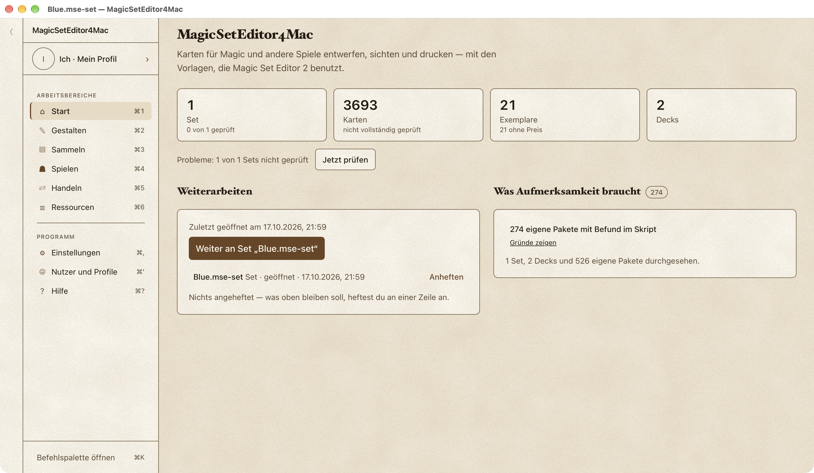

**Seit Werkstück U11 der Iteration 0.5.0** (#1422)
ist die Startseite eine **Übersicht**, und **seit UXR-03**
(#1911)
steht sie in drei Teilen: oben **eine Zeile mit vier Zahlen** — Sets, Karten,
Exemplare, Decks; ein Klick führt zu der Seite, auf der die Zahl entsteht —,
darunter **nebeneinander** _Weiterarbeiten_ (der jüngste Schritt als Handlung
und darunter eine Reihe: was du angeheftet hast, dann was du zuletzt
geöffnet, eingeführt oder ausgegeben hast) und _Was Aufmerksamkeit braucht_
(Sets mit Vorbehalten, Decks mit Fehlkarten, Pakete mit Skriptbefunden, je mit
dem Weg dorthin). Die Reihe zeigt vier Zeilen, die Aufmerksamkeit fünf, und
beide die übrigen auf Wunsch. Die _Hintergrundaufgaben_ stehen darunter,
sobald etwas geholt wird oder gerade fertig ist. Ein leerer Bereich sagt, was
der nächste Schritt ist, und bietet ihn als Knopf an.

Die **drei ersten Schritte** stehen beim ersten Start als Fenster davor, **und
in dieser Reihenfolge**; die Führungen in der Hilfe zeigen sie wieder:

1. **Ein Set öffnen** — eine vorhandene `.mse-set`-Datei aufschlagen, ein neues
   anlegen, oder eines aus MTG JSON übernehmen. Ein **Beispielset** liegt im
   Bündel; es steht nach dem ersten Start sofort da.
2. **Karten bearbeiten** — dafür muss ein Set offen sein. Die Vorschau zeigt
   jede Änderung, ohne dass jemand etwas bestätigt.
3. **Vorlagen beziehen** — auf der Seite _Pakete_. Sie werden aus dem Netz
   geholt, an einem festen Stand und mit Prüfsumme.

**Hier stand bis zum 2026-08-28 die umgekehrte Reihenfolge**, mit dem Satz
„ohne Vorlagen hat eine Karte keine Felder und kein Aussehen". Das galt, bis
die **Saat mit ins Bündel kam**
([0037](entscheidungen/0037-die-vorlagen-gehen-ins-buendel.md)): seither
bringt die Anwendung ein Spiel, Stilbögen und ein Beispielset mit, und der
erste Schritt ist eine Karte und keine Installation. Die Startseite war
umgestellt, dieser Absatz nicht — angestrichen vom ersten Zweitblick über die
Freigabe 0.3.0.

**Bezogene Vorlagen bleiben trotzdem der Weg zu echten Magic-Karten**: die
Saat ist eine Probe, kein `magic.mse-game`.

Unter _Weiterarbeiten_ steht, woran du zuletzt gearbeitet hast — Sets, Decks
und Pakete, je Profil, **jedes einmal** und mit dem, was zuletzt mit ihm
geschah. Was es nicht mehr gibt, fällt aus der Liste; ein Set, dessen Datei
nicht mehr dasteht, lässt sich trotzdem aufschlagen, denn es liegt im Bestand
und nicht in der Datei. Was oben bleiben soll, heftest du an der Zeile an.

### Wenn das Programm beim ersten Öffnen abgewiesen wird

Es ist **nicht notarisiert** — es gibt keinen Apple-Developer-Account, und das
ist eine Entscheidung, keine Nachlässigkeit. Beim ersten Start weist macOS es
deshalb ab.

Der Weg: _Systemeinstellungen_ → _Datenschutz & Sicherheit_ → Abschnitt
_Sicherheit_ → **„Dennoch öffnen"**. Einmalig. Bilder dazu stehen in
[`README.md`](../README.md#erster-start-nach-dem-download).

---

## Eine Karte bauen

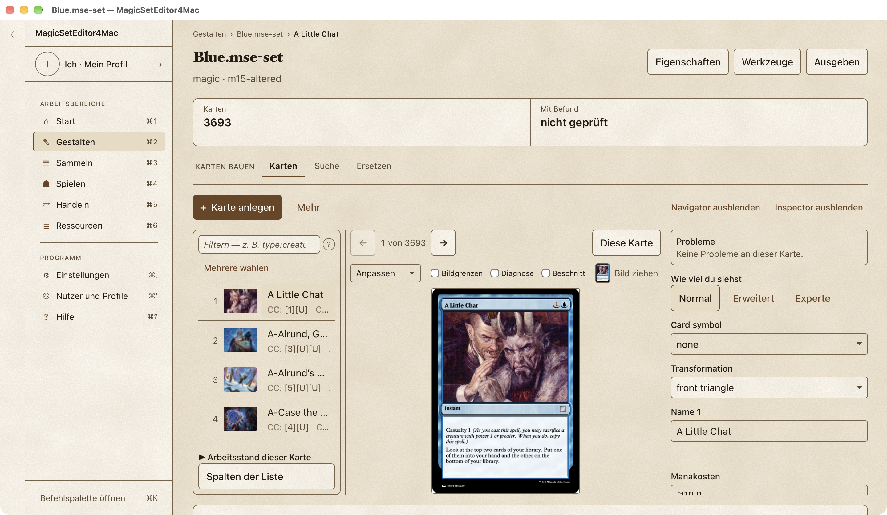

Links die Kartenliste, in der Mitte die Felder, rechts die gezeichnete Karte.

**Die Spalten lassen sich verbreitern**: zwischen ihnen steht ein Trenner —
mit der Maus ziehen oder mit **←**/**→** (mit **⇧** in größeren Schritten,
**Pos1** und **Ende** an die Grenzen). Die Breite bleibt, auch nach einem
Neustart; der Mitte bleiben mindestens 480 Punkte. Wer die Liste breiter
will, als dort Platz ist, macht die rechte Spalte schmaler.

**Was in ein Feld getippt wird, ist sofort in der Vorschau zu sehen.**
Bestätigt werden muss nichts, gespeichert auch nicht — die Änderung steht im
Bestand, sobald das Feld sie hat.

**Zwei Stellen, und beide sagen, worauf sie sich beziehen**: über der Liste
steht, was das **Set** angeht — eine Karte anlegen und die Liste ein- oder
ausblenden; die selteneren Wege zu einer Karte und die Autoersetzung stehen
daneben hinter **Mehr**. Alles, was die **aufgeschlagene Karte** angeht,
steht bei ihr, hinter **Diese Karte**.

| Ich will …                                 | Wo                                                                            |
| ------------------------------------------ | ----------------------------------------------------------------------------- |
| eine Karte anlegen                         | Knopf **Karte anlegen**, oben links                                           |
| eine Karte aus einem Namen holen           | **Mehr** → **Aus Scryfall anlegen …**, Namen eintippen oder suchen            |
| eine Karte kopieren                        | **Diese Karte** → **Karte duplizieren** — mit allen Feldwerten, im selben Set |
| eine Karte umsortieren                     | **Diese Karte** → **Nach oben** / **Nach unten**                              |
| eine Karte löschen                         | **Diese Karte** → **Karte löschen**                                           |
| eine Karte in ein **anderes** Set bringen  | **Diese Karte** → **Kopieren** dort, **Einfügen** hier — oder ⌘C und ⌘V       |
| eine Karte auf einen echten Druck beziehen | **Diese Karte** → **Bezug zu einem Druck …**                                  |
| das Bild einer Karte teilen                | **Diese Karte** → **Teilen …**                                                |
| die Karte größer oder kleiner sehen        | die Auswahl über der Karte — **Anpassen**, 50 bis 200 % oder **Druckgröße**   |

**Kopieren, Ausschneiden und Einfügen meinen die Karten, die angehakt sind** —
dieselbe Auswahl wie die Massenänderung. Steht kein Haken, ist die
aufgeschlagene Karte gemeint. **Angehakt wird nach _Mehrere wählen_** über
der Liste: erst dann trägt jede Zeile ein Kästchen, und wer es wieder
abschaltet, hebt die Haken auf, statt sie unsichtbar stehen zu lassen. ⌘C,
⌘X und ⌘V tun dasselbe, solange die Schreibmarke nicht in einem Textfeld
steht; dort gehören sie dem Text.

Was in der Zwischenablage liegt, ist **Text** in MSEs eigener Feldschreibweise
— ein `game_name:` und je Karte ein `card:`-Block. Er lässt sich weitergeben,
in eine Datei legen und von einem anderen Programm lesen.

**Nach Magic Set Editor 2 kommt er so aber nicht zurück**, und zwar aus zwei
Gründen: jenes legt Karten unter einem eigenen Ablageformat ab
(`application/x-mse-cards`) und schaut beim Einfügen auch nur danach — Text
sieht es gar nicht an. Und die Datei allein genügt ihm ebenso wenig: ein
`.mse-set` ist ein **Paket** mit Spiel, Stil und Setangaben, nicht eine Liste
von Karten.

**Der Weg dorthin ist ein Set**: die Karten hier einfügen und das Set über
_Sichern unter …_ schreiben.

### Die Spalten der Liste

Unter der Kartenliste steht **Spalten der Liste**. Aufgeklappt zeigt sie jedes
Feld, das das Spiel für die Liste vorsieht:

|                    |                                                              |
| ------------------ | ------------------------------------------------------------ |
| **Ankreuzfeld**    | blendet die Spalte ein oder aus                              |
| **↑ und ↓**        | verschieben sie nach vorn oder nach hinten                   |
| **Sortieren nach** | wonach die Liste ordnet — _Reihenfolge des Sets_ hebt es auf |

**Die Wahl gilt für alle Sets desselben Spiels.** Wer sich seine Spalten für
Magic einrichtet, findet sie im nächsten Magic-Set wieder.

**Bei einem großen Spiel stehen nur die gezeigten Spalten offen da** — Magic
bietet 243 an, elf davon sichtbar. Die übrigen findet das Suchfeld darüber,
höchstens zwölf auf einmal. **Sortiert wird nach einer gezeigten Spalte**,
wie in Magic Set Editor; wer nach einer anderen ordnen will, blendet sie
zuerst ein.

Sortiert wird, wie Magic Set Editor es tut: »Karte 10« steht **hinter**
»Karte 2«, und »Ärger« zwischen »apfel« und »Banane«.

### Ersetzen

Die Lasche **Ersetzen** tauscht ein Wort in den Textfeldern des offenen Sets
aus. **Erst zeigen, dann tun**: der Knopf _Zeigen, was sich ändert_ führt jede
betroffene Stelle auf — Karte, Feld, vorher und nachher —, und erst danach
erscheint _Jetzt ersetzen_.

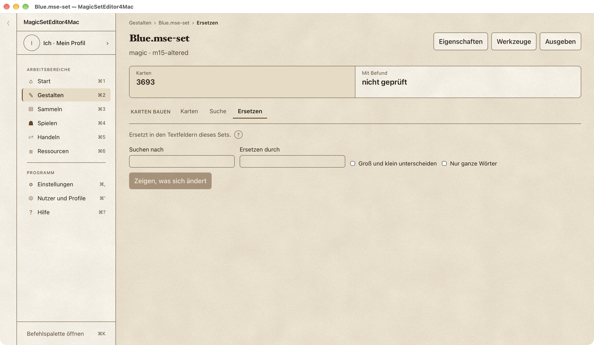

**Ein ⌘Z nimmt den ganzen Zug zurück**, nicht Karte für Karte.

|                                  |                                              |
| -------------------------------- | -------------------------------------------- |
| **Groß und klein unterscheiden** | aus heißt: `flieg` findet auch `Flieg`       |
| **Nur ganze Wörter**             | `ab` findet dann nicht das `ab` in `abseits` |

**Wahlfelder bleiben außen vor** — _rarity_, _card color_ und was sonst eine
feste Auswahl hat. Eine Ersetzung darin schriebe eine Wahl, die es in der
Vorlage nicht gibt, und die Karte zeichnete nichts mehr.

Die Felder selbst kommen aus dem Spiel und dem Stilbogen. Ihre Namen sind
**englisch**, und das bleibt so: sie stehen so in jeder Vorlage, und eine
Übersetzung machte jedes vorhandene Paket unlesbar.

### Bilder

Das Feld _Image_ nimmt eine Bilddatei. **Bild wählen** öffnet den Dateidialog;
was hineinkommt, lässt sich danach zuschneiden. Ein Bild kann auch von
Scryfall kommen — dann steht die Nennung des Künstlers dabei, weil Scryfalls
Bedingungen sie verlangen.

Eine Datei lässt sich auch **auf das Fenster ziehen**: eine `.mse-set` wird
geöffnet, ein Bild landet im Bildfeld der offenen Karte.

**Und heraus**: der kleine Griff **Bild ziehen** neben den Überlagerungen der
Vorschau lässt sich in den Finder ziehen — dort liegt die Karte dann als PNG,
benannt nach ihr. Dasselbe mit Klicks und Tastatur unter **Ausgeben ›
Bilder**.

---

## Im Set nachsehen

| Lasche              | Was sie zeigt                                                      |
| ------------------- | ------------------------------------------------------------------ |
| **Setangaben**      | was für das ganze Set gilt: Name, Beschreibung, Setsymbol, Urheber |
| **Stil**            | die Einstellflächen des Stilbogens — was die Vorlage anbietet      |
| **Suche**           | Volltext über alle Felder aller Karten, mit Fundstelle             |
| **Statistik**       | wie viele Karten welches Feld gefüllt haben                        |
| **Schlüsselwörter** | eigene Schlüsselwörter dieses Sets                                 |
| **Konsole**         | ein MSE-Script-Ausdruck im Kontext der aufgeschlagenen Karte       |

---

## Ausgeben

Der Knopf **Ausgeben** im Kopf eines Sets fragt zuerst, **wohin** — und
zeigt daneben nur, was dieses Ziel braucht: die Optionen des Druckbogens
stehen nur, wenn der Druckbogen gewählt ist. ⌥⌘1 und ⌥⌘0, *Ablage › Drucken
…* und *Ablage › Ausgeben* wählen Bilder oder Druckbogen gleich vor. Was an
einem Ziel eingestellt ist, bleibt stehen, wenn man kurz ein anderes ansieht.

| Weg               | Was herauskommt                                          |
| ----------------- | -------------------------------------------------------- |
| **Setdatei**      | eine `.mse-set` — dieselbe, die Magic Set Editor 2 liest |
| **Kartenbilder**  | eine Bilddatei je Karte: PNG, JPG, BMP, TIFF oder SVG    |
| **Druckbogen**    | ein PDF mit Papierformat, Anschnitt und Schnittmarken    |
| **Exportvorlage** | was eine `.mse-export-template` daraus macht             |
| **MTG JSON**      | das Format, das andere Werkzeuge lesen                   |

### Die Güte beim Schreiben von Kartenbildern

Neben dem Format steht eine **Güte**. Sie sagt, wie sorgfältig gerechnet wird —
und was das kostet:

| Güte     | Wofür                                             | je Karte |
| -------- | ------------------------------------------------- | -------- |
| `fast`   | eine rasche Ansicht                               | ~10 ms   |
| `medium` | **die Vorgabe** — zeichnet wie Magic Set Editor 2 | ~18 ms   |
| `high`   | ohne Flimmern an feinen Linien                    | ~20 ms   |
| `ultra`  | Druck in voller Auflösung                         | ~33 ms   |

**Layout und Zeilenumbruch sind bei allen vier gleich.** Nur die Abtastung
ändert sich — dieselbe Karte, anderer Aufwand. Wer eine Ausgabe mit einer von
Magic Set Editor 2 vergleichen will, nimmt `medium`.

---

## Bedienung

**Alles ist mit der Tastatur erreichbar.** Der Fokusring ist sichtbar, und die
Reihenfolge folgt dem, was auf dem Bildschirm steht.

| Kürzel        | Was                                                     |
| ------------- | ------------------------------------------------------- |
| `⌘K`          | die Befehlspalette — was du tun willst und was du suchst, beim Namen; dazu die Seiten und jeder Fachbefehl |
| `⌘1` … `⌘6`   | die sechs Bereiche der Leiste: Start, **Gestalten**, **Sammeln**, **Spielen**, **Handeln**, **Ressourcen** — jede Taste führt auf die erste Seite ihres Bereichs. **Die Belegung von ⌘0 bis ⌘9 ist einstellbar**: an der Kürzeltafel unter *Einstellungen › Allgemein*, je Ziffer eine Seite, mit „Wie vor 0.6.0“ für die alte Belegung |
| `⌘'`          | **Nutzer und Profile**                                  |
| `⌘?`          | Hilfe                                                   |
| `⌘,`          | Einstellungen                                           |
| `⌥⌘1` … `⌥⌘0` | die übrigen Laschen des offenen Sets, in ihrer Reihenfolge |
| `⌥⌘[`, `⌥⌘]`  | Navigator und Inspector eines Arbeitsplatzes ein- und ausblenden — ab dem ersten Arbeitsplatz (0.5.0), auch über **Darstellung** in der Menüleiste: dort heißen die Einträge „einblenden“ oder „ausblenden“, je nachdem, wie die Spalte steht, und sind grau auf einer Seite ohne Arbeitsplatz (0.6.0) |
| `⌥⌘S`         | die Seitenleiste ein- und ausblenden — auch über **Darstellung** in der Menüleiste und den Knopf an ihrem Rand (0.5.0) |
| `⌘[`, `⌘]`    | **zurück** zur vorigen Seite und wieder **vorwärts** — auch über **Darstellung**. Was du auf einer Seite angefangen hast, steht beim Zurückkommen noch da (0.6.0). Auf einer deutschen Tastatur ist es die Taste **Ü** und die Taste daneben |
| `⌘F`          | Volltextsuche                                           |
| `⌘↩`          | in der Skriptkonsole den Ausdruck auswerten             |
| `⌘N`          | ein neues Set                                           |
| `⌘W`, `⌘Q`    | Fenster schließen, Programm beenden                     |

**Die erste Reihe gehört ganz der Leiste**, und seit 0.6.0 gehört jede Ziffer
einem **Bereich** statt einer Seite. Wohin es innerhalb eines Bereichs
weitergeht, sagt der Kopf der Seite: von **Decks** zu *Turniere*, zu den
*Formaten* und zu *Partie anfangen*, von **Pakete** zur *Vorlagenwerkstatt*, von **Sets** in die
**Karten** eines Sets, sobald du eines öffnest. Die drei Seiten der Dienstzone
tragen das Zeichen, das macOS für sie vorsieht: `⌘,` für Einstellungen, `⌘?`
für Hilfe — und `⌘'` für Nutzer und Profile, weil die Ziffern vergeben waren
und der Apostroph mit keinem Systemkürzel kollidiert.

**Ein neues Deck geht vom offenen Set aus**: „Deck anlegen“ setzt den
Cursor in den Namen, das Spiel ist das des offenen Sets, und die Kartenwahl
beginnt mit diesem Set — von ⌘4 bis zur ersten Karte im Deck sind es sechs
Schritte. Was man seltener braucht — ein Deck aus einem fremden Profil holen,
es als Umschlag weitergeben, Karten aus der Sammlung oder einem Set holen —,
steht im Navigator unter **Holen und weitergeben**; eine Deckliste liest man
über das Menü **…** des offenen Decks ein, und die Formate gehen über
**Formate …** im Kopf in einer Schublade auf. Am offenen Turnier bleibt
**Abschließen** sichtbar; Ausgeben, Bericht und Löschen stehen unter **…** und
im Rechtsklick auf seinen Namen.

**`⌘7` bis `⌘0` sind damit frei.** Sie führten bis 0.5.0 auf Decks, Turniere,
Spielen und Handeln; wer sie gewohnt ist, findet dieselben Seiten unter `⌘4`
und `⌘5` — und über `⌘K` unter ihrem Namen, wie jede andere Seite auch.

**Die Seitenleiste ist eine Tabstelle.** Ein Tab landet auf der
aufgeschlagenen Seite; ↑ und ↓ wandern zwischen den Einträgen, Home und End
springen an Anfang und Ende, Enter öffnet. Das nächste Tab verlässt die Leiste
— elf Halte weniger vor jedem Arbeitsplatz. Die Kürzel ⌘1–⌘6 bleiben.

**Die Seitenleiste lässt sich einklappen.** Der Knopf an ihrem Rand, ⌥⌘S
und der Eintrag unter **Darstellung** tun dasselbe; eingeklappt bleibt nur
der Knopf, und die Breite gehört dem Arbeitsplatz. Die Flächen erreichst du
dann über ihre Tasten und ⌘K. Der Zustand wird je Profil gespeichert — nach
dem Neustart steht die Leiste, wie du sie gelassen hast.

**Hier stand bis zum 2026-09-07 „`⌘1` … `⌘7` — die sieben Seiten der Leiste".**
Das war dreifach falsch: die Grenze war 8, `⌘3` war gar keine Leistenseite, und
`⌘'` fehlte ganz — die einzige Taste für die größte Seite aus Phase 4.12.
**Seit 0.6.0 stimmt der Satz wieder** — nur mit sechs statt sieben, und mit
Bereichen statt Seiten.

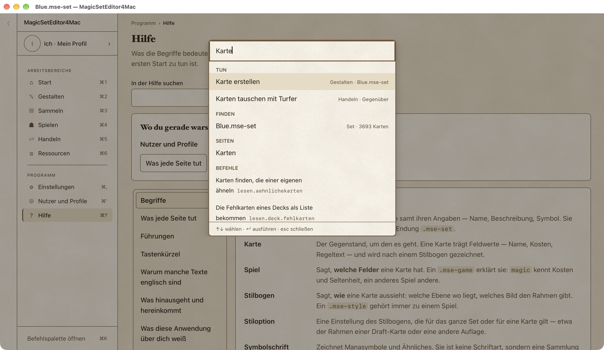

### Tun und Finden

**Die Palette kennt Handlungen und Objekte, nicht nur Seiten.** Unter
**Tun** steht, was gerade geht: „Karte erstellen“, wenn ein Set offen ist —
sonst „Ein Set anlegen oder öffnen“ —, „Deck spielen — …“ je Deck, „Karten
tauschen mit …“ je bestätigtem Gegenüber und „Sicherung erstellen“. Unter
**Finden** stehen Karten, Sets, Decks und Gegenüber, sobald du einen Namen
tippst; Karten ab zwei Zeichen, und jede einmal, auch wenn sie in mehreren
Feldern trifft. Rechts steht jeweils, wohin die Zeile führt — der Bereich und
nicht der Name einer Seite. **Die Pfeiltasten** wandern vom Feld durch die
Zeilen, Enter führt aus, Escape schließt.

Eine Zeile tut dasselbe wie der Weg, den es schon gibt: „Karte erstellen“
legt die Karte auf der Kartenseite an, mit deren Fehlermeldung am Feld; „Deck
spielen“ trägt das Deck in *Eine Partie anfangen*; „Sicherung erstellen“
öffnet *Daten und Sicherung* in den Einstellungen.

### Die Kommandozentrale

Wer in der Palette einen **Befehl** tippt — `lesen.sets`, „Karten auflisten“,
„löschen“ —, sieht neben den Seiten die Fachbefehle dieser Anwendung: dieselben
Werkzeuge, die der MCP-Server einem Sprachmodell gibt, hier im Fenster gerufen.
Enter öffnet die Kommandozentrale über dem Befehl: was er tut, wie er auf der
Kommandozeile und im Dienst heißt, seine Parameter als Felder, und darunter
**was geschickt wird** — als JSON, bevor etwas geschieht. Ein Befehl, der
etwas ändert, das sich nicht ohne Weiteres zurücknehmen lässt, verlangt den
Haken „Ich habe die Vorschau gelesen“. Ausführen zeigt das Ergebnis als Text
oder JSON mit seiner Dauer; Abbrechen beendet einen laufenden Ruf. Der Verlauf
dieser Sitzung steht darunter — ohne Token oder Kennwörter, die stehen als
`•••`. Nichts davon geht durch eine Shell: was du eingibst, bleibt Daten.

### Die Menüleiste

Sie steht oben am Bildschirm, wie bei jedem Mac-Programm, und führt dieselben
Wege wie die Oberfläche — kein zweiter Satz Befehle.

| Menü                   | Was darin steht                                                                                                                  |
| ---------------------- | -------------------------------------------------------------------------------------------------------------------------------- |
| **MagicSetEditor4Mac** | **Über** — Fassung, Lizenz, Inhalte Dritter —, **Einstellungen** (⌘,), Dienste, Ausblenden und Beenden                           |
| **Ablage**             | Neu, Öffnen, Sichern, Sichern unter, Schließen, **Ausgeben** mit Exportvorlage, Bildern und Druckbogen, Zuletzt benutzt, Drucken und Bestand sichern |
| **Set**                | **Rückgängig** und **Wiederherstellen**, Alle Karten anhaken, dazu **Suchen** und **Ersetzen**                                   |
| **Bearbeiten**         | Widerrufen, Wiederholen, Ausschneiden, Kopieren, Einsetzen, Löschen, Alles auswählen und die Sprachausgabe — im Textfeld, das den Fokus hat |
| **Darstellung**        | Seitenleiste (⌥⌘S), Navigator (⌥⌘[) und Inspector (⌥⌘]) ein- und ausblenden, **Zurück** (⌘[) und **Vorwärts** (⌘]), Darstellung zurücksetzen |
| **Fenster**            | Im Dock ablegen, Zoomen, Alle nach vorne bringen                                                                                 |
| **Hilfe**              | die Hilfeseite                                                                                                                   |

**⌘Z gehört dem, woran du gerade arbeitest.** Im Textfeld nimmt es das Tippen
zurück (_Bearbeiten → Widerrufen_), außerhalb eines Textfeldes den letzten
Schritt im Set — dasselbe wie _Set → Rückgängig_. Hier stand, beide gingen
immer über den Verlauf des Sets; das stimmte für das Textfeld nie
(`rahmen/tastatur.ts`).

**Alle Menüs folgen der Sprache des Fensters** — seit
#255 auch
das Anwendungsmenü, _Bearbeiten_ und _Fenster_, die vorher englisch dastanden
([0030](entscheidungen/0030-die-menueleiste-bleibt-zur-haelfte-englisch.md)).

**Und _Alle Karten anhaken_** hakt jede Karte der Liste an — die, die gerade
dasteht: wer gesucht hat, meint mit „alle" seine Auswahl — und schaltet die
Liste dafür auf _Mehrere wählen_. An den Anhakhaken hängen die
Massenänderung und die Zwischenablage.

Es ist Magic Set Editors _Alles auswählen_, das dort über `ItemList` ebenfalls
**alle Karten** wählt und nicht nur Text.

**Was die Menüleiste nicht kennt** und Magic Set Editor 2 kannte:
_Weitersuchen_ (hier ist die Suche eine Seite mit Trefferliste, und „der
nächste" ist die Zeile darunter), die _Autoersetzung_ und _Neu laden_.

Beide fehlen nicht aus Prinzip: die **Verwaltung** der Autoersetzungsregeln
ist offener Umfang und steht als eigene Zeile in
[`PARITAET.md`](PARITAET.md) — das Ersetzen beim Tippen selbst gibt es. Und
_Neu laden_ passt nicht, weil hier der Bestand die Wahrheit ist und nicht die
Datei.

---

## Einstellungen

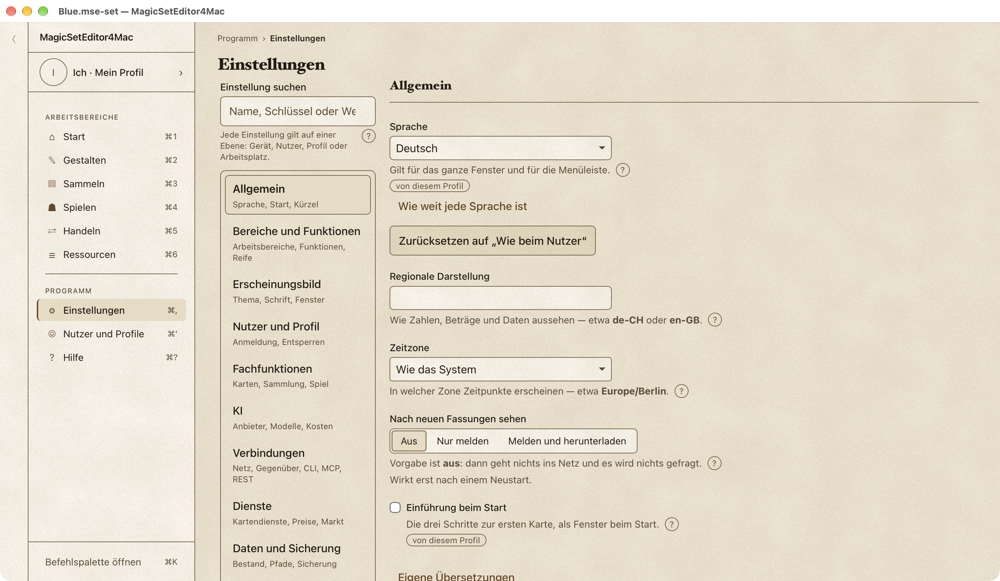

**Sprache** — Deutsch oder Englisch. Was aus einem Paket kommt — Feldnamen,
Spielnamen, Stilbezeichnungen — bleibt, wie es dort steht.

**Erscheinungsbild** — hell, dunkel oder nach Systemeinstellung.

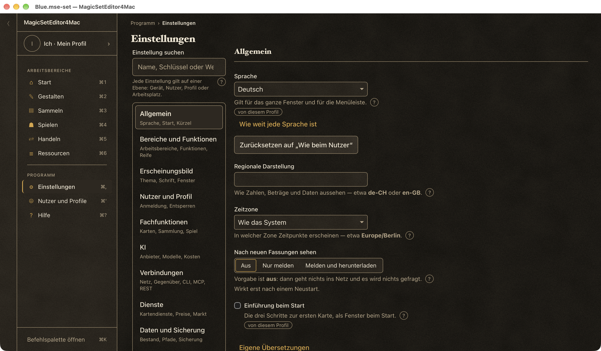

**Schriftgröße** — gilt für das ganze Programm.

**Paketorte** — wo nach Vorlagen gesucht wird.

**Nach neuen Fassungen sehen** — drei Stufen, und die Vorgabe ist **aus**:
dann geht keine einzige Anfrage hinaus.

| Stufe             | Was geschieht                                                                                                                                                         |
| ----------------- | --------------------------------------------------------------------------------------------------------------------------------------------------------------------- |
| **aus**           | nichts. Kein Netzverkehr, keine Frage                                                                                                                                 |
| **melden**        | beim Start erscheint ein Band, wenn eine neuere Fassung vorliegt — einmal je Fassung, nicht bei jedem Start                                                           |
| **herunterladen** | daneben steht ein Knopf. Er lädt die Fassung ins Standard-Downloadverzeichnis, zeigt den Fortschritt und **vergleicht die Prüfsumme, bevor die Datei dort auftaucht** |

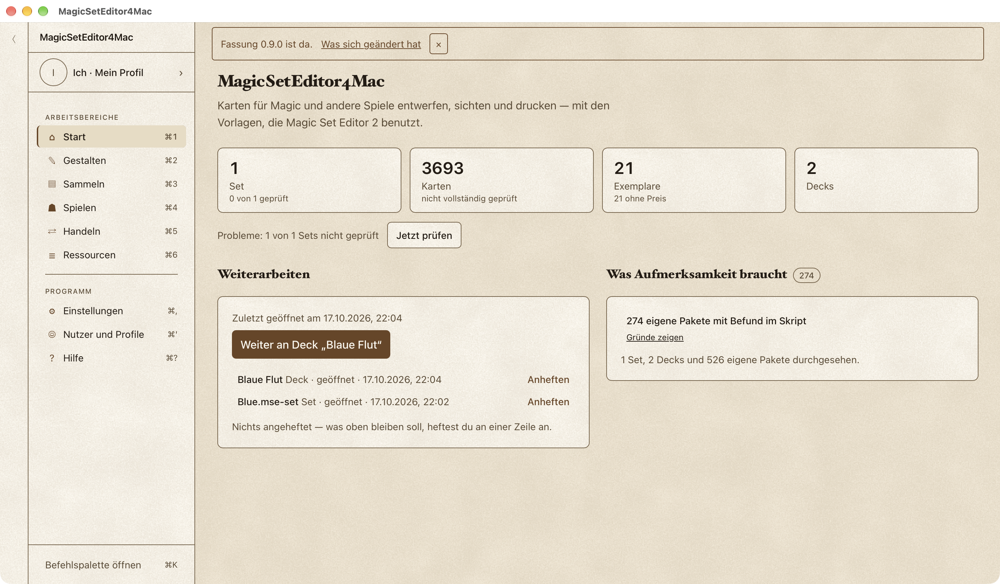

**Installiert wird nichts von selbst.** Die geladene Datei wird im Finder
geöffnet, und die Anwendung darin in den Programme-Ordner gezogen — derselbe
Weg wie beim ersten Mal, samt der einmaligen Freigabe unter _Datenschutz &
Sicherheit_ (siehe [`RELEASE.md`](RELEASE.md)).

**Zweierlei wird geprüft, in dieser Reihenfolge:** die **Signatur** über der
Prüfsummenliste — sie sagt, _von wem_ die Liste kommt — und danach die
**Prüfsumme** des Abbilds. Eine Freigabe ohne Signatur wird abgewiesen, bevor
irgendetwas geladen wird.

**Passt eines von beiden nicht, bleibt nichts liegen.** Ein abgebrochener
Ladevorgang hinterlässt keine halbe Datei: geschrieben wird in eine
Nachbardatei, und erst die geprüfte bekommt ihren Namen.

**Die Freigaben liegen heute noch in einem privaten Repositorium**; es wird
öffentlich, bevor eine Fassung an Anwendende geht. Bis dahin antwortet GitHub
ohne Lesezugriff, es gebe keine — dann sagt die Anwendung das und arbeitet
unverändert weiter. Die Zugangsmarke wird aus der Umgebung gelesen (`GH_TOKEN`,
sonst `GITHUB_TOKEN`) und braucht die Berechtigung `Contents: read`.

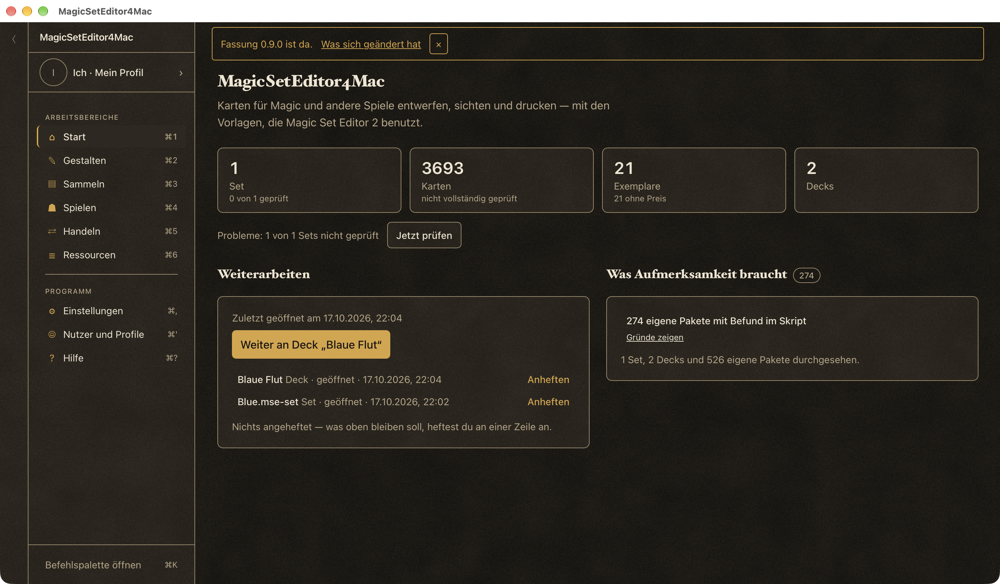

---

## Hell und dunkel

Beides wird bedient, nicht nachgeahmt: die Anwendung folgt der
Systemeinstellung, solange niemand etwas anderes wählt.

| Hell                                                                  | Dunkel                                                                         |
| --------------------------------------------------------------------- | ------------------------------------------------------------------------------ |
|                   | 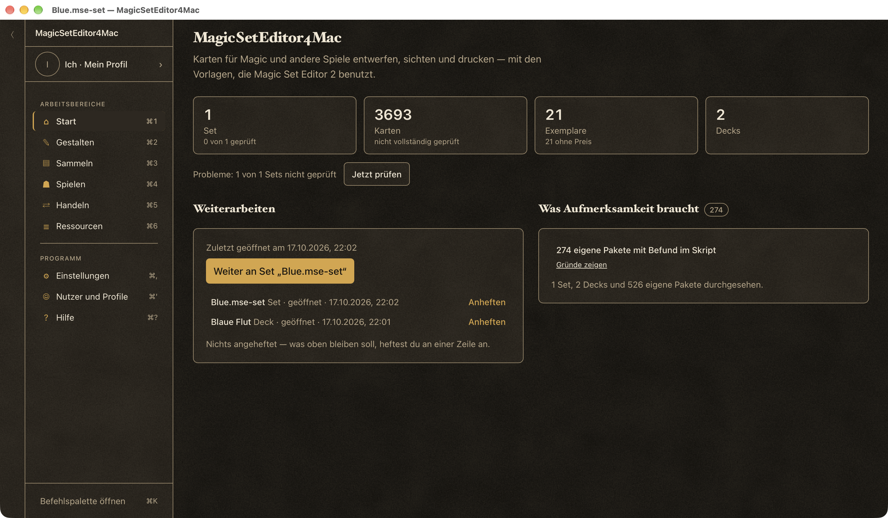                  |
|                | 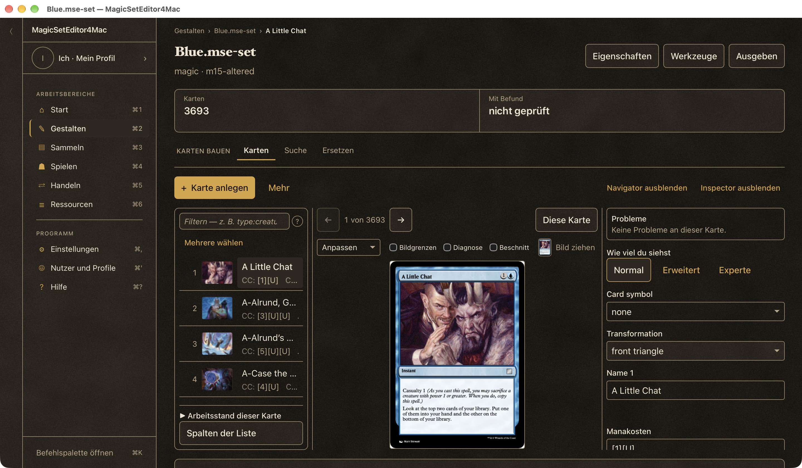               |
| 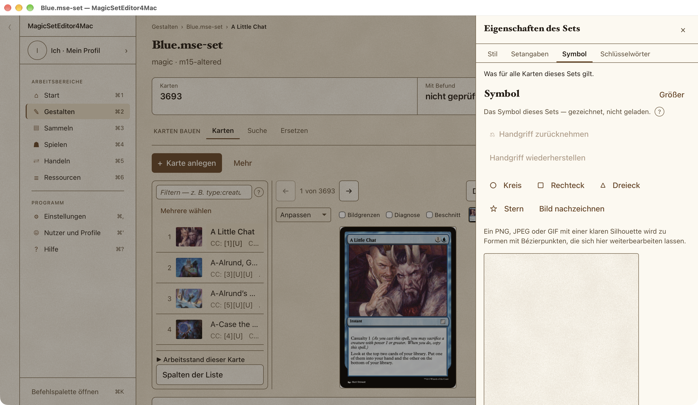               | 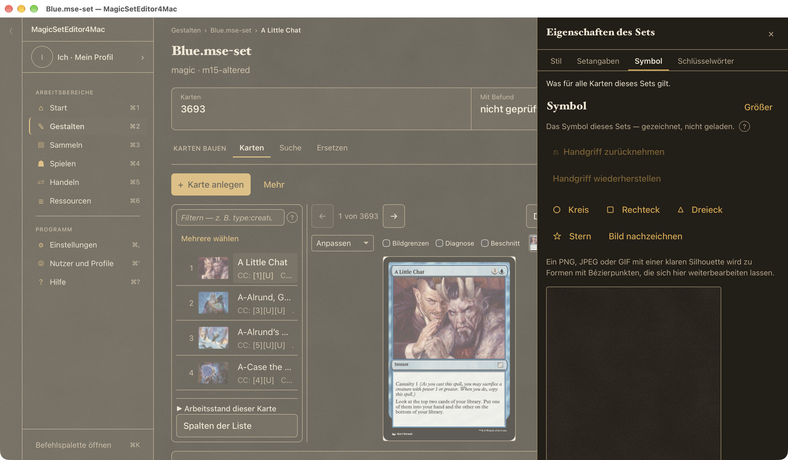               |
| 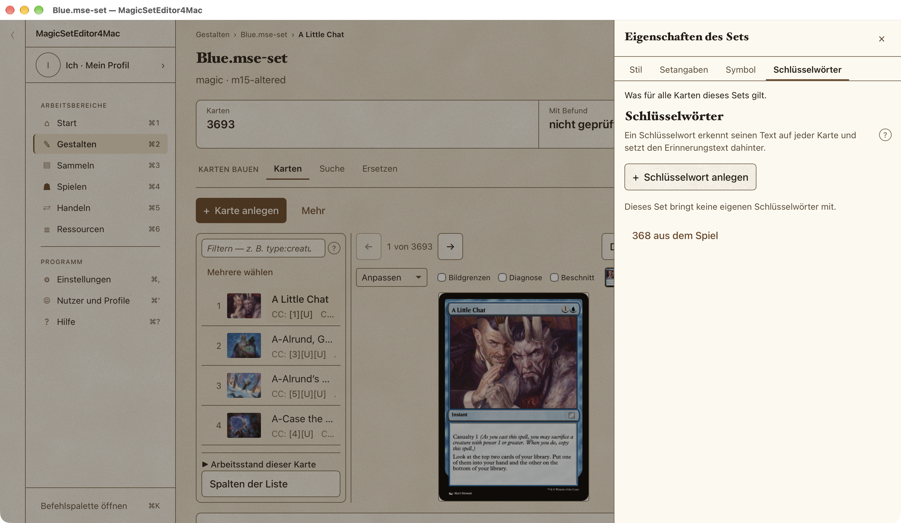 | 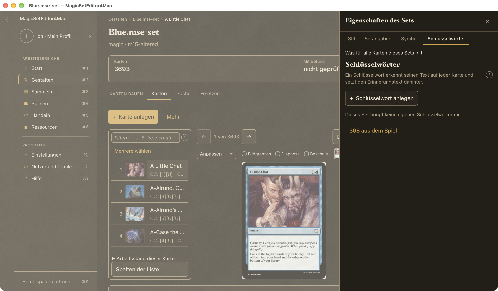 |
| 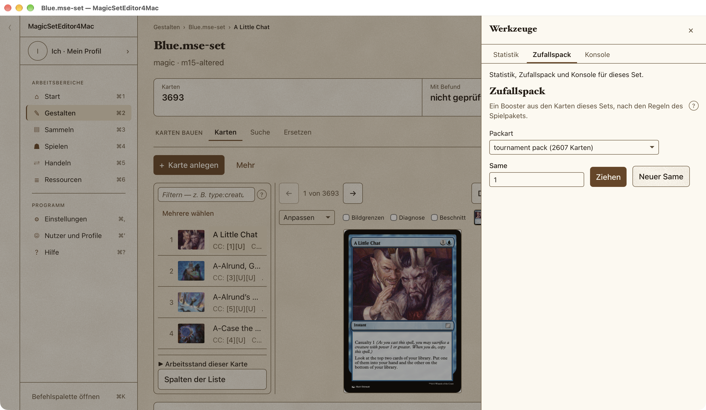           | 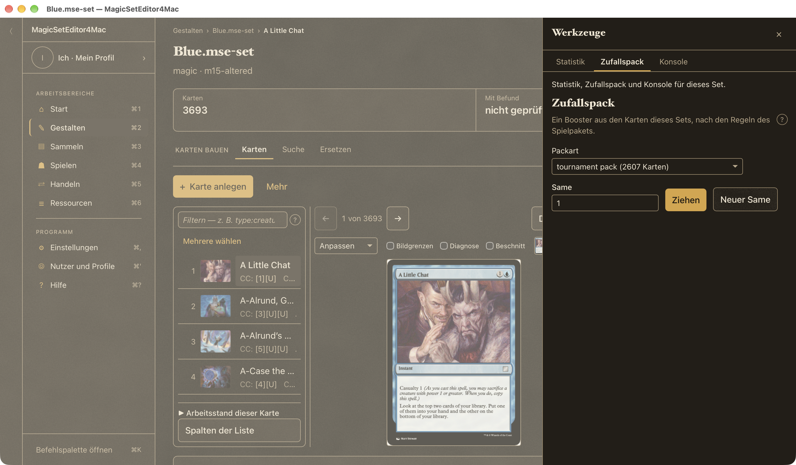           |
| 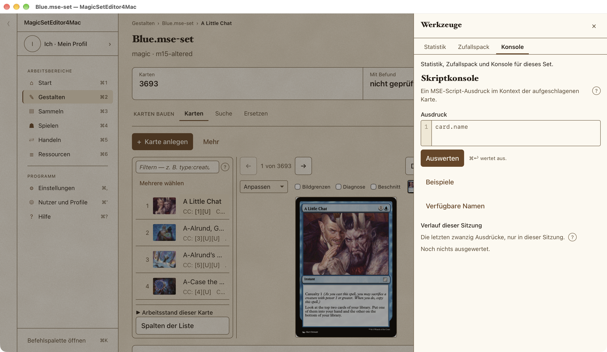                   | 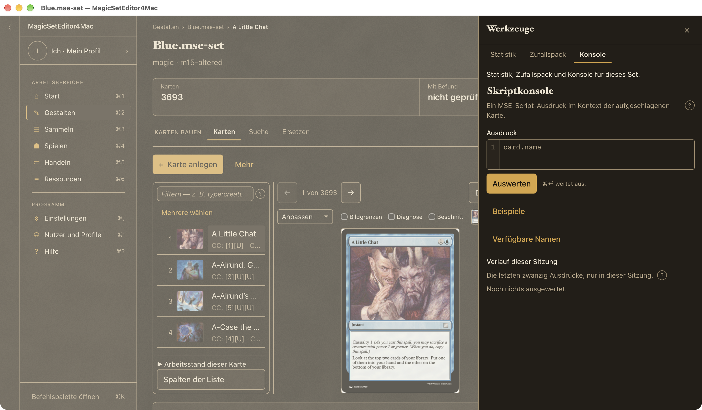                   |
|           |           |

---

## Wenn etwas fehlt

**Eine Karte bleibt leer.** Dann fehlt das Vorlagenpaket. Auf _Pakete_ nachsehen,
ob Spiel und Stilbogen des Sets dastehen.

**Der Text fehlt, der Rahmen ist da.** Dann fehlt eine **Schriftart**. Vorlagen
verlangen Schriften, die aus Lizenzgründen nicht mitgeliefert werden; die
Paketseite sagt, welche.

**Ein Set öffnet mit Befunden.** Das ist der Normalfall bei alten Dateien: was
lesbar ist, wird geöffnet, und was nicht, steht mit Datei, Zeile und Feld
daneben. Ein Set mit 300 lesbaren und zwei unlesbaren Karten wird mit 300
Karten geöffnet, nicht abgewiesen.

---

## Nutzer und Profile

**Wem gehört, was hier liegt.** Die Seite steht unter `⌘'` in der Leiste, ganz
unten bei den Einstellungen — sie stellen dieselbe Frage.

**Ein Nutzer ist die Person. Ein Profil ist eine Arbeitsumgebung dieser
Person** — eigene Sets, eigene Sammlung, eigene Einstellungen. Wer für ein
Turnier getrennt sammeln will, braucht kein zweites Konto, sondern ein zweites
Profil.

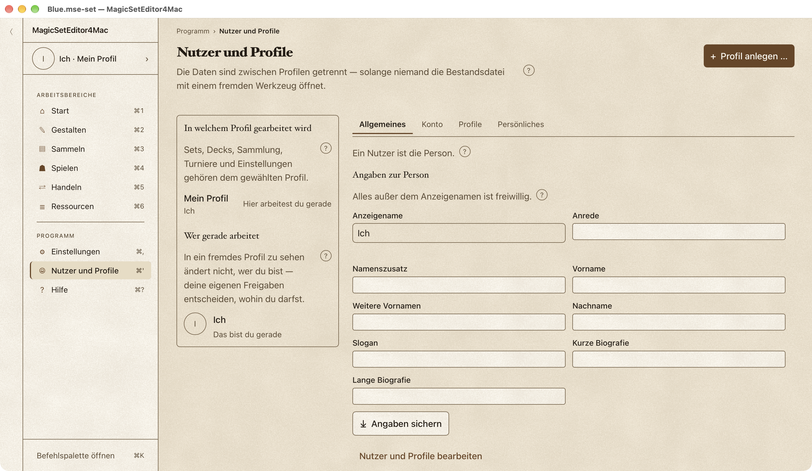

**Wer allein arbeitet, muss hier nichts tun.** Beim ersten Start entsteht ein
Nutzer mit einem Profil, und solange es bei diesem einen bleibt, fragt das
Programm nie nach einem Nachweis. Die Seite ist für den zweiten Fall da.

### Die vier Laschen

| Lasche | Was darin steht |
| -------------- | ----------------------------------------------------- |
| **Allgemeines** | die Nutzer dieses Bestands, ihre Namen und Bilder |
| **Konto** | womit dieser Nutzer sich anmeldet |
| **Profile** | die Arbeitsumgebungen, ihre Vorgaben und Freigaben |
| **Persönliches** | Anrede, Namensteile, Bio — und der Weg, sie auszugeben |

### Ein zweites Profil

*Profile → Profil anlegen*, Name eintragen, fertig. **Der Wechsel geschieht
auf derselben Lasche**, und danach ist alles andere im Fenster ein anderes:
andere Sets, andere Sammlung, andere Decks.

**Ein Profil bekommt Vorgaben** — Vorgabespiel und Vorgabevorlage für neue
Sets, ein Vorgabeformat für neue Decks, Präferenzdecks und zugeordnete
Lagerorte. Sie ersparen das immer gleiche Auswählen.

**Zeigt eine Vorgabe ins Leere**, weil das Spiel oder das Deck nicht mehr da
ist, sagt die Seite es und lässt sie stehen — sie wird nicht still gelöscht.

### Wer sonst noch an ein Profil darf

Der Eigner ist, wer es angelegt hat. Darüber hinaus gibt es drei Rollen:

| Rolle | Darf |
| ---------------- | ------------------------------------------- |
| **Leser** | sehen, **dass** es das Profil gibt — nicht, was darin steht |
| **Mitarbeiter** | hineinwechseln und darin arbeiten |
| **Verwalter** | selbst Freigaben vergeben |

**Freigaben vergeben darf nur, wer das Profil verwaltet.**

### Anmelden

**Gefragt wird nur, wer einen zweiten Faktor führt.** Wer keinen eingerichtet
hat, wechselt ohne Nachweis — und wer sich selbst wählt, ohnehin. Ein Bestand
ohne zweite Faktoren ist nicht geschützt, und genau dafür gibt es sie.

Wege hinein gibt es vier:

- **über einen fremden Anbieter** — GitHub, Google, Microsoft oder X. Das
  Fenster schickt den Browser hin und wartet auf die Rückkehr; Zugangsdaten
  bekommt dieses Programm dabei nie zu sehen. **Es liefert keine `client_id`
  mit**: die legt man beim Anbieter selbst an und trägt sie unter
  *Einstellungen → Anwendung* ein ([`ADMINISTRATION.md`](ADMINISTRATION.md)).
- **mit einem eigenen Kennwort** — hier gehütet mit Argon2id.
- **anonym** — ein Profil ohne Nachweis, für den Rechner, an dem ohnehin nur
  eine Person sitzt.
- **als anderer Nutzer**, wenn man mehrere führt.

### Der zweite Faktor

*Konto → zweiter Faktor.* Es gibt zwei:

**Ein Einmalkennwort nach RFC 6238** — dieselbe Art, die jede
Authenticator-App erzeugt. Die Einrichtung hat **zwei Schritte, und der zweite
ist der wichtige**: das Muster wird gezeigt, und der Faktor gilt erst, wenn ein
Code aus ihm stimmt. Wer den ersten Schritt macht und den zweiten vergisst,
hätte sich sonst selbst ausgesperrt.

**Geheimnis und Wiederherstellungscodes stehen einmal da und nie wieder.** Die
Seite sagt es, bevor sie sie zeigt. Wer sie wegklickt, richtet neu ein.

**Touch ID oder Face ID** — der zweite Weg, und wo ein Sensor da ist, wird er
**zuerst** angeboten, weil er ohne Tippen geht.

**Er sperrt niemanden aus.** Wer Touch ID eingerichtet hat und den Bestand auf
einem Mac ohne Sensor öffnet, wird nach seinem Code gefragt; der Zettel gilt
ebenso weiter. Der Sensor ist eine bequemere Tür in dasselbe Haus, kein
zweites Schloss.

### Was die Trennung leistet und was nicht

**Die Daten sind zwischen Profilen getrennt — solange niemand die
Bestandsdatei mit einem fremden Werkzeug öffnet.** Dagegen hilft die
Verschlüsselung des Bestands; sie steht unter *Bestand*.

Das ist keine Einschränkung, die man verschweigt: ein Profil ist eine
Arbeitsteilung und keine Zugriffssperre gegen jemanden, der die Datei in der
Hand hält.

---

## Wo die Daten liegen, und wie man sie sichert

Das steht in [`ADMINISTRATION.md`](ADMINISTRATION.md) — Orte, Sicherung,
Wiederherstellung und was beim Fassungswechsel geschieht.

---

## Was ein Set noch mitbringt

Neben Karten führt ein Set vier Dinge, die eigene Laschen haben.

### Schlüsselwörter

Eigene Schlüsselwörter des Sets — Wort, Muster, Erinnerungstext, Regeln und
Modus. Die des **Spiels** stehen daneben und sind unveränderlich.

**⌘Z nimmt jede Änderung zurück** — auch ein Löschen, und das Schlüsselwort
kommt an **seine** Stelle zurück. Die Reihenfolge entscheidet, welches zuerst
auf einen Text passt.

### Zufallspack

Ein Booster aus den Karten des Sets, nach den Regeln des Spielpakets.

**Derselbe Same gibt dieselbe Ziehung.** Er steht neben dem Knopf, weil er die
einzige Möglichkeit ist, ein Ergebnis wiederherzustellen.

**Ein großes Pack steht gefaltet da.** Zuerst stehen sechzehn Karten — so viele,
wie ein Booster hat —, daneben „16 von 76“; der Rest folgt auf **Weitere …
zeigen**, in der Reihenfolge, in der er gezogen wurde.

**Ein Set darf eigene Packarten mitbringen.** Nennt die `.mse-set`-Datei einen
eigenen `pack type:`, gilt er — und ein gleichnamiger ersetzt den des Spiels.

### Symbol

Das Setsymbol wird **gezeichnet**, nicht geladen: Grundformen, Punkte, Griffe —
und alles davon mit der Tastatur. **Größer** öffnet die Schublade breit und
die Zeichenfläche mit; ein zweiter Druck nimmt es zurück.

**Eine Symmetrie vervielfältigt, was in ihr liegt.** Art (Drehung oder
Spiegelung), Kopienzahl, Mitte und Griff sind einstellbar; die Kopien stehen
blass auf der Fläche, verändert wird immer nur das Original. Mitte und Griff
lassen sich ziehen **und** über die Zahlenfelder daneben setzen.

**Mehrere Teile wählst du mit gedrückter ⌘-Taste.** Zwei oder mehr lassen sich
zu einer **Gruppe** zusammenfassen; eine Gruppe lässt sich wieder auflösen, und
ihre Kinder stehen eingerückt unter ihr. Was in einer Gruppe liegt, bleibt beim
Auflösen erhalten.

**Die Reihenfolge in der Liste ist die Zeichenreihenfolge**: was **oben** in
der Liste steht, liegt im Bild **oben**. Zwei Knöpfe an jedem Teil schieben es
durch die Liste.

### Skriptkonsole

Ein MSE-Script-Ausdruck im Kontext der aufgeschlagenen Karte — sie ändert
nichts.

Sie beantwortet dieselben Fragen wie MSEs eigene Kommandozeile, ohne dass
jemand ein Terminal aufmacht: `card.name`, `length(card.rule_text)`, was das
Spielpaket sonst anbietet.

**⌘↩ wertet aus**, und solange der Ausdruck läuft, steht **Abbrechen**
daneben — die Antwort sagt danach »abgebrochen«, der Ausdruck bleibt im Feld.
Jedes Ergebnis nennt seine Dauer; eine Abbildung wie `card` oder `set` steht
als aufgeklappter Baum da, Eintrag für Eintrag. **Das Ergebnis steht gleich
unter dem Knopf**; darunter die **Beispiele** und die **verfügbaren Namen**,
beide eingeklappt — ein Klick öffnet sie, und erst das Öffnen holt die Namen.
Ein Klick auf ein Beispiel oder einen Namen setzt ihn ins Feld.

**Der Verlauf dieser Sitzung** führt die letzten zwanzig Ausdrücke mit
Ausgang und Dauer. Ein Klick lädt den Ausdruck zurück, **Verlauf löschen**
räumt ihn; er stirbt mit dem Fenster. Was nach einem Token oder Kennwort
klingt, steht dort als »•••« und lässt sich nicht zurückladen. Ein Schnipsel,
das du einfügst, landet nur im Feld — ausgewertet wird erst auf Knopf oder
⌘↩.

---

## Die eigene Sammlung

**Was du wirklich besitzt** — je Druck, Zustand, Sprache und Ausführung eine
Zeile. Das hat mit den Sets nichts zu tun: eine entworfene Karte ist ein
Entwurf, ein Exemplar ist ein Stück Papier. Deshalb steht die Sammlung neben
den Sets und nicht in einem.

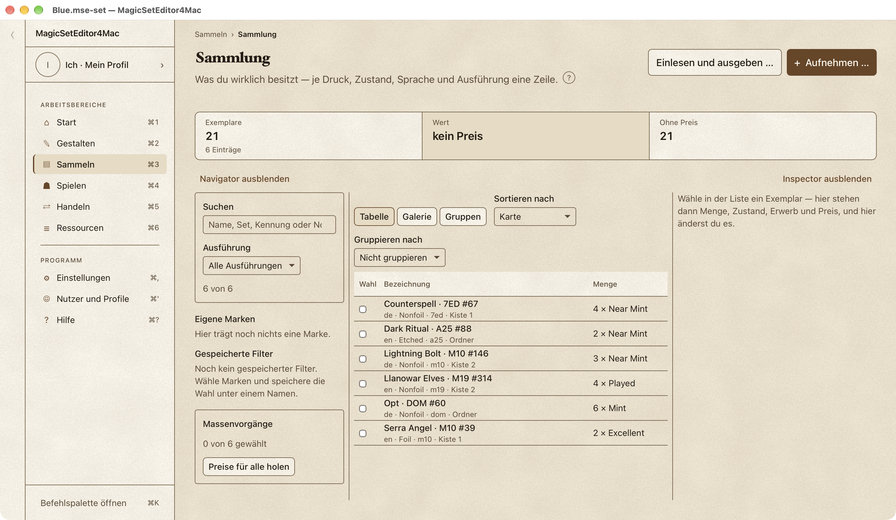

**Ein Exemplar braucht die Scryfall-Kennung seines Drucks** — die UUID aus der
Adresse einer Kartenseite. Sie ist der einzige Bezug, der einen **Druck**
eindeutig benennt: derselbe Kartenname erscheint in dutzenden Sätzen, und was
er wert ist, hängt am Druck.

Ein lesbarer Kartenbezug statt der UUID (Name, Set, Nummer) steht seit dem
Schluss von #1200
am 2026-08-28 am Exemplar; ob das Formular für ein neues Exemplar die UUID
heute noch verlangt, ist nicht nachgeprüft am 2026-10-11.

**Seit 0.5.0 ist die Kennung ein Alias und nicht mehr die Identität.** Jeder
Druck ist eine Zeile dieses Bestands, die ihre Kennungen kennt — Scryfall,
MTGJSON, Händler. Ein Exemplar aus einer Liste **ohne** Scryfall-Kennung
bekommt trotzdem seinen Druck (Name, Set, Nummer) und trägt die Marke
**vorläufig**: Preise und Bilder bleiben aus, bis jemand ihn auflöst. Die
CSV-Ausfuhr trägt je Zeile die portable Referenz (`verweisfassung`,
`kennungssystem`, `kennung`) neben `printing`; wer sie in einem anderen
Bestand einliest, trifft denselben Druck — über die Kennung, sonst über Name,
Set, Nummer und Sprache zusammen. Trifft sie mehrere, meldet die Einfuhr einen
Konflikt für die Zeile, statt zu raten.

### Der Arbeitsplatz

**Links die Sicht, in der Mitte die Liste, rechts das Exemplar** — seit 0.5.0
ist die Sammlung ein Arbeitsplatz wie die Karten. Das Suchfeld ist das erste
Bedienelement; darunter liegen Sortierung, Ausführung, **Ansicht** (Tabelle,
Galerie, Gruppen) und **Gruppieren nach** Set, Lagerort, Zustand oder Sprache
— jede Gruppe nennt Anzahl und Stückzahl. Die Werkzeuge zum Aufnehmen und
Einlesen, die Massenvorgänge und das Portfolio stehen ebenfalls links.

**Die Liste zeichnet nur, was im Fenster steht**, und trägt trotzdem
zehntausend Zeilen: ↑ und ↓ wandern, Home und End springen an Anfang und
Ende, und ein Vorleseprogramm hört, die wievielte von wie vielen Zeilen es
liest. Ein Klick auf eine Zeile (oder eine Kachel) wählt das Exemplar für den
**Inspector** rechts — dort stehen Menge, Zustand, Sprache, Lagerort, Erwerb
und Preis, und dort wird geändert und gelöscht. Der Haken vor der Zeile ist
etwas anderes: er gehört den Massenvorgängen.

**Ist die Liste schmal**, weil links und rechts die Spalten stehen, rücken
Sprache, Set und Lagerort klein unter die Bezeichnung — so steht sie ganz da.
Wer sie wieder in eigenen Spalten will, blendet eine Seite aus oder zieht den
Trenner.

**Ein Filter nimmt dem Inspector nichts weg.** Steht das gewählte Exemplar
nach einer neuen Suche nicht mehr in der Liste, sagt der Inspector es — und
eine Änderung trifft weiterhin dieses Exemplar, kein anderes. Ein Preis, der
älter als eine Woche ist, heißt »veraltet«; das ist etwas anderes als »kein
Preis«.

### Preise

**Geholt wird auf Verlangen, nicht im Hintergrund.** _Preise holen_ fragt
Scryfall nach dem Stand eines Drucks und legt ihn ab; die **Übersicht**
rechnet, was die Sammlung nach den abgelegten Preisen wert ist, und der
**Verlauf** zeigt eine Reihe über die Zeit.

**Preise sind Schätzwerte von Scryfall und dessen Partnern.** Für keine Angabe
wird eine Gewähr übernommen; verbindlich ist der Preis im Laden. Der Hinweis
steht auch in der Anwendung.

---

## Vorlagen bearbeiten

Ein Spiel, ein Stilbogen, eine Exportvorlage — sie sind Textdateien in einem
Paket, und die Lasche **Vorlagen** macht sie auf.

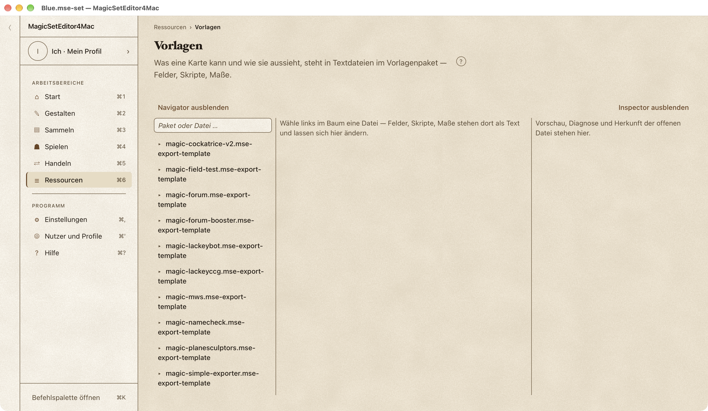

**Erst das Paket, dann die Datei.** Ein `.mse-style` führt eine `style`, ein
`.mse-game` eine `game`; was es sonst noch gibt — Bilder, Schriften —, lässt
sich hier nicht ändern.

**Gespeichert wird gegen den Stand, aus dem gelesen wurde.** Hat jemand die
Datei inzwischen von außen geändert, wird das Schreiben abgewiesen statt zu
überschreiben.

**Wer eine Vorlage ändert, ändert sie für jedes Set, das sie benutzt.** Das
ist der Sinn — und es ist der Grund, vorher eine Sicherung zu machen.

---

## Mehr als das Fenster

Dieselben Fähigkeiten gibt es ohne Fenster: auf der **Kommandozeile**, über
**MCP** für ein Sprachmodell und über einen **REST-Dienst** auf der
Rückschleife. Was welche Fläche kann, führt
[`FAEHIGKEITEN.md`](FAEHIGKEITEN.md); wie sie benutzt werden,
[`README.md`](../README.md#schnittstellen).
